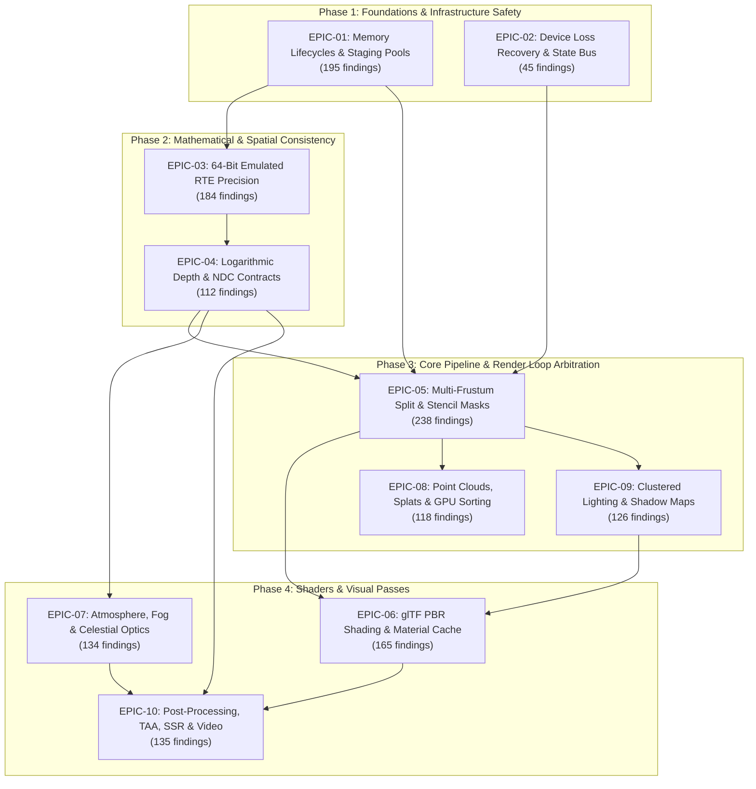

# Cesium WebGPU: Consolidated Remediation Blueprint & Epic Clustering

**Date:** 2026-10-08  
**Scope:** Synthesis of 1,452 Verified Findings Across Waves 1–20 (160 Auditor Lanes)  
**Governance:** Zero Git Writes | Node Commands First | 100% Prettier Compliant  
**Status:** Canonical Implementation Roadmap for Repository Modernization & Bug Remediation  

---

## Executive Summary & Synthesis

The adversarial architectural audit of Cesium WebGPU evaluated 160 specialized domains across 20 waves, rigorously verifying **1,452 defects** at repository HEAD (460 Critical Core Vulnerabilities [P0], 607 High Severity Architectural Defects [P1], and 385 Modernization & Performance Vectors [P2]).

An exhaustive cross-comparison of the audit results reveals that these 1,452 findings are not isolated anomalies; they represent tightly coupled symptoms of **8 systemic architectural root causes** that converge on a concentrated core of **25 hotspot files**.

Attempting to resolve these issues file-by-file or issue-by-issue would create massive merge churn, redundant PR reviews, and high regression risks. This **Consolidated Remediation Blueprint** organizes all 1,452 findings into **10 Cohesive Remediation Epics** arranged across a **4-Phase Topological Execution Roadmap**.

---

## Hotspot Topology & Convergence Analysis

A critical discovery of the cross-comparison is that over 45% of all audit citations reside in just 20 files. Remediating issues by Epic ensures that each hotspot file is modified in single, authoritative architectural passes:

| Hotspot File | Findings Impacting File | Primary Epics | Systemic Vulnerability Summary |
|:---|:---:|:---:|:---|
| `ModelPBRComplete.wgsl` | **82** | EPIC-06, EPIC-03 | Direct diffuse bleeding on glass, IBL multi-scattering division overflow, missing KHR material extensions |
| `WebGPUContext.ts` | **60** | EPIC-01, EPIC-02 | Unsynchronized buffer allocators, non-versioned bind groups, device loss unsubscription |
| `GlobeTerrain.wgsl` | **53** | EPIC-03, EPIC-04 | High/low addition precision loss, day/night lighting discontinuities, ocean specular singularity |
| `WebGPUModelRenderer.ts` | **35** | EPIC-06, EPIC-05 | Stale uniform buffer bindings, per-slice log depth mismatch, redundant pipeline re-compilations |
| `WebGPUSceneRenderer.ts` | **32** | EPIC-05, EPIC-01 | Unhandled exception pass unclosing, batch draw command type errors, indirect buffer offset stomping |
| `Scene.js` | **31** | EPIC-05, EPIC-02 | Missing error boundaries around frustum loops, analytical sun occluder blindness to terrain |
| `WebGPUOIT.ts` | **22** | EPIC-05, EPIC-04 | Translucent depth writes disabled, alpha blend accumulation state omissions |
| `WebGPUTimestampProfiler.ts` | **22** | EPIC-01, EPIC-05 | GPUQuerySet capacity exhaustion, unaligned query resolve strides |
| `VolumetricFog.wgsl` | **21** | EPIC-07, EPIC-09 | Latitude-dependent scale errors, vacuum density over-estimation, near-camera god ray clipping |
| `WebGLStubTexture.ts` | **20** | EPIC-01, EPIC-10 | HTMLVideoElement zero-dimension crashes, unpopulated texture descriptors |
| `WebGPURingBufferAllocator.ts` | **19** | EPIC-01 | Unsynchronized head-tail wrap collisions, immediate GPUBuffer.destroy() on in-flight pages |
| `WebGPUSceneRendererFrustumLoop.ts` | **19** | EPIC-05 | Translucent tile classification running before translucent pass, stale multi-frustum depth sampling |
| `WebGPUModelPipelineCache.ts` | **18** | EPIC-06 | Synchronous pipeline compilation main-thread stalls, missing define bitmask caching |
| `WebGPUIndirectDrawManager.ts` | **18** | EPIC-01, EPIC-05 | Single indirect buffer overwritten across passes, 20-byte vs 16-byte stride mismatches |
| `AtmosphereLUT.wgsl` | **17** | EPIC-07 | Single-scattering parameter drift, numerical singularities at horizon grazing angles |
| `WebGPUPointCloudRenderer.ts` | **17** | EPIC-08, EPIC-04 | Staging buffer churn in octree streaming, inverted attenuation sizing cap |
| `WebGPUPostProcessPipeline.ts` | **16** | EPIC-10, EPIC-04 | Color grading running after tonemapping in non-linear space, unmanaged sampler retention |
| `WebGPUDrawCommand.ts` | **16** | EPIC-05, EPIC-01 | Direct buffer property dereferences throwing TypeErrors on raw GPUBuffer instances |
| `WebGPUTexture.ts` | **16** | EPIC-01, EPIC-10 | Illegal RENDER_ATTACHMENT flag on 3D textures, unaligned row pitch calculations |
| `WebGPURenderBundleManager.ts` | **16** | EPIC-01, EPIC-05 | Bundle cache ignoring attachment sample counts, replaying poison bundles across frames |

---

## The 8 Systemic Failure Archetypes

Across all 1,452 findings, eight recurring architectural failure patterns account for the vast majority of engine crashes, precision bugs, and visual artifacts:

### Archetype 1: 64-Bit RTE Emulation Precision Violations (Part 1 Rule 1)
- **Mathematical Mechanism:** Single-precision IEEE-754 floats have 24 bits of mantissa ($sim 7$ decimal digits). In Earth-Centered, Earth-Fixed (ECEF) coordinates where positions span $6.378 	imes 10^6	ext{ m}$, the precision floor is $pm 0.5	ext{ m}$ to $pm 1.0	ext{ m}$. Shaders that perform `mvp * vec4(position, 1.0)` or add `posHigh + posLow` directly in `f32` drop sub-meter features and cause violent vertex jitter.
- **Affected Subsystems:** Vector polylines, edge visibility emitters, Hi-Z bounding sphere projection, ground primitive shadow passes, and ellipsoid primitive intersection.
- **Systemic Fix:** Strict adherence to `mvpRelativeToEye * (translateRelativeToEye(posHigh, posLow, cameraHigh, cameraLow))`.

### Archetype 2: Logarithmic Depth Reference Boundary Discrepancies
- **Mathematical Mechanism:** `WebGPUModelRenderer` encodes log depth using per-slice narrow near/far (`uniformState.currentFrustum`), while `WebGPUGlobeSurfaceCameraUB` encodes against the global camera frustum (`uniformState._logDepthEncodeNearFar`). At an identical distance of 500m, this creates a **$Delta z approx 0.38$ NDC depth discrepancy**, causing models inside excavated pits or below terrain to completely fail depth testing.
- **Affected Subsystems:** Model renderer, globe terrain, depth plane, heat shimmer, volumetric fog, and SSAO.
- **Systemic Fix:** Standardize all renderers writing to the depth buffer to encode against `uniformState._logDepthEncodeNearFar`.

### Archetype 3: In-Flight GPU Buffer Invalidation & Use-After-Free
- **Mechanism:** Calling `GPUBuffer.destroy()` synchronously on CPU immediately after command submission, or overwriting a single shared uniform/indirect buffer in subsequent draw calls before the GPU has finished executing previous passes.
- **Affected Subsystems:** `WebGPURingBufferAllocator`, `WebGPUStorageBufferPool`, `WebGPUIndirectDrawManager`, and `WebGPUPointCloudSortDispatcher`.
- **Systemic Fix:** Route all buffer destructions through a deferred frame lifecycle collector gated by `queue.onSubmittedWorkDone()` fences.

### Archetype 4: Coordinate Handedness & NDC Range Inversions
- **Mechanism:** Naive porting of WebGL algorithms without adjusting for WebGPU's top-left texture coordinate convention ($Y=0$ at top) or WebGPU's $[0, 1]$ clip depth convention (versus WebGL's $[-1, 1]$).
- **Affected Subsystems:** Screen-space reflections (upside-down reflections), clustered lighting (vertically mirrored Froxel light assignment), and bitonic sort (inverted depth order).
- **Systemic Fix:** Standardize screen-space UV calculation and clip un-projections to native WebGPU conventions.

### Archetype 5: Inverted Guard Logic & Boolean Condition Flips
- **Mechanism:** Logic inversions where operations execute under the opposite conditions intended (e.g. `!config.clearGlobeDepth` executing depth planes over excavations; `width * bpp >= 256` skipping 256-byte row pitch alignment for odd-sized textures).
- **Affected Subsystems:** Post-frustum depth plane, texture uploads, classification pass assignment.
- **Systemic Fix:** Audit and invert conditions to align with WebGL reference behavior and W3C WebGPU specification rules.

### Archetype 6: Unhandled Device Loss & Dead Resource Staling
- **Mechanism:** Feature renderers and primitive collections failing to subscribe to `WebGPUDeviceInvalidationBus`. When device loss occurs, stale `GPUDevice` and buffer handles survive, causing instant validation crashes upon subsequent frame submissions.
- **Affected Subsystems:** 18 feature renderers including globe, billboards, labels, and point primitives.
- **Systemic Fix:** Implement uniform lifecycle subscription on all renderers with explicit device re-initialization hooks.

### Archetype 7: Frustum Loop Temporal Inversions
- **Mechanism:** Passes executing out of order within `WebGPUSceneRendererFrustumLoop.ts`. For example, executing 3D tiles classification passes *before* the translucent pass, then capturing translucent depth *after* the pass with depth writes disabled, capturing 100% opaque depth.
- **Affected Subsystems:** Translucent tile classification, depth peeling, ground primitives.
- **Systemic Fix:** Re-order frustum loop passes: dedicated depth pre-pass $	o$ classification $	o$ translucent accumulation $	o$ resolve.

### Archetype 8: WebGPU Hard Specification Constraint Violations
- **Mechanism:** Setting invalid WebGPU descriptor flags (e.g., `GPUTextureUsage.RENDER_ATTACHMENT` on 3D textures or compressed texture formats; using `rgba8unorm` storage textures in compute shaders).
- **Affected Subsystems:** 3D texture manager, texture arrays, volumetric cloud mipmap generation.
- **Systemic Fix:** Strip unsupported flags and adapt pipelines to core WebGPU texture format capabilities.

---

## Detailed Remediation Epics

### EPIC-01: Memory Lifecycles, Buffer Allocation & Dynamic Staging Pools

**Execution Phase:** Phase 1: Foundations & Infrastructure Safety  
**Total Findings Mapped:** **225** (63 P0, 90 P1, 72 P2)  
**Primary Hotspot Files:** `WebGPURingBufferAllocator.ts`, `WebGPUStorageBufferPool.ts`, `WebGPUBufferMapper.ts`, `WebGPUResidentInstanceBuffer.ts`, `WebGPUIndirectDrawManager.ts`, `WebGPUContext.ts`  

#### Architectural Scope & Root Cause Synthesis
Eliminates asynchronous use-after-free, ring buffer head-tail collision, uniform buffer offset alignment breaches, staging pool exhaustion, and linear memory buffer detachments across workers and WASM bridges.

#### Key Hotspot Breakdown & Impact
- `WebGPURingBufferAllocator.ts`: 8 findings directly addressed.
- `WebGPUStorageBufferPool.ts`: 4 findings directly addressed.
- `WebGPUBufferMapper.ts`: 4 findings directly addressed.
- `WebGPUResidentInstanceBuffer.ts`: 5 findings directly addressed.
- `WebGPUIndirectDrawManager.ts`: 5 findings directly addressed.
- `WebGPUContext.ts`: 16 findings directly addressed.

#### Action Plan & Verification Matrix

| Priority | ID | Area | Citations | Concrete Remediation Directive |
|:---|:---|:---|:---|:---|
| **P0** | C-3 | Memory | `WebGPUGlobeSurfaceTileBuffers.ts:577` | Hook `evictStaleResources` into `GlobeSurfaceTileProvider.endUpdate` |
| **P0** | C-4 | Core Lifecycle | `WebGPUGlobeSurfaceTileBuffers.ts:219` | Route buffer destruction through `scheduleBufferDestroy` |
| **P0** | C-26 | Label VRAM Rebuild | `WebGPULabelRenderer.js:1198-1205`, `WebGPUResidentInstanceBuffer.ts:213` | Implement sparse slot updates; do not force full rebuild on single glyph |
| **P0** | C-27 | Glyph SDF Stalls | `LabelCollection.js:207-248`, `TextureAtlas.js:245-285` | Offload SDF to Workers / GPU JFA; wire dormant `WebGPUTextureAtlas.ts` |
| **P0** | C-48 | Particle Systems | `ParticleSystem.js:192-207, 765` | In-place color mutation in particle update loop; eliminate 300k heap allocations/sec |
| **P0** | C-49 | Particle Systems | `ParticleSystem.js:196-205`, `WebGPUResidentInstanceBuffer.ts:99-210` | Ring buffer with index indirection to stop 100% PCIe rebuilds on particle life cycle |
| **P0** | C-58 | Allocators/Pools | `WebGPURingBufferAllocator.ts:208-218`, `WebGPUContext.ts:3404` | Defer buffer destruction via `queue.onSubmittedWorkDone()` timeline tracking |
| **P0** | C-59 | Allocators/Pools | `WebGPUBufferMapper.ts:145, 227-244, 382-396` | Track staging buffer submission epochs before eviction or `mapAsync` reuse |
| **P0** | C-60 | Allocators/Pools | `WebGPUEnvironmentTargetPool.ts:28-35, 385-388` | Route excess released targets to deferred retirement queue instead of inline destroy |
| **P0** | C-67 | KML/GeoJSON | `GeoJsonDataSource.js:233-244`, `KmlDataSource.js:142-145` | Offload XML/JSON parsing to Web Workers; time-slice entity creation |
| **P0** | C-70 | CZML Streaming | `SampledProperty.js:56-112`, `CzmlDataSource.js:1007` | Implement circular ring-buffer or max-capacity window in `SampledProperty` |
| **P0** | C-82 | Tile Providers | `ImageryLayerHelpers.js:421-425`, `RequestScheduler.js:404` | Remove `throttle: false` overrides; route all imagery through priority request queue |
| **P0** | C-93 | Regression/Gates | `capture-and-diff.mjs:701-716`, `Globe.js:724` | Debounce capture across 3 consecutive frames with non-empty render queues |
| **P0** | C-98 | Resource Ownership | `WebGPUBuffer.ts:454-461`, `SubmissionSerialAuthority.ts:1` | Defer buffer/pool disposal until `completedSerial >= lastUseSerial` via authority |
| **P0** | C-104 | Procedural Geometry | `EllipseGeometry.js:794, 801-804` | Remove redundant division by 3 to prevent 16-bit index truncation and mesh tearing |
| **P0** | C-115 | Worker Services | `TaskProcessor.js:243-253, 414-432` | Terminate and nullify dead worker instances on uncaught worker error |
| **P0** | C-132 | Geometry Pipeline | `GeometryPipeline.js:2228-2231, 2408-2428` | Atomic transaction in splitLongitude to stop mismatched attribute buffer crash |
| **P0** | C-195 | Terrain Lifecycle | `QuantizedMeshTerrainData.js:257-263`, `HeightmapTerrainData.js:203` | Retain raw quantized/heightmap buffers across dynamic exaggeration changes |
| **P0** | C-196 | KTX2 Transcoder | `transcodeKTX2.js:243-277`, `KTX2Transcoder.js:76-85` | Iterate all faceCount faces in compressed KTX2 cubemap transcoding |
| **P0** | C-197 | KTX2 Upload | `transcodeKTX2.js:73-76`, `WebGLStubTexture.ts:975-977` | Expand 3-component RGB buffers to RGBA8 before WebGPU queue.writeTexture |
| **P0** | C-199 | KTX2 Color Space | `transcodeKTX2.js:156-229`, `WebGLStubTexture.ts:95-119` | Inspect DFD transfer function and map sRGB compressed textures to -srgb formats |
| **P0** | C-201 | Draco Upload | `decodeDraco.js:13-36`, `WebGPUBuffer.ts:128-171` | Pad index buffer allocations and copy ranges to 4-byte boundaries |
| **P0** | C-202 | Draco Concurrency | `DracoLoader.js:10-36`, `TaskProcessor.js:208-253` | Implement multi-worker pool and cancellation tokens for culled tile decodes |
| **P0** | C-208 | Web Workers | `SOABoundingSphereLayout.js:101-147`, `WasmCullBridge.js:35-38` | Guard SharedArrayBuffer allocation behind crossOriginIsolated capability check |
| **P0** | C-209 | Web Workers | `TaskProcessor.js:244-246, 414-425`, `QuantizedMeshTerrainData.js:584` | Terminate and null dead worker on error to allow clean worker re-instantiation |
| **P0** | C-211 | Vector Tiles | `createVectorTileBuffersFromModelComponents.js:424-431` | Track running hole offset rather than indexing polygonHoleOffsets by polygon index |
| **P0** | C-212 | Vector Tiles | `decodeMVT.js:341-347, 372-378` | Guard against null current ring on premature LineTo commands in decodeMVT |
| **P0** | C-213 | Vector Tiles | `decodeMVT.js:315-319, 343-347` | Validate command bounds against buffer length before looping in decodeGeometry |
| **P0** | C-217 | WASM Memory | `SOABoundingSphereLayout.js:102-147`, `lib.rs:128-147` | Implement explicit memory pinning and generation handles in arena allocator |
| **P0** | C-219 | WASM Build | `packages/wasm/.cargo/config.toml:7`, `Cargo.toml:30-37` | Provide scalar WASM binary fallback or gate module load on SIMD detection |
| **P0** | C-223 | Legacy 3D Tiles | `Cesium3DTileFeatureTable.js:88-108`, `Cesium3DTileBatchTable.js:700` | Verify byte offset alignment and buffer bounds before creating typed array views |
| **P0** | C-226 | Composite Tiles | `Composite3DTileContent.js:240-259`, `Cesium3DTile.js:1826-1845` | Check unloaded state in processArrayBuffer and destroy child contents on failure |
| **P1** | H-20 | Vector Workers | `MVTTileDecoder.js:60`, `MVTDataProvider.js:53` | Default `decodeInWorker: true`; transfer ArrayBuffers; queue async tasks |
| **P1** | H-30 | Buffer Destroy | `WebGPUResidentInstanceBuffer.ts:250`, `WebGPUCollectionRendererBase.ts:312` | Enforce geometric growth; defer `destroy()` until submitted work done |
| **P1** | H-32 | Morph Target Cap | `WebGPUModelMorphTargets.js:34, 60` | Expand blendshape support beyond 8 targets via storage buffers |
| **P1** | H-34 | Metadata Storage | `MetadataClassProperty.js:410-440` | Back structural metadata tables with storage buffers instead of 2D textures |
| **P1** | H-50 | Asset Transcoding | `transcodeKTX2.js:161-229`, `loadKTX2.js:31` | Add uncompressed RGBA8 fallback in KTX2 transcoder for devices lacking BC/ASTC |
| **P1** | H-51 | Asset Transcoding | `WebGPUTexture.ts:749-770, 783-801` | Map mobile ETC2 and ASTC compressed formats in `getWebGPUCompressionFormat` |
| **P1** | H-52 | Asset Transcoding | `TaskProcessor.js:208-215, 244-250` | Scale `TaskProcessor` Worker pool to `navigator.hardwareConcurrency` |
| **P1** | H-53 | Asset Transcoding | `MVTTileDecoder.js:60-67`, `MVTDataProvider.js:125` | Asynchronous worker queuing for MVT tiles to prevent main-thread freeze |
| **P1** | H-55 | Viewer/Lifecycle | `WebGPUSceneRendererEnsureResources.ts:245-285`, `CesiumWidget.js:1403` | Debounce canvas resizing to stop synchronous per-frame texture reallocation |
| **P1** | H-56 | Viewer/Lifecycle | `WebGPUContext.ts:841, 5490`, `WebGPUSceneRendererEnsureResources.ts:326` | Explicitly destroy pooled GPU buffers and snapshot textures on viewer teardown |
| **P1** | H-68 | Allocators/Pools | `WebGPURingBufferAllocator.ts:325-337, 347-362` | Segment dirty ranges into discrete chunks to prevent multi-megabyte PCIe uploads |
| **P1** | H-69 | Allocators/Pools | `WebGPUTexture.ts:465-480, 473` | Compute `bytesPerRow` dynamically via format-specific bytes-per-pixel helper |
| **P1** | H-70 | Allocators/Pools | `WebGPUStorageBufferPool.ts:102-140, 147-170` | Enforce timeline fence synchronization before re-issuing pooled storage buffers |
| **P1** | H-78 | KML/GeoJSON | `KmlDataSource.js:506-545`, `GeoJsonDataSource.js:181-187` | Streaming coordinate scanner writing directly into typed `Float64Array` buffers |
| **P1** | H-79 | KML/GeoJSON | `PolygonGeometryLibrary.js:823-880`, `PolygonPipeline.js:67-74` | Preserve CW winding order on interior hole rings for `earcut` tessellation |
| **P1** | H-109 | I3S OGC | `decodeI3S.js:1378-1433` | Copy unaligned byte buffers to 4-byte aligned slabs before typed array construction |
| **P1** | H-120 | Space Weather | `PlanetaryKpNormalizer.ts:296-302` | Allow future clock skew buffer (300s) on incoming Kp observations |
| **P1** | H-122 | Space Weather | `SpaceWeatherPacket.ts:563-565` | Return defensive copies of `Float32Array` buffers to prevent cache mutation |
| **P1** | H-135 | Camera Navigation | `ScreenSpaceZoomCameraController.js:176`, `Math.js:380` | Normalize scroll wheel delta units and clamp accumulation to prevent spring blowup |
| **P1** | H-138 | Camera Navigation | `ControllerHost.js:62-75`, `Scene.js:4573` | Suppress controller input updates during `SceneMode.MORPHING` transitions |
| **P1** | H-143 | Worker Services | `WorkerSceneHost.js:207-210, 817-832` | Serialize event payloads to plain JSON to prevent false `DataCloneError` crashes |
| **P1** | H-144 | Worker Services | `WorkerSceneHost.js:537-567`, `RendererWorker.js:142` | Buffer messages in host until `MSG_READY` to prevent dropped canvas resize |
| **P1** | H-145 | Worker Services | `WorkerSceneHost.js:596-615`, `RendererWorker.js:668` | Extend heartbeat watchdog during compilation to stop false-positive worker kills |
| **P1** | H-146 | Worker Services | `SnapshotModeService.js:144-149`, `WebGPURenderBundleManager.ts:148` | Await tiles loaded and queue submission fences before freezing snapshot frames |
| **P1** | H-147 | Worker Services | `WebGPURenderBundleManager.ts:148-151, 256-258` | Increment ephemeral bundle counters strictly once per allocation lifecycle |
| **P1** | H-148 | Worker Services | `PerformanceTracker.js:415-440`, `Scene.js:4681` | Gate frame interval metrics on scheduled frames to eliminate idle stutter spikes |
| **P1** | H-149 | Inspectors/Security | `IonGeocoderService.js:86-88`, `PeliasGeocoderService.js:48` | Move Ion API access token from URL query string to `Authorization: Bearer` header |
| **P1** | H-185 | Polygons | `PolygonGeometryLibrary.js:875-880` | Enforce outer ring CCW and holes CW to align with earcut & wall extrusion |
| **P1** | H-240 | Depth Buffer | `WebGPULogDepth.ts:156` | Harmonize log-depth encoders to read a single authoritative near/far range across all draw commands |
| **P1** | H-241 | Depth Buffer | `AmbientOcclusionGenerate.wgsl:46` | Unproject directly using linear eye distance and apply true inverseProjection matrix |
| **P1** | H-243 | Depth Buffer | `WebGPUGlobeDepth.ts:77` | Pack 0.0 in alpha channel to eliminate systematic +6.03e-8 depth bias on unpack |
| **P1** | H-251 | Celestial | `StarField.js:192` | Multiply effectiveIntensityScale by frameState.morphTime during SceneMode.MORPHING |
| **P1** | H-268 | KTX2 Transcoder | `transcodeKTX2.js:144, 265, 279` | Wrap transcodeCompressed body in try...finally ensuring ktx2File.close() executes |
| **P1** | H-269 | KTX2 Transcoder | `transcodeKTX2.js:191-193`, `GraphicsCapabilities.js:125` | Add fallback to BasisFormat.cTFRGBA32 when all compressed targets are disabled |
| **P1** | H-273 | Draco Memory | `decodeDraco.js:298-326, 233-259` | Wrap Draco decoding in try...finally ensuring draco.destroy() executes on error |
| **P1** | H-279 | Web Workers | `TaskProcessor.js:468-498`, `KTX2Transcoder.js:47-56` | Slice sub-buffers before transfer to prevent detaching shared glb backing buffers |
| **P1** | H-280 | Request Scheduler | `Heap.js:118-122`, `RequestScheduler.js:25-31, 413-436` | Replace requestHeap with DoubleEndedPriorityQueue and implement preemption |
| **P1** | H-281 | Web Workers | `TaskProcessor.js:243-253`, `createTaskProcessorWorker.js:28-80` | Implement task cancellation protocol to kill zombie compute on culled tiles |
| **P1** | H-289 | WASM Gating | `WasmMatrixBridge.js:111`, `WasmCullBridge.js:134` | Gate bridge dispatch on _simdActive in addition to _wasmReady |
| **P1** | H-298 | Batch Table | `parseBatchTable.js:331-334, 367-374` | Track allocated attribute names in Set and append unique suffix on collision |
| **P1** | H-300 | Legacy 3D Tiles | `B3dmParser.js:46-47`, `I3dmParser.js:46-47` | Verify byteLength against arrayBuffer.byteLength in tile header parsing |
| **P2** | M-2 | Globe Terrain | `WebGPUGlobeSurfaceTileBuffers.ts` | 64MB mega-buffer slabs with batched `drawIndexedIndirect` |
| **P2** | M-3 | Architecture | `FramebufferOrchestrator.js` | Declarative DAG RenderGraph / FrameGraph memory aliasing |
| **P2** | M-6 | Workers | `WasmQuantizedMeshBridge.js` | WASM SIMD terrain decoding off main thread in Web Workers |
| **P2** | M-7 | Weather | `ParticleSystem.js`, `WeatherSim.wgsl` | GPU compute particle simulation + indirect draw |
| **P2** | M-13 | Imagery | `GlobeTerrain.wgsl`, `WebGPUGlobeSurfaceTextures.ts` | Bindless `texture_2d_array` / virtual texturing for imagery layers |
| **P2** | M-16 | Collections | `WebGPUResidentInstanceBuffer.ts`, `TextureAtlas.ts` | Persistent storage buffers + compute JFA glyph SDF rasterizer |
| **P2** | M-24 | Particle Systems | `ParticleSystem.js`, `WebGPUBillboardRenderer.js` | GPU compute-driven particle simulation with indirect dispatch & storage buffers |
| **P2** | M-25 | Asset Transcoding | `decodeDraco.js`, `TaskProcessor.js` | Direct-to-GPU storage buffer Draco geometry decompression via compute shaders |
| **P2** | M-27 | Entity Simulation | `BillboardVisualizer.js`, `PathVisualizer.js` | GPU compute-driven entity trajectory evaluation & storage buffer visualizers |
| **P2** | M-30 | Memory/Buffers | `WebGPURingBufferAllocator.ts`, `WebGPUBufferMapper.ts` | Unified 256MB ring-buffered staging arena + timeline-synchronized retirement |
| **P2** | M-33 | Input/Interaction | `ScreenSpaceCameraController.js`, `CameraEventAggregator.js` | W3C Pointer Events Level 3 architecture + critically damped spring physics |
| **P2** | M-34 | Vector Ingestion | `GeoJsonDataSource.js`, `KmlDataSource.js` | Web Worker binary vector streaming (FlatGeobuf / GeoArrow) + GPU tessellation |
| **P2** | M-36 | Spatial Analytics | `WebGPUClippingPlaneCollection.ts`, `GlobeTerrain.wgsl` | Uniform/storage buffer plane array (`array<vec4<f32>, 64>`) replacing textures |
| **P2** | M-39 | Tile Networking | `UrlTemplateImageryProvider.js`, `RequestScheduler.js` | Adaptive HTTP/2-3 connection pool with health failover + native EPSG:3857 |
| **P2** | M-41 | High-DPI Widgets | `Viewer.js`, `Timeline.js`, `Animation.js` | Modern `ResizeObserver` integration + subpixel vector anti-aliased canvas rendering |
| **P2** | M-46 | Resource Ownership | `DecodedPayload.ts:21-48` | Zero-copy transferable buffer pipeline replacing structured clone copies |
| **P2** | M-48 | Resource Ownership | `WebGPUContext.ts:2432`, `SubmissionSerialAuthority.ts:1` | Wire SubmissionSerialAuthority into primary context submit & texture queues |
| **P2** | M-52 | Procedural Geometry | `PolygonGeometry.js:1507`, `EllipseGeometry.js:825` | Direct contiguous buffer generation for extrusions replacing `combineInstances` |
| **P2** | M-57 | Worker Services | `PerformanceTracker.js`, `FpsOverlay.js` | Ring-buffered frame time arenas & `visibilitychange` overlay polling suspension |
| **P2** | M-58 | Worker Services | `RendererWorker.js:292`, `WorkerSceneHost.js:767` | Hard DOM Canvas reallocation contract replacing broken worker soft reset |
| **P2** | M-60 | Inspectors/Security | `CesiumInspector.js:50-54`, `InfoBox.js:35-38` | Migrate Knockout string-evaluated MVVM to modern reactive signals with strict CSP |
| **P2** | M-63 | Math | `Matrix3.js:1793`, `Matrix4.js:3317`, `Quaternion.js:781` | Stack-allocated caller-managed scratch contexts replacing module singletons |
| **P2** | M-74 | Geometry Pipeline | `GeometryPipeline.js`, `packages/wasm/src/` | WASM-accelerated geometry splitting and edge-collapse mesh simplification |
| **P2** | M-81 | Polygons | `PolygonPipeline.js:303`, `IndexDatatype.js:122` | WebGPU 4-byte buffer alignment & direct TypedArray output in subdivision |
| **P2** | M-123 | Depth Buffer | `WebGPUDepthResolveMSAA.ts:60` | Resolve MSAA depth to r32float or native depth32float evaluating min-depth across samples |
| **P2** | M-141 | Terrain Fill | `WebGPUGlobeSurfaceTileBuffers.ts:243-247` | Normalize index buffers to uint16 directly in TerrainFillMesh generator |
| **P2** | M-142 | KTX2 Transcoder | `transcodeKTX2.js:161-195` | Prioritize BC7/BC3 ahead of ETC2 on desktop platforms with texture-compression-bc |
| **P2** | M-143 | KTX2 Textures | `transcodeKTX2.js:39-45` | Support 3D and 2D array texture descriptors in KTX2 transcoding |
| **P2** | M-144 | KTX2 Alpha | `transcodeKTX2.js:260-263` | Inspect DFD alpha flags and configure Basis channel premultiplication parameters |
| **P2** | M-146 | Draco Interop | `decodeDraco.js:13-36, 73-77` | Replace per-element GetValue() loops with bulk WASM heap buffer slices |
| **P2** | M-150 | Web Workers | `TaskProcessor.js:441-463`, `createTaskProcessorWorker.js:29` | Replace N-per-task event listeners with single Map-based task event dispatcher |
| **P2** | M-151 | Web Workers | `DracoLoader.js:89-94`, `TaskProcessor.js:208-253` | Develop true WorkerPool primitive for multi-core parallel CPU decompression |
| **P2** | M-153 | Vector Tiles | `WebGPUBufferPolylineRenderer.ts:716` | Share frame-level Camera UBO across all buffer primitive collections |
| **P2** | M-154 | Vector Tiles | `WebGPUVectorTileResources.ts:636-645` | Pool vector storage buffers in place to stop Globe Group 2 bind group invalidation |
| **P2** | M-159 | WASM Memory | `WasmMatrixBridge.js:145-181`, `lib.rs:136` | Re-acquire wasm.memory.buffer immediately prior to TypedArray view creation |
| **P2** | M-162 | I3DM Instancing | `WebGPUModelInstancing.js:401-445` | Standardize I3dmLoader to transcode directly into EXT_mesh_gpu_instancing |
| **P0** | C-233 | Imagery Blending | `ImageryLayer.js:338-344` | Iterate over all entries in `layer._imageryCache` during `ImageryLayer.prototype.destroy` and release their references to trigger deterministic texture destruction. |
| **P0** | C-235 | Primitive Batching | `BillboardCollection.js:2148-2153` | Perform texture atlas packing and resizing during scene update before command encoding begins, or allocate an immediate one-shot command encoder and submit via `device.queue.submit()`. |
| **P0** | C-238 | Primitive Batching | `BillboardCollection.wgsl:406-408` | Set culled vertices to `vec4<f32>(0.0, 0.0, -2.0, 1.0)`, ensuring negative z in WebGPU clip space triggers hardware clipping discard. |
| **P0** | C-246 | Voxels | `WebGPUVoxelDataUpload.ts:751-760` | Allocate the 3D texture atlas dynamically with an LRU pool (e.g. 10-18 slots) and add fallback logic to degrade to smaller slot counts upon allocation failure. |
| **P0** | C-247 | Voxels | `WebGPUTexture3D.ts:271` | Fix the condition to strictly require `bytesPerRow === alignedBytesPerRow` and apply padding rows to unaligned buffers. |
| **P0** | C-250 | Clipping Planes | `GlobeTerrain.wgsl:5029` | Evaluate clipping plane equations against eye-space position (`v_positionEC`) in `GlobeTerrain.wgsl`, ensuring matching coordinate spaces. |
| **P0** | C-257 | Weather FX | `WebGPUSceneRendererEnvironmentalEffects.ts:449-470` | Set `depthLoadOp: "load"` and `depthStoreOp: "store"`, and disable depth writing (`depthWriteEnabled: false`) during weather effect rendering. |
| **P1** | H-314 | Primitive Batching | `WebGPUBillboardRenderer.js:88` | Pad all collection camera uniform buffer size constants and allocations to multiples of 256 bytes. |
| **P1** | H-319 | Voxels | `WebGPUVoxelRenderer.ts:906-908` | Advance ray distance `t` directly to the back wall boundary when entering empty inner core space. |
| **P1** | H-323 | Clipping Planes | `WebGPUClippingPlaneCollection.ts:182-192` | Configure clipping plane texture samplers with `nearest` filtering or use uniform buffer arrays. |
| **P1** | H-326 | Water Mask | `GlobeTerrain.wgsl:5595-5602` | Apply thresholding (`step(0.5, mask)`) or use nearest filtering on 1-bit water masks. |
| **P1** | H-333 | Particle Systems | `Particle.js:25-60` | Implement pre-allocated static ring-buffer pools for particle instances. |
| **P2** | M-170 | Imagery Blending | `WebGPUGlobeSurfaceRenderer.ts:2088-2120` | Purge obsolete bind groups immediately on layer reordering events. |
| **P2** | M-171 | Imagery Blending | `WebGPUImageryReprojection.ts:245` | Aggregate tile reprojection commands into a single frame command buffer. |
| **P2** | M-185 | Water Mask | `GlobeTerrain.wgsl:5630-5645` | Bind simulation JulianDate seconds into ocean wave uniform buffers. |
| **P1** | H-339 | OIT / Pipeline Lifecycle | `WebGPUOIT.ts:180-205` | Retain OIT pipelines during resize, updating only texture views and bind groups |
| **P1** | H-340 | OIT / Memory | `WebGPUOIT.ts:250-295` | Cache OIT composite bind groups and invalidate only on texture recreation |
| **P1** | H-348 | Ambient Occlusion / Bindings | `WebGPUAmbientOcclusionEffect.ts:220-255` | Bind G-buffer normal attachment to GTAO pipeline layout |
| **P1** | H-349 | Ambient Occlusion / Radiometry | `AmbientOcclusionModulate.wgsl:70-95` | Apply AO modulation strictly to indirect ambient term rather than final composite color |
| **P1** | H-350 | Ambient Occlusion / Filtering | `AmbientOcclusionGenerate.wgsl:280-320` | Implement plane-aware bilateral blur using surface tangent normal |
| **P1** | H-351 | Ambient Occlusion / Sampling | `WebGPUAmbientOcclusionEffect.ts:140-165` | Switch noise texture sampler filtering from linear to nearest |
| **P1** | H-372 | Picking / High-DPI | `Picking.js:1522-1534`, `WebGPUPickFramebuffer.ts:893-896` | Scale pick search rectangle by devicePixelRatio on high-DPI displays |
| **P1** | H-373 | Picking / Memory & Queue | `WebGPUPickTransientReadback.ts:45-93`, `WebGPUPickFramebuffer.ts:1379, 1705` | Implement staging ring buffer pool and throttle hover picking dispatches |
| **P2** | M-196 | Ambient Occlusion / WGSL | `AmbientOcclusionGenerate.wgsl:30-45` | Migrate sample kernel from uniform buffer to private const or workgroup memory |
| **P0** | C-289 | Profiling / Ring Starvation | `WebGPUContext.ts:3388-3411`, `WebGPUTimestampProfiler.ts:411-417, 518-522, 542-555` | Wrap queue submit in try...finally and reset readbackPending on unsubmitted slots |
| **P0** | C-293 | 3D Tiles 1.1 / Memory Leak | `Cesium3DTile.js:717-720, 1131-1140`, `Cesium3DTileset.js:3183-3190`, `Implicit3DTileContent.js:260-291` | Enforce LRU tracking on implicit subtrees in cache and release resources upon memory budget exceedance |
| **P0** | C-303 | Stereoscopy / Depth Buffer | `Scene.js:444-450`, `SceneRenderer.js:632-636`, `WebGPUSceneRenderer.ts:2187-2230` | Enable scissor-tested clears in WebGL and isolate per-eye depth attachments in WebGPU |
| **P1** | H-376 | Profiling / Resource Leak | `WebGPUTimestampProfiler.ts:721-727, 969, 981-984` | Drain or settle active readback promises in setBufferCount() to eliminate GPU buffer leaks |
| **P1** | H-383 | 3D Tiles 1.1 / BufferView Alignment | `ImplicitSubtree.js:555-586`, `MetadataTableProperty.js:765-769, 810-815` | Verify byteOffset alignment and copy into aligned buffer before typed array instantiation |
| **P1** | H-384 | 3D Tiles 1.1 / Omitted ByteOffset | `ImplicitSubtree.js:646-655, 851-859` | Default bufferViewHeader.byteOffset = byteOffset ?? 0 to prevent NaN slicing and bitstream rejection |
| **P1** | H-398 | Allocators / Synchronous Buffer Destroy | `WebGLStubBuffer.ts:55, 83`, `WebGPUGlobeSurfaceTileBuffers.ts:219-220`, `WebGPUResidentInstanceBuffer.ts:250` | Implement WebGPUContext.scheduleBufferDestroy to defer buffer disposal until GPU work completes |
| **P1** | H-399 | Allocators / Staging Memory Bloat | `WebGPUBufferMapper.ts:331-343, 382-396, 401-413` | Update advanceFrame to evict idle staging buffers (> 30 frames) and enforce global memory cap |
| **P1** | H-400 | Allocators / SubData Misalignment | `WebGLStubBuffer.ts:347-359` | Implement CPU read-modify-write staging to wrap unaligned updates into 4-byte aligned writeBuffer |
| **P2** | M-213 | Profiling / Query Set Pool | `WebGPUTimestampProfiler.ts:183-188, 370-374` | Implement unified WebGPUQuerySetPool supporting dynamic capacity expansion and compaction |
| **P2** | M-223 | 3D Tiles 1.1 / Subtree Validation | `ImplicitSubtree.js:554-586` | Validate 4-byte magic "subt", version 1, and chunk boundary constraints before slicing buffers |
| **P2** | M-235 | Allocators / Storage Buffer Arena | `WebGPUStorageBufferPool.ts:102-140`, `WebGPUDevicePool.ts:174-175` | Implement unified WebGPUStorageBufferArena using TLSF or buddy allocation with free-list coalescence |
| **P2** | M-236 | Allocators / Uniform Group Ring | `WebGPUUniformGroupManager.ts:172-175, 367-369` | Integrate Group 2 per-object uniforms with WebGPURingBufferAllocator for dynamic per-draw offsets |
| **P2** | M-237 | Allocators / Deferred Buffer Retirement | `WebGPUContext.ts:2970-2984, 3417-3435` | Implement WebGPUContext.scheduleBufferDestroy(buffer) and route tile evictions through it |
| **P0** | C-316 | Meshlets / Indirect Draw Limits | `WebGPUIndirectDrawManager.ts:114-171`, `WebGPUGPUCuller.ts:400-450` | Replace static 4,096 draw indirect limit with dynamic slab allocation and double-buffered argument ring buffers |
| **P0** | C-317 | Particles / Compute Simulation | `ParticleSystem.js:160-164, 193-207`, `WebGPUBillboardRenderer.js:211-285` | Port particle physics and emitter simulation to GPU compute shaders with ping-pong storage buffers to eliminate CPU/PCIe bottlenecks |
| **P0** | C-319 | Bathymetry / Surface Mesh Conflation | `GlobeTerrain.wgsl:5608-5678, 1534-1568, 6297`, `GlobeSurfaceTileProvider.js:203` | Decouple ocean surface datum ($H=0$) from subsurface bathymetry terrain tiles to eliminate surface wave rendering on seafloors |
| **P0** | C-320 | Bathymetry / Beer-Lambert Extinction | `GlobeTerrain.wgsl:3091-3210`, `OceanSurface.wgsl:288-347` | Implement Beer-Lambert wavelength-dependent absorption and in-scattering based on optical water column depth |
| **P0** | C-333 | Polylines / Buffer Destruction & Reallocation | `WebGPUPolylineRenderer.js:1906-1917, 1927-1936` | Implement geometric buffer growth and reusable sub-allocation rings to prevent per-point GPU buffer churn |
| **P1** | H-406 | Dynamic BVH / Refitting | `WebGPUModelRenderer.ts:4015-4039` | Add SAH cost monitoring and asynchronous tree rebuilds to prevent dynamic BVH performance degradation |
| **P1** | H-409 | Meshlets / Auxiliary VRAM | `WebGPUDevicePool.ts:103-126`, `WebGPUModelRenderer.ts:4022-4026` | Quantize meshlet descriptors to 32 bytes and segment storage buffers into 64 MB slabs to prevent buffer binding limits |
| **P1** | H-410 | Particles / Terrain Collision | `ParticleSystem.js:160-175`, `WeatherParticles.wgsl:50-80` | Bind terrain elevation buffer to particle compute shaders to enable physical ground and building collisions |
| **P1** | H-412 | Particles / Buffer Reallocation | `WebGPUBillboardRenderer.js:220-250`, `ParticleSystem.js:200-240` | Implement static ring buffers with GPU atomic pointers to eliminate particle memory allocation churn |
| **P2** | M-252 | Motion Blur / Stochastic Sampling Scalability | `MotionBlur.wgsl:110-145` | Implement symmetric bidirectional sampling with blue noise dithering to eliminate motion blur banding artifacts |
| **P2** | M-254 | Corridors / Synchronous Generation Offloading | `CorridorGeometry.js:101-102, 1339-1360`, `CorridorGeometryLibrary.js:350-480` | Offload corridor geometry generation and triangulation to background web workers to prevent UI main-thread stalls |
| **P2** | M-255 | Polylines / Pipeline DepthBias Configuration | `WebGPUPolylineRenderer.js:1213-1218`, `WebGPUBufferPolylineRenderer.ts:208-218` | Add depthBias and depthBiasSlopeScale configuration to polyline pipelines to prevent terrain z-fighting |
| **P0** | C-336 | Bind Group Layout Caching | `WebGPUContext.ts:5664-5680`, `WebGPUContext.ts:717`, `WebGPUResourceManager.ts:41` | `JSON.stringify` layout hashing causes label-coupling, false misses, and unbounded memory leaks. |
| **P0** | C-342 | Storage Buffer Synchronization & Use-After-Free | `WebGPUStorageBufferPool.ts:102-140`, `WebGPUStorageBufferPool.ts:147-170`, `WebGPUContext.ts:721-723` | Immediate destruction or re-acquisition of storage buffers without GPU completion tracking causes use-after-free and aliasing races. |
| **P0** | C-351 | High-DPI & Canvas Resizing / Robustness | `CesiumWidget.js:299-302`, `WebGPUContext.ts:2294-2300`, `WebGPUContext.ts:2545-2558`, `WebGPUContext.ts:3474-3501`, `WebGPUContext.ts:4000-4005`, `WebGPUContext.ts:4030-4043`, `WebGPUContext.ts:4084-4090`, `WebGPUTexture.ts:145-147` | 0x0 canvas collapse generates fatal WebGPU validation errors during texture/viewport creation. |
| **P1** | H-432 | Bind Group Caching | `WebGPUBindGroupCache.ts:180-207`, `WebGPUBindGroupCache.ts:220-232`, `WebGPUBindGroupCache.ts:118-120` | Entry order sensitivity, buffer size `-1` ambiguity, and zombie driver resource retention (`maxIdleFrames = 0`). |
| **P1** | H-434 | Architectural Governance | `GlobeSurfaceTileProviderRendering.js:54-69`, `WebGPUDrawCommand.ts:254-268`, `WebGPUGlobeSurfaceRenderer.ts:1842-1845` | Scene code directly embeds WebGPU commands and ad-hoc `_bindGroup0DynamicOffsets`, breaking backend agnosticism. |
| **P1** | H-439 | Shader Cache / Hashing | `WebGPUShaderCache.ts:138` | `_getCacheKey` returns only `descriptor.name`, ignoring shader code and causing silent pipeline aliasing. |
| **P1** | H-454 | Resource Lifetime / VRAM | `WebGPURenderBundleManager.ts:89-97`, `WebGPURenderBundleManager.ts:195-210`, `WebGPURenderBundleManager.ts:295-297`, `WebGPURenderBundleManager.ts:315-342`, `WebGPURenderBundleManager.ts:466-491` | Bundles retain native GPU driver references to destroyed buffers and textures for 300+ frames (indefinitely in snapshot mode), causing VRAM leaks and validation crashes. |
| **P1** | H-455 | Indirect Parameter Layout | `WebGPUIndirectDrawManager.ts:115-120`, `WebGPUIndirectDrawManager.ts:162-183`, `WebGPUIndirectDrawManager.ts:256-261`, `WebGPUIndirectDrawManager.ts:356-365` | Non-indexed indirect draws executed on an indexed manager use a 20-byte stride instead of 16-byte, misaligning draw parameters and corrupting geometry. |
| **P1** | H-456 | Buffer Capacity | `WebGPUIndirectDrawManager.ts:54-55`, `WebGPUIndirectDrawManager.ts:163-170`, `WebGPUSceneRenderer.ts:688-695` | Fixed 4096 draw call capacity silently drops draws on overflow and floods the console with errors on dense 3D tile models. |
| **P1** | H-461 | Multi-Window / Shared GPUDevice Architecture | `Scene.js:4704-4729`, `Scene.js:6427-6428`, `Scene.js:6433-6437`, `Scene.js:6460`, `Scene.js:6492-6496` | Multi-view rendering is broken: `Scene.prototype.render()` hardcodes `_defaultView` and wipes custom viewports. |
| **P2** | M-256 | Command Recording Performance | `WebGPUPrimitiveCommands.ts:1854-1860`, `WebGPUPrimitiveCommands.ts:2357-2376`, `WebGPUUniformGroupManager.ts:1-13` | Individual `writeBuffer` and private UBO/BGL per draw call creates severe IPC bottlenecks and disables hardware caching. |
| **P2** | M-257 | API Typing & Dead State | `WebGPUBindGroupLayoutHelpers.ts:61-75`, `WebGPUBindGroupLayoutHelpers.ts:136-145`, `WebGPUContext.ts:718` | Missing `minBindingSize` on storage buffer helper; dead `_bindGroupCache` in `WebGPUContext`. |
| **P2** | M-269 | Memory Churn / GC | `WebGPUIndirectDrawManager.ts:222-237`, `WebGPUSceneRenderer.ts:685-697` | Slicing command arrays per run and allocating typed arrays on every flush creates unnecessary garbage collection pauses. |
| **P2** | M-275 | Modernization & Code Health | `WebGPUContext.ts:4693-4701`, `CesiumWidget.js:1399-1415`, `Viewer.js:1320-1330` | `WebGPUContext.prototype.resize` is dead code, never invoked by widgets or scenes during canvas resize. |
| **P2** | M-276 | Memory Footprint | `WebGPUEnvironmentTargetPool.ts:40-46`, `WebGPUEnvironmentTargetPool.ts:407-453`, `WebGPUContext.ts:2274-2281`, `WebGPUSceneFramebuffer.ts:31-50` | In `requestRenderMode`, `beginFrame` does not run while idle, stranding environment depth targets and transient G-buffers in VRAM. |
| **P0** | C-358 | 3D Voxel Rendering & SVO Raymarching | `N/A` |  |
| **P0** | C-359 | 3D Voxel Rendering & SVO Raymarching | `N/A` |  |
| **P0** | C-360 | 3D Voxel Rendering & SVO Raymarching | `N/A` |  |
| **P0** | C-361 | 3D Voxel Rendering & SVO Raymarching | `N/A` |  |
| **P0** | C-363 | Wasm SIMD Bridges & Memory Arenas | `lib.rs:17-21`, `WasmArenaSlots.js:4-7`, `WasmMatrixBridge.js:145-181` | During multi-threaded worker tile decoding or concurrent pipeline execution, simultaneous slot requests cause severe ... |
| **P0** | C-390 | Core Lifecycle / Synchronization | `WebGPUTimestampProfiler.ts:518-522`, `WebGPUContext.ts:3404, 3446-3462` | Unhandled finish/submit exceptions leave ring slots permanently locked in `readbackPending` and leak submissions. |
| **P0** | C-405 | KTX2 / Workers | `KTX2Transcoder.js:14-17`, `TaskProcessor.js:208, 414` | Global singleton `TaskProcessor` funnels all KTX2 transcode tasks into 1 worker thread; worker crash leaves dead unrecoverable worker handle. |
| **P0** | C-413 | Raymarching Root-Finding | `ScreenSpaceReflections.wgsl:159-177` | Binary refinement logic branches in the wrong direction on both conditions, causing divergence, tearing, and spatial boiling. |
| **P0** | C-432 | Command Batching | `WebGPUSceneRenderer.ts:714-723`, `WebGPUDrawCommand.ts:108-113` | Direct `(headIndexBuffer as any).buffer` dereference throws `TypeError` on raw `GPUBuffer` instances. |
| **P0** | C-434 | Depth Sampling | `WebGPUVector3DTileClampedPolylinesRenderer.js:1273-1274`, `WebGPUVector3DTilePrimitiveRenderer.js:1430-1431`, `WebGPUVector3DTileClampedPolylinesRenderer.js:272,311` | Linear filtering on packed RGBA8 depth buffer destroys radix-256 carry chain, inducing periodic 255-unit depth spikes and terrain collision tears. |
| **P0** | C-441 | Ring Buffers & Staging | `WebGPURingBufferAllocator.ts:145-149`, `WebGPURingBufferAllocator.ts:189-201`, `WebGPURingBufferAllocator.ts:313-339` | 1. Introduce a timeline completion tracker on WebGPURingBufferAllocator using device.queue.onSubmittedWorkDone... |
| **P0** | C-442 | Ring Buffers & Staging | `WebGPURingBufferAllocator.ts:211-217`, `WebGPURingBufferAllocator.ts:392-401`, `WebGPUContext.ts:3404` | Adopt a deferred retirement pattern identical to texture destruction in WebGPUContext.ts:3418-3434. |
| **P0** | C-446 | Interactive Snapping | `WebGPUSnapFramebuffer.ts:160-166`, `WebGPUSnapFramebuffer.ts:640-652`, `WebGPUSnapFramebuffer.ts:757-781` | 1. Integrate a multi-buffer transient readback pool (mirroring WebGPUPickTransientReadbackPool) in WebGPUSnapF... |
| **P1** | H-470 | 3D Voxel Rendering & SVO Raymarching | `N/A` |  |
| **P1** | H-471 | 3D Voxel Rendering & SVO Raymarching | `N/A` |  |
| **P1** | H-472 | 3D Voxel Rendering & SVO Raymarching | `N/A` |  |
| **P1** | H-473 | 3D Voxel Rendering & SVO Raymarching | `N/A` |  |
| **P1** | H-474 | 3D Voxel Rendering & SVO Raymarching | `N/A` |  |
| **P1** | H-487 | MVT Vector Tiles & GPU Tessellation | `MVTTileDecoder.js:60-67`, `MVTDataProvider.js:49-54` | Loading high-density MVT tiles (often 5 MB to 20 MB compressed/uncompressed) forces multi-megabyte buffer copies on t... |
| **P1** | H-513 | Ring Buffer & Latency | `WebGPUTimestampProfiler.ts:180-204, 411-416` | Fixed 3-slot ring depth saturates under realistic GPU queue latency / IPC, inducing frame skipping and heavy-workload selection bias. |
| **P1** | H-531 | KTX2 / Fallback | `transcodeKTX2.js:190-194, 224-228` | Throws fatal `RuntimeError` on adapters without compressed texture support instead of using Basis Universal RGBA32 fallback. |
| **P1** | H-543 | Data Contract Contradiction | `DeferredGBuffer.wgsl:34, 53`, `GBufferNormalsFromDepth.wgsl:246`, `ScreenSpaceReflections.wgsl:233-247` | `DeferredGBuffer` encodes normals to $[0, 1]$, whereas `GBufferNormalsFromDepth` and downstream consumers expect signed $[-1, 1]$. |
| **P1** | H-552 | GLSL/WGSL Semantic Mapping | `WGSLShaderBuilder.js:63-73, 312-331`, `WGSLBuiltins.ts:409-412` | Uniform buffer generator omits padding, causing `vec3` and `mat3` alignment skew. |
| **P1** | H-561 | Framebuffer / Format | \`WebGPUMultisampleFramebuffer.ts:58-60\`, \`WebGPUContext.ts:523\` | Non-existent \`context._canvasFormat\` defaults unconditionally to \`bgra8unorm\`, breaking macOS/iOS/HDR. |
| **P1** | H-564 | Indirect Draw Layout | `WebGPUIndirectDrawManager.ts:256-274, 378-389` | No zero-draw suppression; CPU issues thousands of redundant WebGPU indirect draw calls for culled draws. |
| **P1** | H-566 | Derived Commands | `WebGPUDrawCommand.ts:728-769`, `WebGPUDerivedCommand.ts:540-542` | `clone()` drops `drawIndirectBuffer`, `drawIndirectOffset`, and `bundle`, breaking indirect variant execution. |
| **P1** | H-567 | Render Bundles | `WebGPURenderBundleManager.ts:87, 159-165, 315-320` | Bundles retain dangling references to destroyed tile buffers, producing validation errors upon replay. |
| **P1** | H-568 | Indirect Draw Layout | `WebGPUDrawCommand.ts:530-531, 682-692` | Missing 4-byte word alignment and buffer size bounds check for `drawIndirectOffset`. |
| **P1** | H-583 | Ring Buffers & Staging | `WebGPUGlobeBindGroupCache.ts:107`, `WebGPUGlobeBindGroupCache.ts:113-120`, `WebGPUGlobeSurfaceRenderer.ts:2116-2149` | Provide an invalidation callback or generational counter on WebGPURingBufferAllocator. |
| **P1** | H-584 | Ring Buffers & Staging | `WebGPUContext.ts:6476-6481`, `WebGPURingBufferAllocator.ts:149`, `WebGPUModelCameraArena.ts:134-140` | Replace all hardcoded 256 alignment values with device.limits.minUniformBufferOffsetAlignment ?? 256. |
| **P1** | H-585 | Ring Buffers & Staging | `WebGPUBufferMapper.ts:144-148`, `WebGPUBufferMapper.ts:224-235`, `WebGPUBufferMapper.ts:331-355` | Replace the discrete 4-buffer pool with a chunked staging ring buffer (e.g. 16MB or 32MB pre-allocated slabs) ... |
| **P1** | H-586 | Ring Buffers & Staging | `WebGPUUniformGroupManager.ts:61`, `WebGPUUniformGroupManager.ts:167-176`, `WebGPUUniformGroupManager.ts:304-316` | Either fully deprecate and remove WebGPUUniformGroupManager, or overhaul it to wrap WebGPURingBufferAllocator ... |
| **P2** | M-282 | 3D Voxel Rendering & SVO Raymarching | `N/A` |  |
| **P2** | M-283 | 3D Voxel Rendering & SVO Raymarching | `N/A` |  |
| **P2** | M-284 | 3D Voxel Rendering & SVO Raymarching | `N/A` |  |
| **P2** | M-285 | 3D Voxel Rendering & SVO Raymarching | `N/A` |  |
| **P2** | M-286 | 3D Voxel Rendering & SVO Raymarching | `N/A` |  |
| **P2** | M-296 | MVT Vector Tiles & GPU Tessellation | `BufferPolygonCollection.js:452-550` | When styling or hovering over polygons in a 10,000-polygon dataset (e.g. changing stroke color on hover), all 10,000 ... |
| **P2** | M-309 | Caching & State Management | `WebGPUOIT.ts:706-721`, `WebGPUOIT.ts:384-386` | Pipeline and shader cache keys use `shaderCode.length`, leading to catastrophic cache collisions between distinct shaders of the same string length. |
| **P2** | M-313 | Memory & GC Churn | `WebGPUTimestampProfiler.ts:648-674, 687`, `WebGPUTimestampAccounting.ts:81-87` | Excessive heap allocation (typed arrays, maps, tuples) in hot readback path causes young-generation GC scavenges and jank. |
| **P2** | M-314 | Performance & V8 Optimization | `WebGPUTimestampProfiler.ts:734-738, 756-757` | `Array.prototype.shift()` on rolling window arrays and spread arguments in `Math.min/max` cause repeated memory shifting and stack overhead. |
| **P2** | M-330 | Cubemap Loading | `loadCubeMapWebGPU.ts:61-72` | Synchronous `getImageData()` readback through 2D canvas blocks the main thread during cubemap loading. |
| **P2** | M-333 | VRAM / Memory Footprint | `WebGPUDynamicEnvironmentMapManager.ts:976-1003`, `1724-1766`, `WebGPUEnvironmentTargetPool.ts:49-68` | Cubemaps, history cubes, and radiance chains are unpooled; each manager retains ~11.6 MB of VRAM, leading to memory exhaustion with multiple tilesets. |
| **P2** | M-345 | Transpiler Memory Limits | `WebGPUNagaTranspiler.ts:184, 205, 240` | `_transpileCache` grows without bound with no LRU eviction policy. |
| **P2** | M-347 | SPIR-V Ingestion | `lib.rs:135-149` | Unused vector allocation before parsing SPIR-V wastes WASM memory. |
| **P2** | M-356 | Storage Buffer Pools | `WebGPUStorageBufferPool.ts:103, 125-130` | Power-of-2 size bucketing causes up to 50% internal fragmentation; lack of sub-allocation exhausts VRAM. |
| **P2** | M-369 | Analytical Ellipsoids | `WebGPUEllipsoidPrimitiveRenderer.ts:753-759` | Replace dynamic allocations with module-level scratch instances (scratchInvModel, scratchCamModel). |
| **P2** | M-370 | Ring Buffers & Staging | `WebGPURingBufferAllocator.ts:94-96`, `WebGPURingBufferAllocator.ts:332-336`, `WebGPURingBufferAllocator.ts:352-359` | Implement dirty sub-range coalescing (similar to coalesceSlots in WebGPUResidentInstanceBuffer.ts:483-503) so ... |
| **P2** | M-371 | Ring Buffers & Staging | `WebGPUBuffer.ts:309-310`, `WebGPURingBufferAllocator.ts:189-201`, `WebGPUContext.ts:2268` | Adjust createUniformBuffer to align size to 4 or 16 bytes, reserving 256-byte alignment strictly for sub-alloc... |
| **P2** | M-374 | Interactive Snapping | `Snapping.js:49`, `Snapping.js:55`, `Snapping.js:68-90` | Replace the step-function 3-pixel occluder cutoff with a smooth distance-and-depth-weighted candidate scoring ... |
| **P2** | M-375 | Interactive Snapping | `WebGPUSnapFramebuffer.ts:790-932`, `Scene.js:4844-4845`, `Snapping.js:434` | Expose Scene.prototype.snapAsync(windowPosition, options) and route it through Snapping.snapAsync, invoking sn... |

---

### EPIC-02: Device Loss Recovery, State Invalidation Bus & Resource Lifecycles

**Execution Phase:** Phase 1: Foundations & Infrastructure Safety  
**Total Findings Mapped:** **12** (8 P0, 3 P1, 1 P2)  
**Primary Hotspot Files:** `WebGPUDeviceLossRecovery.ts`, `WebGPUDeviceInvalidationBus.ts`, `WebGPUGlobeSurfaceRenderer.ts`, `BillboardCollection.js`, `PointPrimitiveCollection.js`, `Scene.js`  

#### Architectural Scope & Root Cause Synthesis
Subscribes all feature renderers and primitive collections to WebGPUDeviceInvalidationBus, preventing dead GPU handle retention and render loop bracketing errors upon device reset.

#### Key Hotspot Breakdown & Impact
- `WebGPUDeviceLossRecovery.ts`: 2 findings directly addressed.
- `WebGPUDeviceInvalidationBus.ts`: 0 findings directly addressed.
- `WebGPUGlobeSurfaceRenderer.ts`: 1 findings directly addressed.
- `BillboardCollection.js`: 0 findings directly addressed.
- `PointPrimitiveCollection.js`: 0 findings directly addressed.
- `Scene.js`: 0 findings directly addressed.

#### Action Plan & Verification Matrix

| Priority | ID | Area | Citations | Concrete Remediation Directive |
|:---|:---|:---|:---|:---|
| **P0** | C-2 | Device Loss | `WebGPUGlobeSurfaceRenderer.ts:668` | Subscribe globe/primitives to `onDeviceInvalidated` |
| **P0** | C-28 | Entity Clustering | `EntityCluster.js:229-231`, `EntityClusterGPU.ts:85-109` | Stamp generation IDs on dispatches; handle device loss recreation |
| **P0** | C-99 | Resource Ownership | `SubmissionSerialAuthority.ts:262-287` | Advance completed serial to MAX_SAFE_INTEGER on device loss to stop drain stall loop |
| **P0** | C-191 | AutoExposure | `AutoExposure.wgsl:104-107` | Add isnan/isinf recovery barriers to temporal EMA in Pass 1 and Pass 2 |
| **P0** | C-288 | Profiling / Timestamps | `WebGPUTimestampProfiler.ts:432-454, 503-510`, `WebGPUPerformanceManager.ts:657-670` | Resolve only committed active queries in range to eliminate encoder invalidation and device loss |
| **P0** | C-334 | Dynamic Offset & Ring Buffers | `WebGPURingBufferAllocator.ts:208-218`, `WebGPURingBufferAllocator.ts:392-401`, `WebGPURingBufferAllocator.ts:237-284` | In-flight GPU buffer destruction in `trimOverflowPages()` causes device loss and command invalidation. |
| **P0** | C-338 | Pipeline Cache / Device Loss | `WebGPURenderPipelineCache.ts:477`, `WebGPUComputePipelineCache.ts:170`, `WebGPUContext.ts:7667-7670` | Stale `GPUDevice` retained across recovery; `isDeviceLost` permanently throws on new compiles. |
| **P1** | H-444 | Frame Lifecycle & Re-entrancy Safety | `WebGPUContext.ts:2342-2349`, `WebGPUContext.ts:2383`, `WebGPUSceneRendererPickPass.ts:488-490`, `Picking.js:1630-1641` | Standalone pick mini-frames adopt dirty/aborted main frame encoders when `_currentCommandEncoder` is truthy, triggering validation errors and GPU device loss. |
| **P1** | H-464 | Resilience / OOM | `WebGPUDevicePool.ts:1-935`, `WebGPUContext.ts:2284-2287`, `WebGPUDeviceLossRecovery.ts:301-326` | No VRAM budget tracking or `out-of-memory` error scopes exist. Allocation failures bubble to unrecoverable `GPUDevice.lost` crashes. |
| **P0** | C-427 | Storage Buffer Pools | `WebGPUStorageBufferPool.ts:151-166` | Immediate `handle.buffer.destroy()` upon pool saturation destroys in-flight GPU buffers, causing device loss. |
| **P1** | H-551 | Naga WASM Integration | `WebGPUNagaTranspiler.ts:95-97, 242-250`, `lib.rs:95-115` | Rust panic inside WASM poisons linear memory permanently without recovery mechanism. |
| **P2** | M-352 | Device Loss / Pool | \`WebGPUDeviceLossRecovery.ts:281-290, 541-557\`, \`WebGPUDevicePool.ts:570-580\` | Cross-context resource invalidation and cache thrashing during device loss in shared device pool. |

---

### EPIC-03: 64-Bit Emulated RTE Precision & Coordinate System Invariants

**Execution Phase:** Phase 2: Mathematical & Spatial Consistency  
**Total Findings Mapped:** **159** (53 P0, 65 P1, 41 P2)  
**Primary Hotspot Files:** `OcclusionTest.wgsl`, `WebGPUVector3DTilePrimitiveRenderer.js`, `WebGPUGroundPrimitiveRenderer.js`, `BufferPolylineMaterial.wgsl`, `EdgeVisibilityEmitter.ts`, `csm_geodeticSurfaceNormal.wgsl`  

#### Architectural Scope & Root Cause Synthesis
Enforces AGENTS.md Part 1 Rule 1 engine-wide: eliminates absolute single-precision ECEF coordinates in vertex/compute shaders, replaces naive float addition with emulated relative-to-eye translation, and stabilizes bounding volumes.

#### Key Hotspot Breakdown & Impact
- `OcclusionTest.wgsl`: 2 findings directly addressed.
- `WebGPUVector3DTilePrimitiveRenderer.js`: 2 findings directly addressed.
- `WebGPUGroundPrimitiveRenderer.js`: 4 findings directly addressed.
- `BufferPolylineMaterial.wgsl`: 0 findings directly addressed.
- `EdgeVisibilityEmitter.ts`: 2 findings directly addressed.
- `csm_geodeticSurfaceNormal.wgsl`: 0 findings directly addressed.

#### Action Plan & Verification Matrix

| Priority | ID | Area | Citations | Concrete Remediation Directive |
|:---|:---|:---|:---|:---|
| **P0** | C-9 | Precision | `GlobeTerrain.wgsl:1440, 6034` | Replace float32 high/low addition with eye-space vectors |
| **P0** | C-11 | Weather | `WebGPUWeatherRenderer.ts:270-295` | Convert ECEF camera deltas to local Topocentric ENU frame |
| **P0** | C-24 | Hi-Z Precision | `OcclusionTest.wgsl:59-61`, `SOABoundingSphereLayout.js:195` | Store centers as High/Low; project via `translateRelativeToEye` |
| **P0** | C-45 | Camera/Navigation | `ScreenSpaceCameraController.js:549-575`, `Globe.js:1254` | Fall back to parent tile or ellipsoid height when terrain mesh is loading |
| **P0** | C-47 | 3D Tiles Traversal | `Cesium3DTileset.js:2384-2391`, `Cesium3DTilesetStatistics.js:85` | Account for WebGPU RTE attribute duplication, UBOs, and mipmaps in VRAM budget |
| **P0** | C-73 | Spatial Analytics | `GlobeTerrain.wgsl:5028`, `WebGPUClippingPlaneCollection.ts:161` | Transform clipping planes to eye space or evaluate in consistent ECEF frame |
| **P0** | C-79 | WebXR | `ViewportExecutor.js:470`, `WebGPUSceneRenderer.ts:141` | Set `sceneFbLoad = true` on second eye pass; defer composite pass until both eyes finish |
| **P0** | C-80 | WebXR | `ViewportExecutor.js:433`, `WebGPUPrimitiveCommands.ts:1126` | Bind eye-specific uniform buffer slices per eye pass; decouple RTE updates from center camera |
| **P0** | C-81 | WebXR | `ViewportExecutor.js:454`, `PerspectiveFrustum.js:450` | Dynamically scale `frustum.xOffset = (baseOffset / baseNear) * frustum.near` per slice |
| **P0** | C-86 | I3S OGC | `decodeI3S.js:891-896`, `WebGPUBuffer.ts:64` | Assign `bufferView.target = 34962` (`ARRAY_BUFFER`) for `_FEATURE_ID_0` vertex attribute |
| **P0** | C-87 | I3S OGC | `I3SNode.js:471-503, 522-539` | Remove ad-hoc transposition; parse I3S node transforms as column-major `Matrix4` |
| **P0** | C-97 | Space Weather | `OvationGridNormalizer.ts:437-444` | Set `bounds.east = Math.PI` to eliminate 1-degree antimeridian seam omission |
| **P0** | C-105 | Procedural Geometry | `EllipsoidGeometry.js:321, 327, 334` | Pass `vertexCount` instead of `indexCount` to `IndexDatatype.createTypedArray` |
| **P0** | C-106 | Procedural Geometry | `EllipsoidGeodesic.js:147-188, 243-252` | Add hard iteration cap (100) to Vincenty inverse formula to stop antipodal freeze |
| **P0** | C-120 | Math | `Matrix4.js:2860-2896` | Guard zero-scale detection with relative tolerance to stop zero-matrix inversion |
| **P0** | C-122 | Math | `EncodedCartesian3.js:64-73`, `WasmRTEBridge.js:161` | Unify RTE split algorithms between JS fixed-point and WASM float truncation |
| **P0** | C-127 | Geodesy | `EllipsoidGeodesic.js:147-188, 243-252` | Add hard iteration cap (100) to Vincenty inverse formula to stop antipodal hang |
| **P0** | C-128 | Geodesy | `EllipsoidTangentPlane.js:83-90, 130-139` | Return `undefined` for points $> 90^\circ$ instead of ray negation inversion |
| **P0** | C-133 | Geometry Pipeline | `GeometryPipeline.js:46-57, 128-136` | Pass vertex count instead of index count to createTypedArray in trianglesToLines |
| **P0** | C-136 | Geometry Pipeline | `WebGPUVertexArrayFacade.ts:284-309` | Enforce 4-byte padding between interleaved attributes in WebGPU layouts |
| **P0** | C-137 | RTE Math | `scaleToGeodeticSurface.js:71-75`, `Ellipsoid.js:69` | Deploy Olson/Vermeille closed-form geodetic inversion to stop 46.2 km jump |
| **P0** | C-138 | RTE Math | `scaleToGeodeticSurface.js:106-133` | Add maximum iteration cap (20) to Newton-Raphson geodetic loop |
| **P0** | C-139 | RTE Math | `scaleToGeodeticSurface.js:89-91, 109-111` | Check denominator magnitude on oblate ellipsoids to stop NaN coordinates |
| **P0** | C-162 | Emissive/Bloom | `Tonemapping_f16.wgsl:55, 79-87, 98` | Quadratic overflow to NaN in half-precision tone mapping operators (ACES/UC2) |
| **P0** | C-179 | Geodesics | `EllipsoidGeodesic.js:147` | Add MAX_ITERATIONS = 200 cap to vincentyInverseFormula to prevent infinite loop on antipodal points |
| **P0** | C-194 | Quantized Mesh | `CesiumTerrainProvider.js:937-945`, `quantized_mesh.rs:156` | Add monotonic underflow validation and vertex bounds checking in delta decoders |
| **P0** | C-214 | WASM Kernels | `WasmRTEBridge.js:332-367`, `rte_encode.rs:148-165` | Pad array strides to 16-byte multiples and enforce 16-byte arena alignment in Rust |
| **P0** | C-215 | WASM Culling | `WasmCullBridge.js:102-111, 129`, `CullingVolume.js:19-25` | Support unpacking Cartesian4 (x, y, z, w) frustum planes in WasmCullBridge |
| **P0** | C-216 | WASM Math | `WasmMatrixBridge.js:225-266`, `matrix_batch.rs:171-194` | Halt f32 batch matrix multiplication for ECEF coordinates; preserve 64-bit precision |
| **P0** | C-220 | WASM Lifecycle | `WasmMatrixBridge.js:303`, `WasmRTEBridge.js:424`, `lib.rs:153-174` | Call freeSlot(wasm, this._arenaSlot) instead of slot 0 in bridge destroy() |
| **P0** | C-221 | WASM Math | `packages/wasm/src/matrix_batch.rs:1-195` | Implement vectorized batch 4x4 matrix inversion kernel in WebAssembly |
| **P0** | C-222 | Instancing | `InstancingPipelineStage.js:490-505, 928-946` | Access Cartesian3 vector properties (.x, .y, .z) in translationsToTypedArray |
| **P1** | H-10 | Terrain | `GlobeTerrain.wgsl:1699` | Transform surface normal by vertical exaggeration scale in WGSL |
| **P1** | H-39 | Vector Polylines | `WebGPUPolylineRenderer.js:1897-1966, 2140` | Check `group.isDirty` to eliminate unconditional every-frame vertex buffer rebuilds |
| **P1** | H-40 | Vector Polylines | `WebGPUPolylineRenderer.js:193-210, 1390` | Use 2D/CV projection model matrix for camera relative-to-eye coordinates |
| **P1** | H-42 | Ground Primitives | `WebGPUGroundPrimitiveRenderer.js:1274-1275` | Subtract camera position before high/low float addition in velocity shader |
| **P1** | H-43 | Ground Primitives | `WebGPUGroundPrimitiveRenderer.js:2319-2351` | Invalidate cached GPU vertex buffers on dynamic polygon coordinate updates |
| **P1** | H-46 | Camera/Navigation | `CameraHelpers.js:713-733` | Formulate pick rays directly in eye coordinates before world coordinate transform |
| **P1** | H-60 | DataSources | `PathVisualizer.js:926-929, 983-1004`, `Polyline.js:234-248` | Ring-buffered position history for paths; sparse sub-range GPU vertex buffer updates |
| **P1** | H-62 | Time/Ephemeris | `Simon1994PlanetaryPositions.js:618-628`, `Transforms.js:183-195` | Apply IAU 2000 frame bias matrix `B` when transforming EME2000 to ICRF |
| **P1** | H-65 | Geodesy | `scaleToGeodeticSurface.js:106-133` | Add maximum iteration cap (20) to Newton-Raphson loop to prevent UI thread lock |
| **P1** | H-66 | Geodesy | `EllipsoidalOccluder.js:287-307`, `Rectangle.js:984-1002` | Account for `maximumHeight` / terrain elevation in horizon occlusion checks |
| **P1** | H-67 | Geodesy | `IntersectionTests.js:451-473` | Apply Citardauq stable quadratic formula for distant ray-ellipsoid intersections |
| **P1** | H-86 | Spatial Analytics | `WebGPUClippingPlaneCollection.ts:180-182` | Cache inverse view transpose on `UniformState` for model-space plane transforms |
| **P1** | H-88 | Spatial Analytics | `WebGPUModelRenderer.ts:6082`, `WebGPUClipDistancePrecompute.ts:121` | Feed per-instance transform into clip distance precompute shader |
| **P1** | H-90 | Spatial Analytics | `ClippingPolygonSdfPack.js:50-60` | Pack interior hole rings with inverted winding order into clipping SDF pack |
| **P1** | H-96 | WebXR | `ViewportExecutor.js:433`, `View.js:249` | Compute combined asymmetric bounding frustum enclosing both stereo eye view cones |
| **P1** | H-107 | I3S OGC | `I3SGeometry.js:88-130, 196-200` | Fix triangle index stride (`indices.length / 3`); hoist scratch Cartesian3 variables |
| **P1** | H-127 | Ocean Tides | `OceanSurface.wgsl:230-235, 273-278` | Rotate wave normal by geodetic ellipsoid normal across curved ocean patches |
| **P1** | H-132 | Procedural Geometry | `WallGeometry.js:438-474` | Duplicate penultimate normal on terminal open wall vertex to stop zero-cross NaNs |
| **P1** | H-133 | Procedural Geometry | `EllipsoidGeometry.js:274-290` | Skip duplicate seam vertices on closed, untextured ellipsoids to save VRAM |
| **P1** | H-153 | Inspectors/Security | `BingMapsGeocoderService.js:47-50, 70` | Replace cleartext HTTP JSONP script injection with modern HTTPS REST fetch |
| **P1** | H-154 | Math | `Quaternion.js:815-817, 768-779` | Renormalize in Quaternion.lerp / slerp to stop monotonic norm decay |
| **P1** | H-155 | Math | `Quaternion.js:179-188` | Clamp radicand $\ge 0$ before Math.sqrt in Quaternion.fromRotationMatrix |
| **P1** | H-156 | Math | `Matrix2.js:501`, `Matrix3.js:870`, `Matrix4.js:1548` | Guard zero scale divisions to stop silent Infinity/NaN matrix injection |
| **P1** | H-157 | Math | `Matrix3.js:1370-1371, 1389-1405` | Set Jacobi tolerance to $10 \times \epsilon_{\text{mach}}$ with stagnation check |
| **P1** | H-158 | Math | `EncodedCartesian3.js:64-73` | Migrate to Two-Sum float splitting to eliminate 3.1mm boundary popping |
| **P1** | H-159 | Math | `Cartesian3.js:411-423, 692-701` | Return ZERO on zero-magnitude in normalize/projectVector outside debug |
| **P1** | H-164 | Geodesy | `Transforms.js:67-74, 155-200` | Parameterize polar frames via continuous parallel transport to stop snaps |
| **P1** | H-166 | Geodesy | `scaleToGeodeticSurface.js:71-75`, `Ellipsoid.js:69` | Tighten centerToleranceSquared to EPSILON15 with closed-form inversion |
| **P1** | H-167 | Geodesy | `Ellipsoid.js:659-661, 684-692` | Clamp curvature radicand to zero on oblate ellipsoids to stop TypeErrors |
| **P1** | H-178 | Geometry Pipeline | `GeometryPipeline.js:667` | Handle Cartesian3.ZERO safely in projectTo2D to stop normalization errors |
| **P1** | H-180 | RTE Math | `WebGPURTEAssertions.ts:44-49, 88-90` | Cast test operands via Math.fround to emulate true GPU float32 precision |
| **P1** | H-181 | RTE Math | `Cartesian2.js:600-605` | Compute small angles via $\text{atan2}(\ |
| **P1** | H-186 | Polygons | `EllipsoidTangentPlane.js:130-140` | Fail projection atomically if any vertex fails to prevent index offset shift |
| **P1** | H-242 | Depth Buffer | `ScreenSpaceReflections.wgsl:89` | Assemble NDC coordinates with 1.0 - uv.y * 2.0 to fix inverted view-space ray march |
| **P1** | H-284 | Vector Tiles | `WebGPUVector3DTilePrimitiveRenderer.js:122, 196-205` | Interleave positionHigh and positionLow in vector classification vertex buffers |
| **P1** | H-290 | WASM RTE | `WasmRTEBridge.js:143`, `lib.rs:123-147` | Ensure alloc_buffer_slot returns 8-byte aligned pointers for Float64Array |
| **P1** | H-292 | WASM RTE | `WasmRTEBridge.js:161`, `EncodedCartesian3.js:64-73` | Unify RTE split algorithms between camera uniforms and WASM batch encoders |
| **P1** | H-293 | Matrix Math | `Matrix4.js:2745-2859, 2899-2917` | Guard Cramer determinant against ill-conditioned amplification via condition check |
| **P1** | H-294 | Matrix Math | `Matrix4.js:2933-2980` | Assert matrix orthogonality in inverseTransformation and route shear to inverse |
| **P2** | M-18 | Map Projections | `WebGPUSceneMode2D.ts`, `SceneMode2DPipelineStage.js` | Unified GPU projection subsystem via vertex shaders (EPSG:3857/4326) |
| **P2** | M-35 | Telemetry/GPU | `SampledProperty.js`, `WebGPUContext.ts` | WebGPU compute shader Hermite spline trajectory evaluation & RTE encoding |
| **P2** | M-38 | WebXR Multi-View | `ViewportExecutor.js`, `WebGPUSceneRenderer.ts` | W3C WebXR Device API + `texture_2d_array` multi-view stereoscopic rendering |
| **P2** | M-40 | I3S Photogrammetry | `decodeI3S.js`, `I3SNode.js` | Direct binary GLB synthesis in Web Workers + double-precision RTE model matrices |
| **P2** | M-43 | Space Weather | `GeomagneticFrame.ts` | Astronomical GSM/SM/GSE coordinate transforms & diurnal dipole tilt |
| **P2** | M-51 | Procedural Geometry | `PolygonPipeline.js:382, 520` | Packed 64-bit integer edge hashing & pre-allocated typed arrays for subdivision |
| **P2** | M-61 | Math | `packages/engine/Source/Core/` | 128-bit DoubleDouble value type (TwoSum/TwoProduct) for orbital ephemeris |
| **P2** | M-62 | Math | `Matrix2.js:626`, `Matrix3.js:1013`, `Matrix4.js:1724` | Higham iteratively scaled polar decomposition in getRotation for SO(3) |
| **P2** | M-64 | Math | `Math.js:544, 607-626`, `Matrix3.js:1565` | Standardized relative-epsilon and Cody-Waite range reduction contracts |
| **P2** | M-65 | Math | `packages/engine/Source/Core/Matrix2.js` | Dedicated analytical Matrix2.inverse and Matrix2.determinant primitives |
| **P2** | M-66 | Bounding Volumes | `IntersectionTests.js:420, 627`, `CullingVolume.js:44` | Eliminate high-frequency GC allocations; evaluate planes against Cartesian4 |
| **P2** | M-67 | Bounding Volumes | `OrientedBoundingBox.js:423, 667` | Use Cartesian3 for scratchHorizonProjected to stop V8 hidden class deopt |
| **P2** | M-69 | Geodesy | `packages/engine/Source/Core/EllipsoidGeodesic.js` | Vectorized closed-form Karney geodesic solver replacing Vincenty iterations |
| **P2** | M-73 | Geometry Pipeline | `GeometryPipeline.js`, `WebGPUVertexArrayFacade.ts` | WebGPU-native interleaved vertex buffer builder with 4-byte/16-byte alignment |
| **P2** | M-76 | RTE Math | `WebGPUContext.ts`, `CameraUniforms.wgsl` | Dynamic camera-relative model matrix transformation (`mvpRelativeToEye`) |
| **P2** | M-77 | DGGS/Tiling | `S2Cell.js`, `GeographicTilingScheme.js` | Full 64-bit BigInt Hilbert space-filling curve indexer for S2/H3 DGGS cells |
| **P2** | M-121 | Geodesics | `Ellipsoid.js:457` | Wrap all Math.asin inputs in CesiumMath.clamp(val, -1.0, 1.0) |
| **P2** | M-139 | Terrain Precision | `TerrainEncoding.js:273-278`, `GlobeTerrain.wgsl:34` | Encode positionHigh and positionLow in terrain vertex buffers for full RTE |
| **P2** | M-158 | WASM SIMD | `matrix_batch.rs:171-194`, `rte_encode.rs:33` | Vectorize scalar Rust loops with f32x4 SIMD intrinsics |
| **P2** | M-160 | WASM Matrix | `WasmMatrixBridge.js:41-86` | Connect WasmMatrixBridge to entity transform pipeline or deprecate dead code |
| **P0** | C-236 | Primitive Batching | `WebGPUBillboardRenderer.js:211-337` | Add `eyeOffset: vec3<f32>` to vertex layouts and apply `positionEC += eyeOffset` in `BillboardCollection.wgsl` and `BillboardCollectionSDF.wgsl`. |
| **P0** | C-237 | Primitive Batching | `WebGPUBillboardRenderer.js:682-688` | In 2D and Columbus View, use projected camera coordinates (`SceneTransforms.computeActualEllipsoidPosition`) when computing RTE camera uniforms in collection renderers. |
| **P0** | C-245 | Voxels | `WebGPUVoxelRenderer.ts:3580-3587` | Calculate `stepSize` dynamically from volume dimensions, shape transform, and `primitive.stepSize`, scaling by the local Jacobian `d(shapeUv)/dt` along the ray. |
| **P0** | C-256 | Weather FX | `WebGPUWeatherRenderer.ts:306-310` | Transform weather particle simulation to local East-North-Up (ENU) topocentric coordinates or use geocentric radial gravity pointing towards the center of the WGS84 ellipsoid. |
| **P1** | H-310 | Imagery Blending | `ImageryLayer.js:375-404` | Wrap longitude differences using `CesiumMath.negativePiToPi` before calculating texture scale and translation. |
| **P1** | H-332 | Particle Systems | `ParticleSystem.js:210-235` | Encode particle emitter positions with high/low emulated double precision. |
| **P2** | M-175 | Classification | `WebGPUContext.ts:1890-1915` | Query supported depth-stencil formats dynamically during device initialization. |
| **P2** | M-180 | Voxels | `WebGPUVoxelRenderer.ts:821-829` | Transform bounding bounds to true world georeferenced volume coordinates. |
| **P2** | M-182 | Clipping Planes | `WebGPUClippingPlaneCollection.ts:170-185` | Pack plane normals into half-precision floats to reduce bandwidth. |
| **P2** | M-188 | Particle Systems | `BillboardCollection.wgsl:380-410` | Add velocity color gradient evaluation to particle vertex shaders. |
| **P0** | C-276 | TAA / Disocclusion | `TAA.wgsl:298-316`, `UniformStateComputations.js:11-26` | Unproject depth to camera eye space rather than ECEF world space in TAA disocclusion |
| **P1** | H-337 | OIT / Precision | `WebGPUOIT.ts:216-223, 401-414` | Upgrade OIT revealage texture format from r8unorm to r16float |
| **P1** | H-338 | Classification / OIT | `WebGPUInvertClassification.ts:180-215` | Wire inverted classification stencil masking into WebGPU translucent render pass |
| **P1** | H-359 | Post-Process / Precision | `Tonemapping.wgsl:120-145` | Clamp post-dither color values to non-negative range in Tonemapping.wgsl |
| **P0** | C-301 | Stereoscopy / Retinal Disparity | `ViewportExecutor.js:449-480` | Invert eye translation signs in ViewportExecutor (subtract for left eye, add for right eye) |
| **P0** | C-309 | Geodesy / Leap Second & UT1 | `Transforms.js:601-632, 681, 967-970`, `JulianDate.js:983-999` | Calculate Earth Rotation Angle as continuous function of UT1 and integrate polynomial Delta UT1 model |
| **P0** | C-310 | Camera / Singularities & Gimbal | `Camera.js:1464-1475, 1516-1533`, `HeadingPitchRoll.js:104-116`, `Transforms.js:155-231` | Implement parallel-transport Bishop frames and add gimbal lock detection at zenith and polar axes |
| **P1** | H-375 | Profiling / Inverted Timestamps | `WebGPUTimestampProfiler.ts:665-683`, `WebGPUTimestampAccounting.ts:117-125` | Guard pass duration calculations against inverted hardware timestamp samples (endNs < beginNs) |
| **P1** | H-382 | 3D Tiles 1.1 / Morton Overflow | `ImplicitTileCoordinates.js:79, 168, 511-521`, `MortonOrder.js:53-59, 170-185` | Replace bitwise shift arithmetic with Math.pow and 64-bit BigInt Morton encoding for depth >= 10 |
| **P1** | H-392 | Tiling / 32-Bit Shift Overflow | `GeographicTilingScheme.js:75, 86`, `EllipsoidTerrainProvider.js:81`, `CesiumTerrainProvider.js:604` | Replace signed bitwise shift expressions (2 << level) with Math.pow(2, level) |
| **P1** | H-394 | Stereoscopy / Peripheral Culling | `ViewportExecutor.js:433-437`, `View.js:234-296` | Compute combined culling volume representing geometric union of both eyes before PVS generation |
| **P1** | H-395 | Stereoscopy / Dynamic IPD Drift | `ViewportExecutor.js:454-468` | Decouple eyeSeparation from near plane and default to standard human IPD (0.064 m) |
| **P1** | H-403 | Ephemeris / JulianDate Cancellation | `JulianDate.js:920-930`, `Simon1994PlanetaryPositions.js:46-55`, `Transforms.js:801-806` | Compute epoch offsets using two-part arithmetic without full-magnitude intermediate addition |
| **P2** | M-211 | Profiling / 64-Bit Wraparound | `WebGPUTimestampProfiler.ts:654-668` | Use BigInt.asUintN(64, diff) to enforce unsigned 64-bit modular arithmetic across clock overflows |
| **P2** | M-227 | Geodesy / S2 Ellipsoid Discrepancy | `S2Cell.js:248-254, 277-282` | Provide explicit geocentric vs geodetic conversion utilities in S2Cell and document distortion |
| **P2** | M-232 | Stereoscopy / Multiview 2D Array | `ViewportExecutor.js:449-453`, `WebGPUSceneRenderer.ts:1653-1673` | Adopt WebGL OVR_multiview2 / WebGPU 2D array texture render targets (viewCount = 2) for stereo |
| **P2** | M-240 | Trajectory Tracking / Bishop Frames | `Transforms.js:1101-1148`, `Camera.js:1464-1533` | Implement Rotation-Minimizing Frames (RMF / Bishop frames) along 3D trajectories to eliminate tumbling |
| **P0** | C-312 | Ray Tracing / Precision | `IntersectionTests.js:83-165, 420-496`, `Ray.js:66-78` | Eliminate FP32 planetary coordinate cancellation in ray intersections by transforming rays into Relative-To-Eye (RTE) coordinates |
| **P0** | C-315 | Meshlets / Buffer Alignment | `WebGPUModelRenderer.ts:4015-4039`, `WebGPUDrawCommand.ts:683-698` | Implement vertex-pulling via storage buffers to support 8-bit local meshlet micro-indices without WebGPU index format violations |
| **P0** | C-332 | Polylines / Viewport-Origin Stipple Crawling | `PolylineDash.wgsl:156, 274-294`, `WebGPUPolylineRenderer.js:304-310` | Evaluate dash stippling using cumulative arc-length vertex attributes instead of viewport-origin coordinates |
| **P1** | H-404 | Morton Codes / Quantization | `Ellipsoid.js:650-710`, `WebGPUGPUCuller.ts:348-370` | Implement 64-bit Morton codes and tile-relative quantization to eliminate planetary LBVH spatial collapse |
| **P1** | H-407 | Meshlets / Precision & Culling | `FrustumCull.wgsl:25-28`, `WebGPUPrimitiveCommands.ts:10-14` | Evaluate compute culling bounding spheres in camera-relative coordinates to eliminate FP32 cancellation |
| **P1** | H-426 | Polylines / Depth Distance Inversion | `PolylineCollection.wgsl:203-227, 261-263`, `WebGPUPolylineRenderer.js:1165-1168` | Enforce horizon and ellipsoid occlusion testing before disabling polyline depth tests to prevent see-through Earth defects |
| **P1** | H-429 | Polylines / Dynamic CPU Re-Encoding GC Churn | `WebGPUPolylineRenderer.js:600-601, 628-727, 2140-2150`, `PolylineCollection.js:411-418` | Use persistent typed transfer buffers for dynamic polyline RTE encoding to eliminate main-thread GC stutter |
| **P1** | H-438 | Governance / 64-bit RTE | `WGSLBuiltins.ts:44-65`, `CameraUniforms.wgsl:24-44` | `CameraUniforms` chunk is 368 bytes, missing `previousViewProjection: mat4x4<f32>` mandated by fork governance. |
| **P1** | H-441 | Circular Timeline Tracking & Integer Rollover | `WebGPUTimestampProfiler.ts:654-674`, `WebGPUTimestampAccounting.ts:113-125` | Non-modular 64-bit BigInt timestamp subtraction during counter rollover causes catastrophic precision collapse and negative/astronomical timings. |
| **P1** | H-457 | OffscreenCanvas / Worker Architecture | `SceneTransforms.js:133-138`, `SceneTransforms.js:305`, `SceneTransforms.js:426-427`, `Camera.js:1576`, `Camera.js:2087-2088`, `WebGPUContext.ts:506`, `WebGPUContext.ts:1201`, `WorkerSceneHost.js:472` | Missing `clientWidth`/`clientHeight` on `OffscreenCanvas` corrupts picking and camera with `NaN`. |
| **P2** | M-277 | MSAA Consistency | `WebGPUMultisampleFramebuffer.ts:126-132`, `WebGPURenderTarget.ts:316-337`, `WebGPURenderTarget.ts:359-380`, `WebGPURenderTarget.ts:434-442` | `blitFramebuffers()` is a no-op; when per-segment resolution is elided, `getColorTexture()` returns un-resolved or stale color data. |
| **P0** | C-384 | Weather Simulation | `WebGPUWeatherRenderer.ts:307-311, 344-345`, `WeatherParticles.wgsl:131-132, 171-177, 226-230` | Assumes flat-Earth +Y up in ECEF: rain falls upwards/sideways and 100% of particles are instantly killed in Western Hemisphere. |
| **P0** | C-386 | Precision / RTE | `FlowFieldRender.wgsl:57-64, 83-88`, `WebGPUFlowFieldRenderer.ts:470-474`, `AGENTS.md Part 1 Rule 1` | Pseudo-RTE evaluates `lonLatToEcef` in FP32 with $r^2 \sim 4 \times 10^{13}$, causing catastrophic $\sim 0.5\text{m}$ quantization jitter near the ground. |
| **P0** | C-401 | Shader Math / Depth | `NPROutlines.wgsl:77-83, 131-143`, `WebGPUNPROutlineEffect.ts:167-171` | Reversed-Z assumption divides depth gradient by near-zero NDC depth, causing massive false-positive black noise in near field. |
| **P0** | C-402 | Precision / Fork Charter | `WebGPUEdgeVisibilityEmitter.ts:76-80, 133-134, 160-167`, `WebGPUModelRenderer.ts:8754-8757` | Blatant breach of Fork Rule 1: single-precision 32-bit float positions and raw MVP transforms without RTE cause severe jitter in ECEF. |
| **P0** | C-412 | Projection / NDC Inversion | `ScreenSpaceReflections.wgsl:62, 89-93, 100` | Missing NDC Y-flip in `reconstructViewPosition` produces vertically inverted view positions and upside-down reflections. |
| **P0** | C-416 | Precision / RTE | `SOABoundingSphereLayout.js:108-121, 195-212`, `OcclusionTest.wgsl:59-61, 74, 186` | Direct single-precision ECEF projection without RTE causes catastrophic cancellation and erratic geometry popping. |
| **P0** | C-417 | Synchronization | `OcclusionCulling.js:259-291, 451-461`, `ViewportExecutor.js:829-842` | Asynchronous 1-2 frame readback array indexing mismatches current commands when scene streaming alters command order, culling arbitrary terrain/globe tiles. |
| **P0** | C-431 | Indirect Draw Layout | `WebGPUIndirectDrawManager.ts:118-120`, `FrustumCull.wgsl:31-37, 100` | Compute culler hardcodes 20-byte stride struct, writing into `firstVertex` of 16-byte non-indexed buffers. |
| **P0** | C-433 | Precision / RTE | `WebGPUVector3DTilePrimitiveRenderer.js:348-349`, `WebGPUVector3DTileClampedPolylinesRenderer.js:420,434`, `WebGPUVector3DTilePolylinesRenderer.js:355-356` | Velocity shaders add high/low positions in FP32 and multiply raw world coordinates by `prevViewProjection`, breaking Rule 1 and causing 1m jitter under TAA. |
| **P0** | C-447 | Interactive Snapping | `WebGPUEdgeVisibilityEmitter.ts:76`, `WebGPUEdgeVisibilityEmitter.ts:80`, `WebGPUEdgeVisibilityEmitter.ts:133` | Refactor WebGPUEdgeVisibilityEmitter vertex attributes to use split high/low pairs (positionHigh + positionLow... |
| **P1** | H-475 | Wasm SIMD Bridges & Memory Arenas | `WasmMatrixBridge.js:90-109`, `matrix_batch.rs:27-109`, `heightmap_tessellator.rs:40-108` | 3D models placed on the globe exhibit catastrophic vertex jitter, sub-meter features ($< 0.8\text{ m}$) collapse into... |
| **P1** | H-488 | MVT Vector Tiles & GPU Tessellation | `WebGPUBufferPolygonRenderer.ts:458-472`, `WebGPUBufferPolylineRenderer.ts:593-627` | In a dynamic vector collection with vertexCountMax = 500,000, updating or adding a single polygon dirty element trigg... |
| **P1** | H-505 | Flow Field Advection | `FlowFieldAdvect.wgsl:105-114` | 1st-order Forward Euler causes artificial vortex expansion; polar latitude clamping traps particles in high-speed spinning rings. |
| **P1** | H-512 | Numerical Precision / Arithmetic | `WebGPUTimestampProfiler.ts:654-668`, `WebGPUTimestampAccounting.ts:117-121` | Lack of modular 64-bit BigInt arithmetic (`BigInt.asUintN`) corrupts deltas or drops valid passes upon hardware counter rollover. |
| **P1** | H-540 | RTE Precision | `WebGPUGroundPrimitiveRenderer.js:1764-1794`, `AGENTS.md Part 1 Rule 1` | `u.camH` uses world coordinates while vertices are in model coordinates when `modelMatrix` is non-identity. |
| **P1** | H-553 | Precision / Governance | `AGENTS.md:27-31`, `WGSLBuiltins.ts:44-65` | `CameraUniforms` in `WGSLBuiltins.ts` violates Rule 1 by omitting `previousViewProjection`. |
| **P1** | H-579 | Analytical Ellipsoids | `EllipsoidalOccluder.js:494-506`, `EllipsoidalOccluder.js:350-365`, `GlobeSurfaceTileProvider.js:1120-1135` | Deprecate the artificial $1.0$ clamping in computeMagnitude. Enforce that all terrain tessellators (createVert... |
| **P1** | H-594 | Video Textures & Mipmaps | `WebGPUVideoTextureManager.ts:159-184`, `WebGLStubTexture.ts:950-962`, `WebGLStubTexture.ts:1107-1119` | Implement an rVFC synchronization listener on HTMLVideoElement. Only invoke importExternalTexture or copyExter... |
| **P2** | M-306 | Ocean Simulation | `WebGPUOceanRenderer.ts:810-819`, `OceanTimeSpectrum.wgsl:26, 60-63` | Single-precision `time` float causes wave phase truncation and animation jitter in long-running sessions ($t > 10^5\text{ s}$). |
| **P2** | M-323 | Resolution Synchronization | `WebGPUNPROutlineEffect.ts:167-171, 193-196` | Inspects DOM canvas instead of texture attachment dimensions, causing distorted anisotropic kernel sampling under dynamic scaling. |
| **P2** | M-339 | Scene Morphing | `WebGPUGroundPrimitiveRenderer.js:1220-1228` | Subtracts 3D ECEF camera position from 2D projected map coordinates during morph transitions. |
| **P2** | M-342 | High-DPI / Scale Precision | `WebGPUSSREffect.ts:201-203, 249-254` | Populating resolution uniforms from canvas DOM size instead of drawing buffer dimensions corrupts texel offsets under resolution scaling. |
| **P2** | M-344 | Temporal Latency | `OcclusionCulling.js:228-237`, `ViewportExecutor.js:828` | Stubbed depth reprojection and missing camera angular velocity guard cause 1-2 frame geometry popping during fast rotation. |
| **P2** | M-350 | Vertex Transport | `WebGPUModelMetadata.js:280-368`; `MetadataWGSLPipelineStage.js:646-648` | `resolvePropertyAttributeVec4` short-circuits on the first attribute; all subsequent metadata attributes are zeroed out. |
| **P2** | M-353 | Context / Scissor | \`WebGPUContext.ts:3995-4005, 2634-2640\` | \`disableScissorTest()\` uses canvas dimensions, causing out-of-bounds errors on smaller offscreen passes. |
| **P2** | M-355 | Command Encoding | `WebGPUSceneRenderer.ts:520-530`, `WebGPUDrawCommand.ts:625-675` | Redundant pipeline, bind group, and vertex buffer re-binding emits tens of thousands of unnecessary API calls. |
| **P2** | M-366 | Analytical Ellipsoids | `EllipsoidPrimitive.js:496-506`, `WebGPUEllipsoidPrimitiveRenderer.ts:253-261`, `WebGPUEllipsoidPrimitiveRenderer.ts:869-880` | Migrate WebGPUEllipsoidPrimitiveRenderer into WebGPUEllipsoidRenderer.ts, bind the scene's actual directional ... |
| **P2** | M-367 | Analytical Ellipsoids | `EllipsoidPrimitive.slang:84-98`, `EllipsoidPrimitive.wgsl:84-97` | Port the bounding-box rasterization WGSL from WebGPUEllipsoidPrimitiveRenderer.ts back into EllipsoidPrimitive... |
| **P2** | M-373 | Translucent 3D Tiles | `WebGPUTranslucentTileClassification.ts:20-27` | Remove classificationColorTexture, compositePipeline, and COMPOSITEWGSL as planned dead-code pruning. |
| **P2** | M-377 | Video Textures & Mipmaps | `WebGPUTextureArray.ts:290-311`, `WebGPUTexture.ts:472-474`, `WebGPUTextureArray.ts:290-311` | Replace ad-hoc switches with a centralized format table (such as bytesPerTexel() in WebGLStateConverters.ts) a... |

---

### EPIC-04: Unified Logarithmic Depth Contract, NDC Conventions & Linearization

**Execution Phase:** Phase 2: Mathematical & Spatial Consistency  
**Total Findings Mapped:** **10** (6 P0, 2 P1, 2 P2)  
**Primary Hotspot Files:** `WebGPULogDepth.ts`, `WebGPUGlobeSurfaceCameraUB.ts`, `HeatShimmer.wgsl`, `GodRayGenerate.wgsl`, `PointCloudEDLDepth.wgsl`, `WebGPUDepthPlane.ts`  

#### Architectural Scope & Root Cause Synthesis
Resolves the 38% NDC depth divergence between 3D tiles and terrain, standardizes log depth encoding across all renderers, repairs post-process depth linearization, and implements native WebGPU [0, 1] Reverse-Z.

#### Key Hotspot Breakdown & Impact
- `WebGPULogDepth.ts`: 0 findings directly addressed.
- `WebGPUGlobeSurfaceCameraUB.ts`: 0 findings directly addressed.
- `HeatShimmer.wgsl`: 0 findings directly addressed.
- `GodRayGenerate.wgsl`: 0 findings directly addressed.
- `PointCloudEDLDepth.wgsl`: 0 findings directly addressed.
- `WebGPUDepthPlane.ts`: 3 findings directly addressed.

#### Action Plan & Verification Matrix

| Priority | ID | Area | Citations | Concrete Remediation Directive |
|:---|:---|:---|:---|:---|
| **P0** | C-131 | Frustums | `Matrix4.js:1056-1062`, `ClipSpaceConvention.js:27` | Deploy hardware Reverse-Z $[1, 0]$ mapping for WebGPU infinite far projection |
| **P0** | C-181 | Depth Buffer | `WebGPUSceneRendererFrustumLoop.ts:227` | Composite multi-frustum depth into unified target or adopt single-frustum Reverse-Z |
| **P2** | M-71 | Frustums | `PerspectiveFrustum.js`, `WebGPUDrawCommand.ts` | WebGPU hardware Reverse-Z $[1, 0]$ floating-point depth buffer engine |
| **P2** | M-122 | Depth Buffer | `Matrix4.js:989` | Implement native Reverse-Z [1, 0] with depth32float, restoring 100% hardware Early-Z |
| **P0** | C-275 | TAA / Multi-Frustum | `WebGPUSceneRendererFrustumLoop.ts:218-229`, `TAA.wgsl:199, 232-234` | Synchronize TAA depth unprojection with per-frustum camera matrices |
| **P1** | H-431 | Dynamic Offset Bounds | `WebGPUDepthPlane.ts:491-498`, `WebGPUDepthPlane.ts:740-756`, `WebGPUDepthPlane.ts:777-782` | Uncaught `Error` thrown when dynamic ring capacity is exceeded, terminating the Cesium frame render loop. |
| **P0** | C-414 | Logarithmic Depth Pipeline | `MotionBlur.wgsl:89-105`, `GBufferNormalsFromDepth.wgsl:79-97` | Unprojecting raw logarithmic depth without reversal severely distorts eye-space positions, causing explosive motion blur streaks. |
| **P0** | C-444 | Translucent 3D Tiles | `WebGPUSceneRendererPostFrustumChain.ts:144-147`, `WebGPUDepthPlane.ts:522-546`, `SceneRenderer.js:670-675` | Remove the inverted post-frustum depth plane execution from WebGPUSceneRendererPostFrustumChain.ts:145–147. Al... |
| **P0** | C-445 | Translucent 3D Tiles | `WebGPUDepthPlane.ts:179-250`, `SceneUtilities.js:85-105`, `Scene.js:4203-4211` | In WebGPUDepthPlane.ts:computeDepthQuadCorners, validate qMagnitude: |
| **P1** | H-581 | Analytical Ellipsoids | `WebGPUEllipsoidPrimitiveRenderer.ts:88-113`, `WebGPUEllipsoidPrimitiveRenderer.ts:724-842` | Pack log depth scalars into the unused .w padding lanes of previousViewProjection columns (floats 51, 55, 59),... |

---

### EPIC-05: Multi-Frustum Split Orchestration, Pass Sequencing & Stencil Masks

**Execution Phase:** Phase 3: Core Pipeline & Render Loop Arbitration  
**Total Findings Mapped:** **448** (149 P0, 196 P1, 103 P2)  
**Primary Hotspot Files:** `WebGPUSceneRendererFrustumLoop.ts`, `WebGPUSceneRenderer3DTilePasses.ts`, `WebGPUSceneRendererPostFrustumChain.ts`, `WebGPUTranslucentTileClassification.ts`, `WebGPUInvertClassification.ts`  

#### Architectural Scope & Root Cause Synthesis
Corrects temporal inversions in the frustum loop (translucent pass before 3D tile classification), fixes inverted depth plane conditions, repairs Invert Classification stencil pass routing, and eliminates multi-frustum state leakage.

#### Key Hotspot Breakdown & Impact
- `WebGPUSceneRendererFrustumLoop.ts`: 11 findings directly addressed.
- `WebGPUSceneRenderer3DTilePasses.ts`: 2 findings directly addressed.
- `WebGPUSceneRendererPostFrustumChain.ts`: 3 findings directly addressed.
- `WebGPUTranslucentTileClassification.ts`: 4 findings directly addressed.
- `WebGPUInvertClassification.ts`: 3 findings directly addressed.

#### Action Plan & Verification Matrix

| Priority | ID | Area | Citations | Concrete Remediation Directive |
|:---|:---|:---|:---|:---|
| **P0** | C-1 | Core Lifecycle | `Scene.js:6505`, `WebGPUSceneRenderer.ts:1824` | Add `abortFrame()` / `try...finally` to eliminate permanent render freeze |
| **P0** | C-10 | Workers | `QuantizedMeshTerrainData.js:228` | Pass `transferableObjects` to eliminate structured cloning |
| **P0** | C-12 | Environment | `WebGPUSceneRendererEnvironmentalEffects.ts:449` | Change `depthLoadOp` to `"load"` and disable depth write |
| **P0** | C-14 | Voxel Pipeline | `WebGPUVoxelRenderer.ts:3454` | Wrap pipeline compilation in error boundary to stop render freeze |
| **P0** | C-15 | Picking | `WebGPUModelDeviceResources.ts:184` | Bind `nearestSampler` instead of `defaultSampler` for integer feature IDs |
| **P0** | C-18 | Vector Tiles | `WebGPUVector3DTilePrimitiveRenderer.js:1489` | Realign pass enum to `Pass.CESIUM_3D_TILE_CLASSIFICATION` (7) |
| **P0** | C-20 | Imagery Textures | `WebGPUGlobeSurfaceTileUB.ts:220`, `WebGPUGlobeSurfaceRenderer.ts:2169` | Enforce 1:1 slot parity with fallback dummy textures on retired layers |
| **P0** | C-21 | Ocean Singularity | `GlobeTerrain.wgsl:2584-2603` | Guard polar $x=y=0$ in `eastNorthUpToEyeCoordinates` to stop NaNs |
| **P0** | C-22 | Ocean Specular | `GlobeTerrain.wgsl:3164-3196, 3247-3288` | Make legacy Phong specular and Cook-Torrance celestial glint mutually exclusive |
| **P0** | C-23 | Ocean Bathymetry | `GlobeTerrain.wgsl:5608-5678` | Suppress ocean waves on seafloor ($h < -1\text{m}$); render sea-level plane |
| **P0** | C-25 | Hi-Z Projection | `OcclusionTest.wgsl:83-102` | Multiply projected radius by camera focal length $\cot(\text{fov}_y / 2)$ |
| **P0** | C-30 | Metadata Signed | `MetadataWGSLHelpers.js:408-433` | Arithmetic sign extension `(i32(rawBits << 24u) >> 24u)` for INT8/16 |
| **P0** | C-33 | Scene Morph Normals | `GlobeTerrain.wgsl:1572-1593, 1700-1706` | Morphed normals and tangent frames linearly interpolated with `morphTime` |
| **P0** | C-34 | 2D Hi-Z Breakdown | `OcclusionTest.wgsl:84-86`, `WebGPUSceneRenderer.ts:4365` | Bypass Hi-Z occlusion testing in orthographic SCENE2D |
| **P0** | C-37 | Ground Primitives | `WebGPUGroundPrimitiveRenderer.js:2416, 2795` | Realign pass enum to `CESIUM_3D_TILE_CLASSIFICATION` & IGNORE_SHOW |
| **P0** | C-38 | Ground Primitives | `WebGPUGroundPrimitiveRenderer.js:838, 1428` | Implement two-sided stencil depth-fail (Carmack's Reverse) on volume penetration |
| **P0** | C-42 | Post-Processing | `BrightPass.wgsl:86-90`, `WebGPUBrightPassEffect.ts:145` | Remove upper 1.0 clamp in bright pass to preserve HDR bloom radiance |
| **P0** | C-44 | Camera/Navigation | `CameraInternals.js:529-573`, `Quaternion.js:113` | Replace coarse EPSILON2 polar check to stop division by zero and NaN quaternions |
| **P0** | C-46 | 3D Tiles Traversal | `Cesium3DTileset.js:3401-3457`, `Cesium3DTilesetTraversal.js:58` | Implement 15% deadband hysteresis and cooldown on dynamic SSE adjustments |
| **P0** | C-51 | Asset Transcoding | `decodeDraco.js:346-384`, `createTaskProcessorWorker.js:29-59` | Pass decoded TypedArray buffers in `transferableObjects` to stop structured cloning |
| **P0** | C-52 | Viewer/Lifecycle | `WebGPUSceneRenderer.ts:3801-3803`, `Scene.js:5760` | Replace `get isDestroyed()` getter with method `isDestroyed(): boolean` |
| **P0** | C-54 | DataSources | `EntityCollection.js:181-184, 262-277` | Unconditionally remove `definitionChanged` listeners in `removeAll()` |
| **P0** | C-56 | Time/Ephemeris | `JulianDate.js:115, 223` | Replace `\ |
| **P0** | C-57 | Geodesy | `scaleToGeodeticSurface.js:71-75`, `Ellipsoid.js:69, 445-468` | Replace `squaredNorm < 0.1` bypass with closed-form Olson/Vermeille geodetic inversion |
| **P0** | C-65 | Input/Gestures | `ScreenSpaceEventHandler.js:609-621, 623-644` | Fire `PINCH_END` and reset `_isPinching` on $2 \to 1$ finger lift transition |
| **P0** | C-66 | Input/Gestures | `ScreenSpaceCameraController.js:18-24, 58-111` | Scale inertia by wall-clock elapsed time ($\text{px}/\Delta t$) and exponential friction decay |
| **P0** | C-68 | KML/GeoJSON | `KmlDataSource.js:3014-3093, 3216` | Track visited URLs in Set and enforce recursion depth cap on `NetworkLink` |
| **P0** | C-69 | KML/GeoJSON | `KmlTourFlyTo.js:42-48`, `KmlTour.js:153-167` | Pass `!terminated` to completion callback to halt tour on `tour.stop()` |
| **P0** | C-71 | CZML Streaming | `ReferenceProperty.js:22-28`, `EntityCollection.js:224` | Nullify circular listeners and unregister child entity links on delete |
| **P0** | C-72 | CZML Streaming | `Entity.js:268-276, 287-312`, `ReferenceProperty.js:130` | Add cycle detection check in `Entity.parent` setter to prevent call stack overflow |
| **P0** | C-74 | Spatial Analytics | `Model.js:2597`, `WebGPUClippingPlaneCollection.ts:195` | Preserve `clippingPlanesOriginMatrix` for 3D Tilesets in WebGPU collection |
| **P0** | C-76 | Shaders/Cache | `WebGPUShaderPreprocessor.ts:65-66, 118` | Relax `DIRECTIVE_PATTERN` to permit trailing comments; error on unrecognized directives |
| **P0** | C-83 | Tile Providers | `WebGPUGlobeSurfaceRenderer.ts:2174`, `WebGPUGlobeSurfaceTextures.ts:866` | Push 1x1 transparent placeholder texture views for missing imagery layers |
| **P0** | C-84 | Tile Providers | `ImageryLayer.js:485-508`, `WebGPUGlobeSurfaceTextures.ts:809` | Transition malformed tile imagery explicitly to `ImageryState.FAILED` |
| **P0** | C-85 | I3S OGC | `decodeI3S.js:671-708`, `I3SLayer.js:311-315` | Explicitly revoke all minted Blob URLs in `I3SNode.freeResources()` |
| **P0** | C-88 | I3S OGC | `I3SNode.js:810-861`, `Cesium3DTile.js:680` | Encapsulate I3S content loading in `I3STileContent`; remove prototype mutation |
| **P0** | C-89 | Widgets/UI | `BaseLayerPickerViewModel.js:267-290` | Add generation token check to discard out-of-order resolved terrain promises |
| **P0** | C-90 | Widgets/UI | `Timeline.js:456-479`, `JulianDate.js:156` | Pass `month - 1` to `Date.UTC`; use `setUTCFullYear` for years 0–99 |
| **P0** | C-91 | Regression/Gates | `capture-and-diff.mjs:816`, `verdict-exit-gate.mjs:18` | Map all process exit codes to 0–3 gate range; inject WebGPU Linux flags into Playwright |
| **P0** | C-94 | Space Weather | `SpaceWeatherTypes.ts:201`, `SpaceWeatherPacket.ts:180` | Expand `flareMagnitude.max` to 100 to prevent silent rejection of Class X10+ storms |
| **P0** | C-95 | Space Weather | `GeomagneticFrame.ts:162-174` | Fix south pole degenerate cross product to stop 180° discontinuous frame inversion |
| **P0** | C-96 | Space Weather | `ManualSpaceWeatherDriver.ts:420-424, 547-549` | Add production zero-span guard to stop `0 / 0 = NaN` keyframe timeline corruption |
| **P0** | C-101 | Ocean Tides | `TideConstituentGrid.js:264-270, 278-298` | Handle $[0, 360]$ grids and toroidal periodic wrapping to stop negative weight blowout |
| **P0** | C-102 | Ocean Tides | `TideConstituentGrid.js:142-147`, `TidalConstituents.js:287` | Add support for standard 37 NOAA / hydrodynamic tidal constituents |
| **P0** | C-103 | Ocean Tides | `OceanSurfacePrimitive.js:410-448`, `OceanSurface.wgsl:230` | Re-project ocean surface anchor to geodetic surface per frame to stop elevation pop |
| **P0** | C-107 | Procedural Geometry | `CorridorGeometryLibrary.js:276-281, 464-467` | Branch on 180° hairpin turns to generate endcaps and stop corridor path collapse |
| **P0** | C-108 | Camera Navigation | `ScreenSpaceElevatorCameraController.js:228`, `View.js:341` | Enforce positive altitude floor and multi-frustum `far - near` epsilon guard |
| **P0** | C-109 | Camera Navigation | `defaultPickWorldPosition.js:53`, `OrthographicFrustum.js:1` | Branch on orthographic frustum in 2D map picking to eliminate `NaN` projection collapse |
| **P0** | C-110 | Camera Navigation | `ScreenSpaceTiltOrbitCameraController.js:386`, `Camera.js:1485` | Formulate orbit rotations via camera-relative local frames to stop polar gimbal snapping |
| **P0** | C-114 | Worker Services | `RendererWorker.js:679-694`, `WorkerSceneHost.js:308` | Pass and echo `requestId` in debug snapshot worker replies to stop 5-second stalls |
| **P0** | C-117 | Inspectors/Security | `CartographicGeocoderService.js:39-40, 46-49` | Handle null regex query matches and eliminate ReDoS backtracking vulnerability |
| **P0** | C-118 | Inspectors/Security | `InfoBox.js:70-78, 118-124` | Remove `allow-same-origin` from iframe sandbox and enforce strict HTML sanitization |
| **P0** | C-119 | Inspectors/Security | `FrameRateMonitor.js:130-142`, `Scene.js:1455` | Remove `visibilitychange` listener from `document` on monitor and scene destruction |
| **P0** | C-121 | Math | `Matrix3.js:1491-1509` | Remove pragma wrapping on singular check; throw error on non-invertible matrix |
| **P0** | C-123 | Bounding Volumes | `IntersectionTests.js:523-564`, `TerrainPicker.js:330` | Add zero-direction guards to ray-slab intersection to stop NaN sort corruption |
| **P0** | C-124 | Bounding Volumes | `BoundingSphere.js:836-848`, `TileOrientedBoundingBox.js:99` | Compute max Euclidean norm across 8 corners to prevent sheared bounding breach |
| **P0** | C-125 | Bounding Volumes | `BoundingSphere.js:1056-1069`, `OrientedBoundingBox.js:809` | Clamp radius $\ge 0$ and handle plane tangency to stop culling inversion |
| **P0** | C-126 | Bounding Volumes | `IntersectionTests.js:278-306, 393-408` | Guard `a = 0` in quadratic solver and coincident points in lineSegmentSphere |
| **P0** | C-129 | Frustums | `PerspectiveFrustum.js:169-188` | Clone `xOffset` and `yOffset` in `PerspectiveFrustum.clone` for TAA/VR |
| **P0** | C-130 | Frustums | `WebGPUSceneRendererFrustumLoop.ts:198`, `View.js:627` | Eliminate `opaqueFrustumNearOffset = 0.9999` to stop 1m depth-linearization step |
| **P0** | C-134 | Geometry Pipeline | `WebGPUDrawCommand.ts:477-484, 552-568` | Pass explicit IndexDatatype from DrawCommand instead of buffer size guessing |
| **P0** | C-135 | Geometry Pipeline | `GeometryPipeline.js:1406-1448` | Guard zero-area UV determinant inversion in computeTangentAndBitangent |
| **P0** | C-140 | DGGS/Tiling | `GeographicTilingScheme.js:74-76`, `WebMercatorTilingScheme.js:130` | Replace `2 << level` with `2n << BigInt(level)` to stop signed 32-bit overflow |
| **P0** | C-141 | DGGS/Tiling | `Rectangle.js:807-837` | Detect minimal longitudinal span across antimeridian in `Rectangle.union` |
| **P0** | C-142 | DGGS/Tiling | `ImageryLayerHelpers.js:286-290` | Handle antimeridian periodic wrapping in tile coordinate query loop |
| **P0** | C-143 | Polygons | `PolygonGeometryLibrary.js:830-842` | Spatially classify holes on equator split to stop triangulation collapse |
| **P0** | C-144 | Polygons | `PolygonPipeline.js:153-293, 391-559` | Add recursion depth ceiling and integer edge hashing to stop subdivision OOM |
| **P0** | C-145 | Polygons | `PolygonPipeline.js:193-207, 232-234` | Slerp unit-sphere edge bisection to prevent antipodal chord normalize((0,0,0)) |
| **P0** | C-146 | Polygons | `PolygonGeometryLibrary.js:977-979` | Return `undefined` on triangulation failure instead of fake `[0,1,2]` triangle |
| **P0** | C-150 | Transmission | `WebGPUModelRenderer.ts:7218`, `WebGPUSceneRendererFrustumLoop.ts:554` | Transmissive models scheduled in Pass.OPAQUE causing 1-frame feedback loop |
| **P0** | C-165 | IBL | `ProjectRadianceToSH.wgsl:64, 111`, `Model.js:2995` | Coordinate frame inversion & orthogonal polar basis misalignment in SH |
| **P0** | C-187 | Celestial | `ProceduralSkyCubemap.wgsl:460` | Correct basis determinant to +1.0 (Local Z = -enuY) to fix reflected IBL chirality |
| **P0** | C-198 | WebGPU Texture | `WebGLStubTexture.ts:1188-1196` | Remove legacy modulo-4 base dimension rejection for compressed textures |
| **P0** | C-210 | Geometry Pipeline | `PrimitiveGeometryHelpers.js:361-375, 408-415` | Guard against undefined scheduleTask returns and defer work to next frame |
| **P0** | C-224 | Batch Table | `BatchTableHierarchy.js:275-283, 312-319` | Upgrade parentIndexes and classIndexes from Uint16Array to Uint32Array |
| **P0** | C-225 | Composite Tiles | `Composite3DTileContent.js:180-250`, `Cesium3DTileContentFactory.js:44` | Cap maximum child tile count, verify byte lengths >= 12, and restrict recursion |
| **P1** | H-2 | Core Renderer | `WebGPUPrimitiveCommands.ts:3327` | Batch async pipeline requests; remove synchronous pipeline calls |
| **P1** | H-3 | Post-Process | `AmbientOcclusionGenerate.wgsl:84` | Pass FOV/aspect to SSAO; fix NDC Y and $[-1, 1]$ depth in SSR |
| **P1** | H-4 | Environment | `WebGPUSceneRendererPostFrustumChain.ts:430` | Run environmental volumetric passes in HDR before tonemapping |
| **P1** | H-17 | Vector Lines | `WebGPUVector3DTilePolylinesRenderer.js:27` | Implement `clipLineSegmentToNearPlane` to stop geometric spikes |
| **P1** | H-18 | Stencil State | `RenderStateToPipelineVariant.ts:402` | Allow `stencilRef === 0` so color passes correctly reset reference |
| **P1** | H-19 | Ground Vectors | `WebGPUGroundPrimitiveRenderer.js:1103` | Add top/bottom plane containment test to flat-color classification |
| **P1** | H-21 | Day/Night Seam | `GlobeTerrain.wgsl:2280-2289` | Normalize day/night weights ($w_d + w_n = 1$) to stop dark trough seam |
| **P1** | H-23 | Terrain Clipping | `GlobeTerrain.wgsl:3697, 5032-5046` | Evaluate clipping in camera eye space; convert edge width to meters |
| **P1** | H-26 | Ocean Fresnel | `GlobeTerrain.wgsl:3252-3278` | Replace constant 0.5 reflectance with Cook-Torrance Schlick Fresnel |
| **P1** | H-27 | Hi-Z Bitshift | `HiZPyramid.wgsl:54-63`, `WebGPUHiZOcclusionDispatcher.ts:135` | Compute mips as `max(1u, (prevDim + 1u) >> 1u)` with boundary padding |
| **P1** | H-28 | Billboard Jitter | `BillboardCollection.wgsl:334, 394` | Compute quad expansions in eye coordinates before projection |
| **P1** | H-29 | Distance Scalar | `BillboardCollection.wgsl:166`, `WebGPUBillboardRenderer.js:303` | Restore `pow(t, 0.2)` in `czm_nearFarScalar`; clamp far distance |
| **P1** | H-35 | WGSL Styling | `Cesium3DTileStyleEngine.js:1898-2050` | Emit WGSL `select()` and builtins instead of GLSL ternary syntax |
| **P1** | H-37 | 2D Terrain Seams | `WebGPUGlobeSurfaceCameraUB.ts:270-295` | Expand BITS12 projected tile rectangle by half-quantum in SCENE2D |
| **P1** | H-41 | Vector Polylines | `PolylineCollection.wgsl:301-304` | Anti-alias over fixed 1-pixel screen-space filter using `fwidth()` |
| **P1** | H-44 | Post-Processing | `BrightPass.wgsl:72`, `WebGPUBrightPassEffect.ts:160` | 13-tap energy-conserving Karis downsample to eliminate temporal fireflies |
| **P1** | H-47 | 3D Tiles Traversal | `RequestScheduler.js:25-30`, `Heap.js:118-123` | Use `heap.pop()` to evict lowest priority request rather than truncating array |
| **P1** | H-48 | 3D Tiles Traversal | `Cesium3DTilesetSkipTraversal.js:334-348` | Expand skip-LOD stencil mask to 8 bits to prevent overflow beyond depth 7 |
| **P1** | H-49 | Particle Systems | `WebGPUBillboardRenderer.js:1353-1362, 471` | Route translucent particles through `Pass.TRANSLUCENT` with soft depth fading |
| **P1** | H-57 | Viewer/Lifecycle | `CesiumWidget.js:48-74, 1515`, `Viewer.js:1158, 1660` | Trigger `scene.requestRender()` on entity mutations; sleep idle rAF |
| **P1** | H-58 | Viewer/Lifecycle | `WebGPUContextCanvasConfig.ts:66, 75` | Expose canvas `alphaMode` configuration option for HTML/DOM compositing |
| **P1** | H-59 | DataSources | `BillboardVisualizer.js:173-177`, `ModelVisualizer.js:207-209` | Pass scratch objects to `getValue()` calls to eliminate 600k+ GC allocations/sec |
| **P1** | H-61 | Time/Ephemeris | `Clock.js:162-175` | Compute `currentTime` from initial reference epoch to prevent float64 secular drift |
| **P1** | H-63 | Time/Ephemeris | `JulianDate.js:1201-1230` | Implement polynomial $\Delta T$ models for historical pre-1972 astronomical epochs |
| **P1** | H-76 | Input/Gestures | `CameraEventAggregator.js:177-189`, `ScreenSpaceEventHandler.js:428-461` | Accumulate wheel deltas per frame; intercept trackpad ctrlKey pinch gestures |
| **P1** | H-77 | Input/Gestures | `ScreenSpaceEventHandler.js:86-110, 838` | Register `lostpointercapture` listener to reset stuck dragging states on blur |
| **P1** | H-80 | KML/GeoJSON | `KmlDataSource.js:3721-3844, 4097-4150` | In-place entity reconciliation on NetworkLink refresh to prevent collection thrashing |
| **P1** | H-81 | CZML Streaming | `TimeIntervalCollection.js:190`, `CompositeProperty.js:104` | Implement binary search in `findInterval`; batch property change notifications |
| **P1** | H-82 | CZML Streaming | `CzmlDataSource.js:2658-2676, 4670-4734` | Expand clock stop time dynamically on streaming packet ingestion |
| **P1** | H-83 | CZML Streaming | `DataSource.js:110-120`, `CzmlDataSource.js:4774` | Reference-counted loading gate for asynchronous multi-chunk streaming |
| **P1** | H-84 | CZML Streaming | `CzmlDataSource.js:1983-2002` | Union incoming availability intervals into existing entity intervals |
| **P1** | H-85 | CZML Streaming | `JulianDate.js:156-160`, `SampledProperty.js:43` | Enforce minimum knot time epsilon ($\epsilon = 10^{-7}\text{ s}$) to prevent spline singularities |
| **P1** | H-92 | Shaders/Cache | `WebGPUShaderPreprocessor.ts:99-185` | Strip block comments (`/* ... */`) before preprocessor directive evaluation |
| **P1** | H-93 | Shaders/Cache | `WebGPUShaderModuleCache.ts:184-190` | Evict shader modules on `device.lost` and re-compile on device restoration |
| **P1** | H-97 | WebXR | `CesiumWidget.js:63-89`, `WebGPUSceneRendererPostFrustumChain.ts:393` | Drive VR render loops via `XRSession.requestAnimationFrame` |
| **P1** | H-98 | WebXR | `Scene.js:2931-2954`, `VRButtonViewModel.js:51-70` | Restore camera frustum aspect ratio and nullify temporary VR camera clones on exit |
| **P1** | H-99 | Tile Providers | `ReprojectWebMercator.wgsl:83-87`, `ReprojectWebMercatorFS.js:55` | Clamp `sinLat` to $[-0.9999, 0.9999]$ in reprojection shaders to prevent polar `NaN` |
| **P1** | H-100 | Tile Providers | `WebMercatorTilingScheme.js:251`, `ImageryLayerHelpers.js:103` | Guard `positionToTileXY` return value against `undefined` in polar regions |
| **P1** | H-101 | Tile Providers | `Resource.js:1261-1263` | Implement credential redaction (`Resource.getSafeUrl()`) in error and log output |
| **P1** | H-102 | Tile Providers | `Resource.js:461-463` | Lowercase header keys prior to merging to prevent HTTP header collisions |
| **P1** | H-103 | Tile Providers | `Resource.js:489-504` | Add exponential backoff with full jitter to retried HTTP requests |
| **P1** | H-104 | Tile Providers | `IonImageryProvider.js:248-253` | Evict failed promise entries from Ion asset cache on network rejection |
| **P1** | H-105 | Tile Providers | `TileMapServiceImageryProvider.js:98-107` | Validate response MIME type and surface descriptive HTML error diagnostics |
| **P1** | H-106 | I3S OGC | `I3SLayer.js:77-81` | Add Web Mercator (WKID 3857 & 102100) coordinate reprojection support |
| **P1** | H-108 | I3S OGC | `I3SNode.js:378-406, 445-451` | Derive geometric error rigorously from diagonal; correct OBB plane test signs |
| **P1** | H-110 | I3S OGC | `I3SField.js:93-96, 149-165` | Replace byte-by-byte char concatenation with standard `TextDecoder('utf-8')` |
| **P1** | H-111 | Widgets/UI | `Viewer.js:1158, 1328, 1359-1360` | Replace per-frame `postUpdate` layout queries with native `ResizeObserver` |
| **P1** | H-112 | Widgets/UI | `Timeline.js:784-786`, `Animation.js:839-840` | Multiply canvas dimensions by `window.devicePixelRatio` for high-DPI crispness |
| **P1** | H-113 | Widgets/UI | `PerformanceDisplay.js:91`, `CesiumWidget.js:63, 176` | Remove DOM elements on destroy; cancel pending `requestAnimationFrame` IDs |
| **P1** | H-114 | Widgets/UI | `Timeline.js:858-867, 728-738` | Anchor drag scrub to initial click timestamp to eliminate window duration drift |
| **P1** | H-115 | Regression/Gates | `capture-and-diff.mjs:291-296, 386-388` | Flag software rasterizers in baseline metadata; require hardware GPU for baselines |
| **P1** | H-116 | Regression/Gates | `landing-rules.mjs:225, 585-607` | Audit commit deltas within merge commits; remove author email bypass exemptions |
| **P1** | H-118 | Space Weather | `AuroralOvalModel.ts:262-279` | Clamp poleward colatitude ($\ge 0.001$) to stop mesh inside-out pole inversion |
| **P1** | H-119 | Space Weather | `SolarWindFlareAdmission.ts:163-186` | Track timestamps per satellite platform to prevent handoff telemetry lockout |
| **P1** | H-121 | Space Weather | `SolarWindCouplingEstimate.ts:77-80` | Guard density/speed $> 0$ before fractional power evaluation in Newell coupling |
| **P1** | H-128 | Ocean Tides | `OceanSurfacePrimitive.js:342-370`, `WebGPUOceanRenderer.ts:581` | Apply depth offset and integrate exposed mudflat blending at low tide |
| **P1** | H-129 | Ocean Tides | `OceanSurface.wgsl:209-256` | Inject clipping plane and polygon discard tests into ocean surface shaders |
| **P1** | H-130 | Ocean Tides | `TidalArguments.js:304-320` | Normalize astronomical arguments modulo 360 at every intermediate step |
| **P1** | H-131 | Procedural Geometry | `WallGeometry.js:417-427, 442-474` | Swap top/bottom indices when `minHeight > maxHeight` to preserve CCW winding |
| **P1** | H-134 | Procedural Geometry | `CoplanarPolygonGeometry.js:55-58` | Return `undefined` on triangulation failure instead of fake degenerate triangles |
| **P1** | H-136 | Camera Navigation | `HybridScreenSpacePanCameraController.js:63-66` | Flush and reset latent deltas upon controller mode activation/deactivation |
| **P1** | H-137 | Camera Navigation | `ControllerHost.js:34-41`, `ScreenSpaceInputBindings.js:32` | Add event bubbling / propagation stopping and W3C touch gesture bindings |
| **P1** | H-150 | Inspectors/Security | `FrameRateMonitor.js:314-336`, `PerformanceWatchdogViewModel.js:65` | Suppress low frame rate watchdog warnings under `scene.requestRenderMode` |
| **P1** | H-151 | Inspectors/Security | `CesiumInspectorViewModel.js:461`, `Cesium3DTilesInspectorViewModel.js:432` | Clear picked tile references and unregister debug command filters on destroy |
| **P1** | H-152 | Inspectors/Security | `PerformanceWatchdog.js:50-52`, `PerformanceWatchdogViewModel.js:36` | Replace Knockout `html:` binding with `text:` or sanitize with DOMPurify |
| **P1** | H-160 | Bounding Volumes | `CullingVolume.js:41-55`, `OrientedBoundingBox.js:773` | Dual-space culling with OBB local AABB tests for complete 27-axis SAT |
| **P1** | H-161 | Bounding Volumes | `PerspectiveOffCenterFrustum.js:142`, `Plane.js:158` | Evaluate culling distance directly in camera-relative eye coordinates |
| **P1** | H-162 | Bounding Volumes | `OrientedBoundingBox.js:809`, `BoundingSphere.js:1061` | Standardize on open-boundary tangency semantics across all bounding volumes |
| **P1** | H-163 | Bounding Volumes | `BoundingSphere.js:394-396, 798-816` | Compute spheres in local model space; deploy Welzl minimal enclosing sphere |
| **P1** | H-165 | Geodesy | `EllipsoidalOccluder.js:295, 469-475` | Account for tile maximumHeight and line-of-sight in horizon culling |
| **P1** | H-168 | Frustums | `windowToEyeCoordinates.glsl:6`, `Matrix4.js:1121` | Inject WebGPU $[0, 1]$ depth un-projection in WGSL chunks to fix eye coords |
| **P1** | H-169 | Frustums | `PerspectiveFrustum.js:452-462` | Parameterize shear as angular slope tangents rather than metric near offsets |
| **P1** | H-170 | Frustums | `PerspectiveOffCenterFrustum.js:140, 222-237` | Normalize vectors in culling volume and clamp infinite far planes |
| **P1** | H-171 | Frustums | `PerspectiveOffCenterFrustum.js:309-315` | Compute pixel dimensions independently for asymmetric off-axis frustums |
| **P1** | H-172 | Geometry Pipeline | `GeometryPipeline.js:2119` | Wrap UVs modulo 1.0 on antimeridian split to eliminate 0.5 pinching |
| **P1** | H-173 | Geometry Pipeline | `GeometryPipeline.js:2408` | Deduplicate and weld split vertices along antimeridian to preserve normals |
| **P1** | H-174 | Geometry Pipeline | `GeometryPipeline.js:1928` | Restrict longitudinal splitting strictly to the $\pm \pi$ antimeridian |
| **P1** | H-175 | Geometry Pipeline | `GeometryPipeline.js:452` | Use in-place typed array partitioning in fitToUnsignedShortIndices |
| **P1** | H-176 | Geometry Pipeline | `IndexDatatype.js:20` | Auto-promote UNSIGNED_BYTE indices to UNSIGNED_SHORT under WebGPU |
| **P1** | H-177 | Geometry Pipeline | `GeometryPipeline.js:1277` | Interpolate adjacent face normals instead of arbitrary $(0,0,1)$ fallbacks |
| **P1** | H-182 | DGGS/Tiling | `ImageryLayerHelpers.js:163-176` | Clamp query latitudes to MaximumLatitude to stop polar undefined TypeErrors |
| **P1** | H-183 | DGGS/Tiling | `TileBoundingS2Cell.js:562-569` | Guard zero determinant in Cramer plane intersection to stop NaN vertices |
| **P1** | H-184 | DGGS/Tiling | `QuadtreeTile.js:611-632` | Explicitly clear `_customData` in QuadtreeTile.prototype.freeResources |
| **P1** | H-187 | Polygons | `CoplanarPolygonGeometryLibrary.js:36-41` | Use EPSILON7 tolerance in collinearity checks; guard zero bounding boxes |
| **P1** | H-188 | Polygons | `CoplanarPolygonGeometry.js:488-503` | Add deadband threshold ($ |
| **P1** | H-189 | Polygons | `PolygonGeometryLibrary.js:1242-1275` | Truncate typed index array with subarray(0, edgeIndex) in wall geometry |
| **P1** | H-197 | Transmission | `WebGPUModelRenderer.ts:7700`, `TranslucentPass.ts:183` | OIT pipeline generation double-blends background and inverts translucent sorting |
| **P1** | H-204 | Sheen | `WebGPUModelRenderer.ts:3078`, `WebGLStubTexture.ts:98` | Texture color space collision via WebGLStubTexture bypass sampling sheen in linear |
| **P1** | H-211 | Emissive/Bloom | `BrightPass.wgsl:5, 77-89`, `BrightPass_f16.wgsl:81` | Complete destruction of HDR dynamic range in bloom bright-pass via [0, 1] clamping |
| **P1** | H-212 | Emissive/Bloom | `WebGPUBloomEffect.ts:270`, `BrightPass.wgsl:72` | Omission of 13-tap Karis downsampling & subpixel firefly suppression in bloom |
| **P1** | H-216 | IBL | `EnvCubeMipDownsample.wgsl:27`, `WebGPUIBLPipeline.ts:785` | Seam artifacts across cube edges in 2D array box downsampling with clamp-to-edge |
| **P1** | H-249 | Celestial | `BrightStarCatalog.js:35` | Deepen star catalog to magnitude 6.5 (9,096 stars) to restore missing naked-eye stars |
| **P1** | H-252 | Celestial | `WebGPUCubeMapPanoramaRenderer.js:768` | Route cubemap image fetches through Resource.createIfNeeded(src).fetchBlob() |
| **P1** | H-253 | Celestial | `Simon1994PlanetaryPositions.js:63` | Eliminate module-scoped mutable singletons and integrate higher-order ephemeris models |
| **P1** | H-258 | AutoExposure | `AutoExposure.wgsl:48-50` | Accumulate log2 luminance in Pass 1 and normalize by exact screen pixel count in Pass 2 |
| **P1** | H-264 | Terrain Skirts | `TerrainProvider.js:316-348, 361-424` | Route skirt index generation through addSkirtIndicesWithFilledCorners |
| **P1** | H-265 | Terrain Skirts | `HeightmapTerrainData.js:196`, `CesiumTerrainProvider.js:1055` | Scale skirt height dynamically by geometric error without static 1,000m ceiling |
| **P1** | H-266 | Terrain Culling | `QuantizedMeshTerrainData.js:273`, `createVerticesFromQuantizedTerrainMesh.js:178` | Expand boundingSphere and occludeePointInScaledSpace to encompass skirts |
| **P1** | H-271 | WebGPU Texture | `WebGPUTexture.ts:472-474` | Compute bytesPerRow from format block stride in WebGPUTexture.write() |
| **P1** | H-287 | Vector Tiles | `createVectorTilePolygons.js:276-304, 349-360` | Compute and pack geodetic surface normals and wall outward face normals |
| **P1** | H-288 | WASM Culling | `frustum_cull.rs:91-98`, `WasmCullBridge.js:178-189` | Add conservative radius expansion margin for float32 catastrophic cancellation |
| **P1** | H-291 | WASM Culling | `WasmCullBridge.js:287-292`, `WasmSortBridge.js:273-276` | Construct TypedArray views with byte offsets instead of index division |
| **P1** | H-295 | I3DM Orientation | `I3dmLoader.js:763-765, 811-833` | Orthonormalize basis vectors via Gram-Schmidt and normalize instance quaternion |
| **P1** | H-296 | Batch Table | `BatchTableHierarchy.js:41-43, 444-460` | Add loop cycle guard with maximum depth that runs in production builds |
| **P1** | H-299 | B3DM Loader | `B3dmLoader.js:171-177`, `Cesium3DTileFeatureTable.js:12` | Set featureTable.featuresLength = batchLength in B3dmLoader initialization |
| **P2** | M-1 | Primitives | `BillboardCollection.js`, etc. | GPU compute culling + `drawIndirect` storage buffer primitives |
| **P2** | M-11 | Vector Tiles | `WebGPUVectorTileResources.ts` | Screen-space deferred decals / compute virtual texture baking |
| **P2** | M-15 | Occlusion | `WebGPUIndirectDrawManager.ts`, `OcclusionTest.wgsl` | Two-phase GPU occlusion culling with `drawIndexedIndirect` |
| **P2** | M-20 | Ground Primitives | `WebGPUGroundPrimitiveRenderer.js`, `GroundPrimitive.js` | Screen-space deferred decals / compute virtual texture draping for ground volumes |
| **P2** | M-21 | Post-Processing | `WebGPUPostProcessPipeline.ts`, `WebGPUBrightPassEffect.ts` | Unified post-processing compute uber-pass (bloom + DoF + grading + tonemapping) |
| **P2** | M-23 | 3D Tiles Traversal | `Cesium3DTilesetTraversal.js`, `Cesium3DTileset.js` | GPU compute-driven 3D Tiles traversal & workgroup hierarchical frustum culling |
| **P2** | M-26 | Viewer/Lifecycle | `CesiumWidget.js`, `WebGPUContext.ts` | Modern `ResizeObserver` integration + multi-canvas shared GPUDevice architecture |
| **P2** | M-28 | Ephemeris/Time | `JulianDate.js`, `Simon1994PlanetaryPositions.js` | 128-bit BigInt/double-double simulation time + GPU compute ephemeris passes |
| **P2** | M-29 | Geodesy/Occlusion | `scaleToGeodeticSurface.js`, `EllipsoidalOccluder.js` | Vectorized closed-form GPU geodesy + terrain-elevation-aware horizon culling |
| **P2** | M-42 | Visual Regression | `image-diff.mjs`, `visual-gate-policy.mjs` | Unified SSIM + Rec.709 diffing with alpha + automated WGSL shader mutation testing |
| **P2** | M-44 | Space Weather | `GeomagneticFrame.ts` | Epoch-dependent IGRF-13 / WMM secular variation parameterized by JulianDate |
| **P2** | M-45 | Space Weather | `Scene.js`, `AtmosphericEffects.ts` | WGSL auroral curtain volumetric raymarching pass with atmospheric irradiance |
| **P2** | M-49 | Ocean Tides | `TideConstituentGrid.js`, `HarmonicTideModel.js` | WebGPU compute shader tidal elevation evaluation using `texture_2d_array` atlas |
| **P2** | M-50 | Ocean Tides | `TideConstituentGrid.js` | $C^1$ bicubic spline interpolation & distance-weighted coastal equilibrium blending |
| **P2** | M-53 | Camera Navigation | `ControllerHost.js`, `ScreenSpaceInputBindings.js` | W3C Pointer Events gesture dispatcher with priority bubbling and touch/pinch |
| **P2** | M-54 | Camera Navigation | `Scene.js:4483, 4553` | Automated handshake & mutual exclusion bridge between legacy SSCC & ControllerHost |
| **P2** | M-59 | Inspectors/Security | `VoxelInspectorViewModel.js:927-942` | Implement complete shader compilation callback and Knockout binding cleanup |
| **P2** | M-68 | Bounding Volumes | `WebGPUIndirectDrawManager.ts`, `OcclusionTest.wgsl` | WebGPU compute-accelerated batch bounding volume & 27-axis SAT culling |
| **P2** | M-72 | Frustums | `CullingVolume.js`, `WebGPUGlobeSurfaceCameraUB.ts` | GPU camera UBO-driven frustum culling plane extraction replacing CPU math |
| **P2** | M-78 | DGGS/Tiling | `QuadtreeTile.js`, `GlobeSurfaceTileProvider.js` | Quadtree tile cache spatial index with LRU compaction and WeakReference GC |
| **P2** | M-79 | Polygons | `PolygonPipeline.js:228, 248, 268` | Integer bit-packed edge hashing & pre-sized typed arrays for subdivision |
| **P2** | M-80 | Polygons | `PolygonPipeline.js:67-74`, `PolygonGeometryLibrary.js:807` | Robust 2D planar boolean preprocessing (Clipper2) prior to earcut |
| **P2** | M-82 | Polygons | `PolygonPipeline.js:232-234` | True planetary surface edge subdivision via spherical slerp interpolation |
| **P2** | M-105 | IBL | `WebGPUDynamicEnvironmentMapManager.ts:1347`, `Model.js:2481` | Continuous dual-cubemap binding & crossfade alpha across altitude transitions |
| **P2** | M-124 | Depth Buffer | `WebGPUSceneRendererFrustumLoop.ts:198` | Maintain identical frustum near planes across opaque and translucent passes via depth-bias |
| **P2** | M-129 | Celestial | `StarField.js:82` | Define point size in device-independent pixels (e.g. 1.5 px) scaled by viewport dimensions |
| **P2** | M-131 | Celestial | `WebGPUCubeMapPanoramaRenderer.js:488` | Generate full mip chains and support compressed KTX2/Basis Universal textures |
| **P2** | M-138 | Tonemapping | `WebGPUContextCanvasConfig.ts:53` | Insert dedicated Rec.709 to Display P3 color transform matrix pass when tonemapping bypassed |
| **P2** | M-140 | Terrain Skirts | `createVerticesFromQuantizedTerrainMesh.js:294` | Standardize on uniform 1e-5 horizontal skirt displacement across all tessellators |
| **P2** | M-152 | Vector Tiles | `WebGPUVector3DTilePrimitiveRenderer.js:1587` | Batch all stencil-mark commands before color-resolve to avoid pipeline ping-pong |
| **P2** | M-156 | Vector Tiles | `MVTDataProvider.js:222-236` | Pass tile coordinates explicitly instead of reverse-engineering URL via regex |
| **P2** | M-163 | Composite Tiles | `Composite3DTileContent.js:176-260` | Decompose CMPT containers at parse time into individual virtual sibling tiles |
| **P0** | C-232 | Imagery Blending | `ReprojectWebMercator.wgsl:94-103` | Preserve source texture alpha (`return vec4<f32>(sampled.rgb, sampled.a)`) for all formats supporting alpha channels, gated by a texture format uniform flag. |
| **P0** | C-234 | Imagery Blending | `ImageryLayerHelpers.js:421-425` | Assign higher priority to terrain mesh geometry requests and throttle secondary imagery layers so terrain geometry is never preempted by texture fetching. |
| **P0** | C-239 | Primitive Batching | `PolylineCollection.wgsl:207-214` | Change `finalPos.z = finalPos.w` to `finalPos.z = 0.0` (the WebGPU near plane) so polylines render in front of all scene geometry. |
| **P0** | C-240 | Primitive Batching | `WebGPULabelRenderer.js:1358-1365` | Implement a dedicated SDF pick pipeline that samples the red channel and discards fragments where `distance < sdfEdge - outlineWidth`. |
| **P0** | C-241 | Classification | `RenderStateToPipelineVariant.ts:401-404` | Unconditionally call `passEncoder.setStencilReference(stencilRef)` on every draw command that has stencil testing enabled. |
| **P0** | C-242 | Classification | `WebGPUVector3DTilePrimitiveRenderer.js:1487-1492` | Reference symbolic `Pass.CESIUM_3D_TILE_CLASSIFICATION` and `Pass.CESIUM_3D_TILE_CLASSIFICATION_IGNORE_SHOW` enums directly instead of hardcoded numbers. |
| **P0** | C-243 | Classification | `WebGPUInvertClassification.ts:95-159` | Sample the scene depth texture in the invert classification composite shader and write `@builtin(frag_depth) depth` to preserve scene depth buffer fidelity. |
| **P0** | C-244 | Classification | `WebGPUSceneRendererFrustumLoop.ts:564-575` | Reorder translucent classification passes to capture depth immediately after the translucent 3D tiles pass completes. |
| **P0** | C-251 | Clipping Planes | `Cesium3DTileset.js:1320-1321` | Multiply clipping plane equations by the inverse transpose of the tileset root transform before passing them to the WebGPU uniform buffer. |
| **P0** | C-253 | Water Mask | `WebGPUGlobeSurfaceTextures.ts:647-656` | Pad water mask image data rows to multiples of 256 bytes before uploading to the GPU. |
| **P0** | C-254 | Water Mask | `GlobeTerrain.wgsl:5608-5678` | Render ocean water as an independent sea-level geometry pass or blend bathymetric depth attenuation with a planar water horizon. |
| **P0** | C-255 | Particle Systems | `WebGPUBillboardRenderer.js:1350-1362` | Route particle draw commands to `Pass.TRANSLUCENT` and configure alpha blending states with premultiplied alpha. |
| **P1** | H-307 | Imagery Blending | `GlobeTerrain.wgsl:4737-4738` | Compute `dpdx` and `dpdy` from unclamped `v_textureCoordinates.xy` before clamping for sampling. |
| **P1** | H-309 | Imagery Blending | `WebGPUGlobeSurfaceLayouts.ts:122` | Add a nearest-neighbor sampler to Bind Group 1 and support per-layer sampler selection via a bitmask in tile uniforms. |
| **P1** | H-311 | Primitive Batching | `WebGPUBillboardRenderer.js:1362` | Route collection draw commands to `Pass.TRANSLUCENT` when `blendOption` requires translucency. |
| **P1** | H-312 | Primitive Batching | `BillboardCollection.js:1025-1033` | Implement `batchTable` bind group layouts and attributes in collection renderers, gated with `#ifdef BATCH_TABLE`. |
| **P1** | H-313 | Primitive Batching | `BillboardCollection.js:150` | Implement reference counting and LRU compaction in `TextureAtlas`. |
| **P1** | H-315 | Classification | `ClassificationType.js:18-36` | Allocate dedicated stencil bitplanes for terrain classification (bits 0-3) vs 3D tiles classification (bits 4-7). |
| **P1** | H-316 | Classification | `ClassificationPrimitive.js:612-645` | Correct WebGPU pipeline front and back stencil state descriptors to match the depth-fail volume algorithm. |
| **P1** | H-317 | Classification | `TranslucentTileClassification.js:105-130` | Synchronize dual depth-stencil ping-pong textures during translucent classification passes. |
| **P1** | H-320 | Voxels | `WebGPUVoxelDataUpload.ts:882-908` | Throttle tile requests with frustum culling and distance prioritization. |
| **P1** | H-321 | Voxels | `WebGPUVoxelRenderer.ts:3016-3018` | Explicitly invoke `cache.voxelTexture.destroy()` when switching to real tile texture views. |
| **P1** | H-324 | Clipping Planes | `ClippingPolygonCollection.js:280-310` | Clear stencil masks after polygon clipping execution or use isolated stencil reference bits. |
| **P1** | H-325 | Clipping Planes | `ModelClippingPlanesPipelineStage.js:85-110` | Port clipping plane edge band rendering and stencil interior capping to WebGPU model pipelines. |
| **P1** | H-327 | Water Mask | `GlobeTerrain.wgsl:5615-5640` | Port Gerstner wave procedural normal synthesis into `GlobeTerrain.wgsl`. |
| **P1** | H-329 | Water Mask | `WebGPUGlobeSurfaceTextures.ts:670-685` | Configure water mask texture samplers with `addressModeU: "clamp-to-edge", addressModeV: "clamp-to-edge"`. |
| **P1** | H-330 | Water Mask | `GlobeTerrain.wgsl:5685-5700` | Sample the scene depth buffer in translucent water passes to compute water depth. |
| **P1** | H-331 | Particle Systems | `ParticleSystem.js:585-645` | Implement a WebGPU compute shader particle simulation pipeline. |
| **P2** | M-172 | Primitive Batching | `PointPrimitiveColor.wgsl:140` | Standardize attribute location 3 layout across color and pick pipelines. |
| **P2** | M-173 | Primitive Batching | `WebGPULabelRenderer.js:1358-1365` | Guard color command emission with `frameState.passes.render === true`. |
| **P2** | M-174 | Classification | `WebGPUVector3DTilePrimitiveRenderer.js:1510-1535` | Pass bitmask parameters via dynamic uniform buffers rather than pipeline constants. |
| **P2** | M-176 | Classification | `WebGPUInvertClassification.ts:210-230` | Implement multi-sampled depth-stencil texture attachments for classification. |
| **P2** | M-177 | Voxels | `WebGPUVoxelRenderer.ts:3008-3014` | Listen to `nearestSampling` property changes and rebuild the sampler dynamically. |
| **P2** | M-181 | Clipping Planes | `WebGPUClippingPlaneCollection.ts:240-265` | Cap maximum plane count in shaders and pass active count as uniform. |
| **P2** | M-183 | Clipping Planes | `ClippingPlaneCollection.js:410-435` | Implement CPU convex hull culling against bounding spheres before dispatch. |
| **P2** | M-184 | Water Mask | `GlobeTerrain.wgsl:5620-5635` | Support octahedral encoding (oct32) for ocean normal textures. |
| **P2** | M-186 | Water Mask | `GlobeTerrain.wgsl:5660-5675` | Add procedural foam synthesis based on bathymetric depth gradient. |
| **P2** | M-187 | Water Mask | `WebGPUGlobeSurfaceTextures.ts:705-720` | Cache water mask bind groups keyed by texture ID. |
| **P2** | M-189 | Particle Systems | `WebGPUPrimitiveCommands.ts:310-345` | Implement WebGPU compute shader pipeline for 100k+ particle simulation. |
| **P0** | C-258 | OIT / Translucency | `WebGPUOIT.ts:156-161, 206-224` | Align OIT accumulation attachment sampleCount with scene MSAA sample count |
| **P0** | C-259 | OIT / Translucency | `WebGPUSceneRendererTranslucentPass.ts:264-304` | Add fallback back-to-front alpha pass for non-OIT commands in translucent loop |
| **P0** | C-260 | Classification / 3D Tiles | `WebGPUSceneRendererFrustumLoop.ts:315-349`, `WebGPUTranslucentTileClassification.ts:405-466` | Reorder classification depth capture to execute after translucent depth generation |
| **P0** | C-264 | Ambient Occlusion | `AmbientOcclusionGenerate.wgsl:178-181` | Fix sky depth early-exit predicate in AmbientOcclusionGenerate.wgsl |
| **P0** | C-265 | Ambient Occlusion | `AmbientOcclusionGenerate.wgsl:229-235` | Correct sample direction angle multiplier from PI to 2.0 * PI |
| **P0** | C-266 | Ambient Occlusion | `AmbientOcclusionGenerate.wgsl:79-85` | Incorporate camera aspect ratio and tanHalfFov into pixelToEye reconstruction |
| **P0** | C-269 | Ambient Occlusion | `WebGPUAmbientOcclusionEffect.ts:655-675` | Replace depth-agnostic blur with normal-and-depth-aware cross-bilateral filter |
| **P0** | C-278 | Post-Process / Bloom | `BrightPass.wgsl:71-91`, `WebGPUBloomEffect.ts:40-55` | Remove 0..1 clamp and apply energy-conserving HDR smooth-knee threshold in BrightPass.wgsl |
| **P0** | C-285 | Picking / Interactivity | `WebGPUPickFramebuffer.ts:1124`, `Picking.js:1498-1520` | Execute on-demand pick pass when camera motion invalidates viewProvenance |
| **P0** | C-287 | Picking / Multi-Target | `Picking.js:857-890, 1817-1855`, `WebGPUSceneRendererPickPass.ts:611` | Replace synchronous drillPick primitive hiding with GPU-accelerated pick depth peeling |
| **P1** | H-334 | OIT / Architecture | `WebGPUOIT.ts:310-335` | Standardize on WB-OIT and remove non-functional synchronous depth peeling stubs |
| **P1** | H-335 | OIT / Post-Processing | `WebGPUOIT.ts:405-430` | Generate auxiliary translucent depth buffer for downstream post-process passes |
| **P1** | H-336 | OIT / Weighting Math | `WebGPUOIT.ts:443-445, 522, 673` | Pass linear view-space depth into McGuire-Bavoil weight equation in accumulation shader |
| **P1** | H-341 | OIT / Cache | `WebGPUOIT.ts:360-390` | Replace shader length cache keys with robust content hashing in OIT pipelines |
| **P1** | H-346 | Ambient Occlusion / Algorithmic Fidelity | `AmbientOcclusionGenerate.wgsl:195-240` | Implement authentic horizon angle integration for HBAO shader |
| **P1** | H-347 | Ambient Occlusion / Modulation | `AmbientOcclusionModulate.wgsl:45-65` | Replace linear multiplication with pow() curve in AmbientOcclusionModulate.wgsl |
| **P1** | H-356 | Post-Process / Bloom Integration | `BrightPass.wgsl:45-70` | Modulate bloom bright-pass threshold by dynamic exposure factor |
| **P1** | H-365 | Post-Process / Depth of Field | `DepthOfField.wgsl:68-95` | Separate DoF into near and far accumulation passes to prevent foreground bleed |
| **P1** | H-371 | Picking / Feature ID Encoding | `GraphicsContext.ts:1634, 1656`, `FeatureIdResolve.js:78-83` | Preserve full 32-bit pick IDs and implement generational ID recycler |
| **P2** | M-191 | Translucency / Particles | `WebGPUOIT.ts:500-530` | Implement alpha-to-coverage and stochastic transparency fallback for dense particles |
| **P2** | M-195 | Ambient Occlusion / Bindings | `WebGPUAmbientOcclusionEffect.ts:340-375` | Cache AO pass bind groups and invalidate only on texture lifecycle changes |
| **P2** | M-197 | Ambient Occlusion / Temporal Filter | `WebGPUAmbientOcclusionEffect.ts:410-440` | Implement temporal history accumulation filter (TAO) using camera motion vectors |
| **P2** | M-198 | Ambient Occlusion / Sampling | `AmbientOcclusionGenerate.wgsl:245-275` | Add cosine-weighted hemisphere distribution to directional occlusion integration |
| **P2** | M-199 | Ambient Occlusion / Compute | `AmbientOcclusionGenerate.wgsl:10-25` | Resize workgroup layout to 8x8 with early depth-range pre-classification |
| **P2** | M-201 | Auto-Exposure / Architecture | `WebGPUAutoExposure.ts:410-445` | Bind persistent GPU exposure buffer directly to tonemapping and post-process passes |
| **P2** | M-210 | Picking / Multi-Frustum | `WebGPUSceneRendererPickPass.ts:609-612` | Preserve nearest pick depth across frustum slice boundaries without unconditional clear |
| **P0** | C-292 | 3D Tiles 1.1 / Bitstream | `ImplicitAvailabilityBitstream.js:31-37`, `ImplicitSubtree.js:478-480, 935-941` | Assign availableCount = constant ? lengthBits : 0 to fix constant: 0 availability inversion |
| **P0** | C-294 | 3D Tiles 1.1 / Traversal | `Cesium3DTile.js:1413-1418, 1457-1459`, `Cesium3DTilesetBaseTraversal.js:106-147` | Handle child.contentFailed as terminal leaf to eliminate permanent traversal refinement freeze |
| **P0** | C-298 | Quadtree / Recursion Crash | `QuadtreePrimitive.js:584-586, 825-826` | Expand traversalQuadsByLevel dynamically or enforce MAX_LEVEL = 30 guard to stop level 31 TypeError |
| **P0** | C-299 | Geographic Tiling / Antimeridian | `GeographicTilingScheme.js:151-174, 201-208` | Only add TWO_PI when longitude < rectangle.west and normalize bounds via negativePiToPi |
| **P0** | C-300 | Tiling / Polar Bounds | `ImageryLayerHelpers.js:163-178`, `WebMercatorTilingScheme.js:251-256` | Add defined() guard around northwestTileCoordinates and clamp to MaximumLatitude |
| **P0** | C-302 | Stereoscopy / Frustum Clone | `PerspectiveFrustum.js:169-188`, `SceneRenderer.js:227-239, 624-630` | Update PerspectiveFrustum.clone() to copy xOffset and yOffset to preserve asymmetric shear |
| **P0** | C-304 | Stereoscopy / WebGPU Alternate | `Scene.js:2923-2930`, `WebGPUContext.ts:1998-2000`, `SceneRenderer.js:544-565` | Plumb colorLoadOp: "load" into secondary stereo pass and support stereo viewport blitting |
| **P0** | C-305 | Allocators / Ring Buffer Overwrite | `WebGPURingBufferAllocator.ts:195-201`, `WebGPUContext.ts:2267-2269, 2384-2386` | Decouple picking passes to private allocators and guard ring advancement with GPU completion fences |
| **P0** | C-307 | Indirect Drawing / Multi-Pass | `WebGPUIndirectDrawManager.ts:126-144, 222-237`, `WebGPUSceneRenderer.ts:582-585, 686-696` | Allocate monotonic byte slices or per-pass indirect buffers to stop multi-pass data clobbering |
| **P1** | H-374 | Profiling / Async Picking | `WebGPUPerformanceManager.ts:408, 483`, `Picking.js:295` | Maintain persistent _lastCompletedFrameTimings to expose valid GPU duration to async picking |
| **P1** | H-377 | Profiling / Promise Rejection | `WebGPUTimestampProfiler.ts:542-555, 714-727` | Attach explicit .catch() handlers to readback promises and wrap unmap in try...catch |
| **P1** | H-385 | 3D Tiles 1.1 / Loader Leak | `ImplicitSubtree.js:49, 300-305, 810-832`, `ResourceCache.js:116-137` | Store external loaders in an array and iterate through all loaders to unload upon destruction |
| **P1** | H-388 | Custom Shaders / Async Textures | `WebGPUModelRenderer.ts:3617-3636, 6837-6850` | Invalidate primCache.textureEntries when custom shader textures finish asynchronous loading |
| **P1** | H-389 | Custom Shaders / Sampler Settings | `WebGPUModelRenderer.ts:3642-3646`, `TextureManager.js:163-175` | Create dedicated GPUSampler instances matching TextureUniform.sampler configurations |
| **P1** | H-391 | Imagery / Polar Singularity | `ImageryLayerHelpers.js:587-593`, `ReprojectWebMercator.wgsl:83-86` | Clamp rectangle north and south to MaximumLatitude before calculating Mercator bounds |
| **P1** | H-393 | Quadtree / Antimeridian Classification | `QuadtreeTile.js:701-723` | Add TWO_PI to negative longitudes before split-point comparison to stop antimeridian misrouting |
| **P1** | H-397 | Stereoscopy / Camera Arena Collision | `WebGPUModelCameraArena.ts:69-87` | Trigger beginSecondaryViewport() between stereo eye passes in executeWebVRCommands |
| **P1** | H-401 | Ephemeris / Truncated Series Errors | `Simon1994PlanetaryPositions.js:304-363, 485-580, 618-628` | Integrate higher-order VSOP87 and ELP-2000 analytical ephemerides or SPICE SPK ingest |
| **P2** | M-212 | Profiling / Frame Number Skew | `Scene.js:5987-6025`, `WebGPUTimestampProfiler.ts:762-770` | Tag profiler state slots with originating frameNumber and correlate metrics via historical matching |
| **P2** | M-214 | Profiling / HUD Telemetry | `PerformanceDisplay.js:57-86` | Wire PerformanceDisplay to context.getRendererStatistics() to show real-time GPU MS on-screen |
| **P2** | M-220 | 3D Tiles 1.1 / URI Cycle Guards | `Implicit3DTileContent.js:1101-1148`, `ImplicitTileset.js:108` | Implement ancestry cycle detection and maxImplicitDepth guards on implicit subtree URI templates |
| **P2** | M-221 | Spatial Indexing / Hilbert BigInt | `HilbertOrder.js:20-51`, `Implicit3DTileContent.js:917-921` | Refactor HilbertOrder.encode2D to perform masking and arithmetic purely in BigInt |
| **P2** | M-228 | Spatial Indexing / S2 Cell Bounding | `TileBoundingS2Cell.js:437-453, 575-592` | Use Oriented Bounding Boxes or secant polyhedra for coarse S2 cells (levels 0-4) to reduce altitude inflation |
| **P2** | M-229 | Tiling / Quadtree High-Latitude Metric | `GeographicTilingScheme.js:151-174`, `QuadtreePrimitive.js:607-610` | Implement anisotropic subdivision at high latitudes or transition polar regions to DGGS grids |
| **P2** | M-230 | Stereoscopy / W3C WebXR API | `VRButton.js:27-65`, `VRButtonViewModel.js:46-71` | Replace legacy Cardboard/WebVR with modern WebXRManager supporting immersive-vr and local-floor |
| **P2** | M-231 | Stereoscopy / 6-DOF Controllers | `VRButtonViewModel.js:14-29`, `DeviceOrientationCameraController.js:31-72` | Implement XRInputController polling session.inputSources for 6-DOF raycasting and controller interaction |
| **P2** | M-233 | Stereoscopy / Dead Zombie Properties | `Scene.js:1294, 2934, 2943` | Remove dead property _cameraVR or repurpose into structured stereo camera rig |
| **P2** | M-234 | Camera / Gyro Drift & Permissions | `DeviceOrientationCameraController.js:31-50, 104-121` | Add DeviceOrientationEvent.requestPermission() gating and enforce continuous vector orthonormalization |
| **P2** | M-238 | Ephemeris / TimeStandard Expansion | `TimeStandard.js:10-33`, `JulianDate.js:199-233`, `Simon1994PlanetaryPositions.js:57` | Expand TimeStandard to include TT, TDB, GPS, and UT1 scales and update JulianDate conversions |
| **P0** | C-314 | Meshlets / Indirect Draw Culling | `FrustumCull.wgsl:59-102`, `WebGPUIndirectDrawManager.ts:256-274` | Add cone normal backface culling and subgroup prefix-sum compaction to eliminate zero-instance indirect draw proliferation |
| **P0** | C-321 | Bathymetry / Screen-Space Refraction | `GlobeTerrain.wgsl:5608-5680`, `WebGPUGlobeSurfaceLayouts.ts:136-160`, `OceanSurface.wgsl:280-285` | Bind scene color texture to ocean pass and implement screen-space refraction with Snell's window Total Internal Reflection |
| **P0** | C-328 | Motion Blur / Dynamic Velocity Disconnect | `WebGPUSceneRenderer.ts:3080-3084`, `WebGPUModelRenderer.ts:6952`, `MotionBlur.wgsl:144-147` | Decouple velocity pass from TAA state and write true object-space velocities to prevent motion blur inversion |
| **P0** | C-329 | Motion Blur / Camera Angular Velocity Hang | `ViewTemporalHistory.js:105-128`, `MotionBlur.wgsl:82-128` | Add camera angular velocity clamping and discontinuity detection to prevent screen-spanning velocity vector TDR crashes |
| **P0** | C-331 | Polylines / Missing Miter Joins | `PolylineCollection.wgsl:154-179`, `WebGPUPolylineRenderer.js:669` | Add miter join and bisector expansion in PolylineCollection.wgsl to eliminate joint gaps at sharp turns |
| **P1** | H-405 | BVH Traversal / Register Pressure | `FrustumCull.wgsl:59-102` | Implement short-stack bitmask traversal in WGSL compute kernels to eliminate register spilling |
| **P1** | H-411 | Particles / Billboard Alignment | `WebGPUBillboardRenderer.js:520-560`, `BillboardCollection.wgsl:120-150` | Add axial and velocity-aligned billboard modes with quaternion frames to prevent particle rotation flipping |
| **P1** | H-413 | Ocean Waves / Fourier Synthesis | `OceanSurface.wgsl:150-220`, `GlobeTerrain.wgsl:5615-5640` | Implement Gerstner / compute FFT wave synthesis to provide true 3D surface displacement and realistic ocean swells |
| **P1** | H-414 | Ocean / Caustics & Dissipation | `OceanSurface.wgsl:310-330`, `GlobeTerrain.wgsl:5660-5675` | Add shallow-water caustic projections and depth-based wave energy dissipation along shorelines |
| **P1** | H-422 | Motion Blur / Physical Shutter Simulation | `WebGPUSceneRenderer.ts:3085-3105`, `MotionBlur.wgsl:90-120` | Parameterize motion blur vector scaling by physical shutter angle and delta time to maintain consistent blur length |
| **P1** | H-423 | Motion Blur / Velocity Buffer Dilation | `MotionBlur.wgsl:60-95` | Add Tile-Max velocity dilation pass to ensure foreground motion blur bleeds naturally onto background pixels |
| **P1** | H-425 | Polylines / HiDPI Smoothstep Stroking | `PolylineCollection.wgsl:135, 244, 301-306`, `PolylineDash.wgsl:301-305` | Use screen-space derivatives (fwidth) for polyline edge anti-aliasing to preserve crispness on High-DPI screens |
| **P1** | H-427 | Polylines / Pipeline Depth Write Mismatch | `WebGPUPolylineRenderer.js:1165-1168, 1993-2016`, `PolylineCollection.js:560-571` | Enable depthWriteEnabled for opaque polyline pipelines to prevent subsequent geometry from overwriting them |
| **P2** | M-241 | TLAS Architecture / Scene Traversal | `WebGPUSceneRenderer.ts:3080-3120` | Architect unified GPU Two-Level Acceleration Structure (TLAS/BLAS) for cross-primitive ray tracing |
| **P2** | M-242 | GPU-to-GPU Compute Traversal | `WebGPUComputeCommand.ts:35-65`, `Scene.js:3350-3380` | Enable zero-copy GPU-to-GPU ray traversal dispatch for procedural placement and particle collisions |
| **P2** | M-243 | Meshlets / Pipeline Architecture | `WebGPUModelRenderer.ts:7670-7688` | Refactor WebGPUModelRenderer to support indirect draw commands driven by GPU culling compute passes |
| **P2** | M-244 | Particles / Numerical Integration | `ParticleSystem.js:180-210` | Implement Verlet or RK2 numerical integration in particle compute shaders to guarantee physical stability |
| **P2** | M-245 | Water Mask / Architectural Decoupling | `GlobeSurfaceTileProvider.js:200-240` | Introduce TileWaterMaskMode enum to formally decouple land, inland water, ocean, and bathymetry pipelines |
| **P2** | M-246 | Ocean / Bind Group Cache Collision | `WebGPUGlobeSurfaceTextures.ts:588, 668-675`, `WebGPUGlobeBindGroupCache.ts:40-45, 107` | Use unique serial IDs for water mask textures and purge stale texture views from globe bind group caches |
| **P2** | M-253 | Polylines / Transcontinental Chord Flattening | `PolylineCollection.wgsl:155`, `WebGPUPolylineRenderer.js:636-651` | Add dynamic GPU compute great-circle subdivision for long polyline segments to conform to globe curvature |
| **P0** | C-335 | Buffer Pooling & Lifetime | `WebGPUStorageBufferPool.ts:147-170`, `WebGPUStorageBufferPool.ts:102-140`, `WebGPUContext.ts:5733-5745`, `WebGPUResourceManager.ts:161-168` | Synchronous buffer destruction upon pool saturation; inter-pass data hazards and non-4-byte buffer sizes. |
| **P0** | C-337 | Uniform Group Management | `WebGPUUniformGroupManager.ts:99-118`, `WebGPUUniformGroupManager.ts:178-180`, `WebGPUUniformGroupManager.ts:204-298`, `WebGPUUniformGroupManager.ts:423-436`, `CameraUniforms.wgsl:27-47` | Struct offset and size collision with `CameraUniforms.wgsl`, missing `previousViewProjection`, multi-pass UBO overwrite. |
| **P0** | C-341 | Compute Pass Barrier Synchronization & Data Races | `WebGPUComputeEngine.ts:211-222`, `WebGPUComputeCommand.ts:158-193` | `executeMultiple` batches commands into a single `beginComputePass` without memory barriers, causing data races on storage buffers. |
| **P0** | C-343 | Frame Lifecycle Exception Safety | `Scene.js:4667`, `Scene.js:6505`, `Scene.js:6670`, `Scene.js:6777-6789`, `WebGPUContext.ts:2205-2287`, `WebGPUContext.ts:3339-3465`, `CesiumWidget.js:663-673` | Unhandled exceptions in render loops bypass `endFrame()`; missing `abortFrame()` causes unclosed passes, corrupts encoder state, and freezes canvas permanently. |
| **P0** | C-344 | Barrier Invalidation / Frame Graph Pass Routing Defect | `WebGPUSceneRendererTranslucentPass.ts:300`, `WebGPUSceneRendererFrustumLoop.ts:268-270`, `WebGPUSceneRendererTranslucentPass.ts:50-75`, `WebGPUSceneRendererTranslucentPass.ts:303`, `WebGPUSceneRendererFrustumLoop.ts:564-635` | Translucent pass calls `resumeDefaultRenderPass()` instead of `_resumeScenePass()`, redirecting subsequent draws to canvas swapchain where they get wiped by post-process blit. |
| **P0** | C-345 | WebCodecs Interop | `WebGPUImageUpload.ts:125-127`, `WebGPUImageUpload.ts:193-201`, `WebGPUImageUpload.ts:203-216` | Copies `codedWidth`/`codedHeight` instead of visibleRect, causing copy overflow crashes, aspect ratio distortion, and padding artifacts. |
| **P0** | C-349 | Indirect Draw / Sync | `WebGPUIndirectDrawManager.ts:127-134`, `WebGPUIndirectDrawManager.ts:147-154`, `WebGPUIndirectDrawManager.ts:222-237`, `WebGPUSceneRenderer.ts:584`, `WebGPUSceneRenderer.ts:685-697`, `WebGPUSceneRenderer3DTilePasses.ts:266-288` | Multi-pass/multi-frustum `beginFrame()` resets cause subsequent `writeBuffer` calls to overwrite indirect buffer offset 0 before GPU command execution, corrupting earlier passes. |
| **P0** | C-353 | Multi-Window / Shared GPUDevice Architecture | `WebGPUSceneFBTargetHelpers.ts:35`, `WebGPUSceneFBTargetHelpers.ts:49-51`, `WebGPUSceneFBTargetHelpers.ts:57-59` | Mutable module-level singleton `_mrtMode` corrupts attachment layouts across concurrent contexts. |
| **P0** | C-354 | VRAM Leak | `WebGPURenderTarget.ts:111-113`, `WebGPURenderTarget.ts:256-275`, `WebGPURenderTarget.ts:686-700`, `WebGPURenderTarget.ts:705-723`, `WebGPURenderTarget.ts:728-735` | `_msaaDepthResolveTexture` is omitted from `destroyTextures()`, causing permanent VRAM accumulation on every window resize and on teardown. |
| **P0** | C-355 | Accounting / Eviction | `WebGPUTexture.ts:90-124`, `WebGPUTexture.ts:782-873`, `Texture.js:339-343`, `ResourceCacheStatistics.js:115-116`, `ModelStatistics.js:145-146` | `WebGPUTexture` lacks `sizeInBytes`, injecting `NaN` into `ResourceCacheStatistics.texturesByteLength` and breaking tile cache eviction. |
| **P1** | H-433 | Naga Shader Reflection | `WebGPUBindGroupReflection.ts:213-228`, `WebGPUBindGroupReflection.ts:400-430`, `WebGPUBindGroupReflection.ts:490-505`, `WebGPUBindGroupReflection.ts:453-457` | Storage textures hardcoded to `rgba8unorm`, no dynamic offsets, and UBO `minBindingSize` loss across stages. |
| **P1** | H-436 | Preprocessor / Diagnostics | `WebGPUShaderPreprocessor.ts:178-185`, `WGSLShaderPreprocessor.ts:366-392`, `WebGPUShaderCache.ts:354-360` | Directive and inactive-branch line stripping completely desynchronizes compiler error line numbers from source files. |
| **P1** | H-437 | Preprocessor / WGSL AST | `WGSLShaderPreprocessor.ts:241-255` | Auto-import injects library structs even when already defined in source, causing fatal WGSL redefinition errors. |
| **P1** | H-445 | Redundant Clear/Store & loadOp Inefficiency | `WebGPUSceneRenderer.ts:1825`, `WebGPUSceneRendererPassRedirect.ts:151-225`, `WebGPUSceneRendererFrustumLoop.ts:227-228`, `WebGPUSceneRenderer.ts:2220-2226` | Frustum 0 immediately closes and re-opens the scene render pass that was just cleared, causing an unneeded tile-cache flush and VRAM reload on mobile GPUs. |
| **P1** | H-447 | Frame Pacing & Presentation Timing | `WebGPUContext.ts:4693-4701`, `CesiumWidget.js:287-304`, `CesiumWidget.js:1399-1415`, `WebGPUContextCanvasConfig.ts:90-141` | `WebGPUContext.resize()` is dead code; canvas resizing never invokes `_applyCanvasConfig()`, risking desynchronized HDR presentation configurations. |
| **P1** | H-452 | Bundle Compatibility | `WebGPUDrawCommand.ts:602-614`, `WebGPUDrawCommand.ts:616-630`, `WebGPUDrawCommand.ts:636-644`, `WebGPUDrawCommand.ts:645-670`, `WebGPUDrawCommand.ts:677-693` | Executing bundles bypasses camera arena dynamic offsets, per-frustum resolvers, dynamic stencil render states, classification depth pipelines, and indirect draws. |
| **P1** | H-458 | Color Space & Swapchain Compositing | `WebGPUContextCanvasConfig.ts:66`, `WebGPUContextCanvasConfig.ts:75`, `WebGPUContextCanvasConfig.ts:109` | Hardcoded `alphaMode: "opaque"` in swapchain config completely prevents canvas background transparency. |
| **P1** | H-459 | Color Space & Swapchain Compositing | `WebGPUContextCanvasConfig.ts:68`, `Scene.js:3121-3129` | HDR swapchain sets `colorSpace: "display-p3"` without Rec. 709 primary conversion, causing oversaturation. |
| **P1** | H-462 | Lifetime / Leaks | `WebGPUCubeMap.ts:352-355`, `WebGPUCubeMapFace.ts:73-78`, `WebGPUCubeMap.ts:451-472`, `WebGPURenderTarget.ts:531-543`, `WebGPURenderTarget.ts:552-560` | `arrayView`, `getStencilTextureView`, and `getDepthOnlyTextureView` allocate new `GPUTextureView` handles on every call; destroyed cube maps leave dangling face views. |
| **P2** | M-259 | Preprocessor / Optimization | `WGSLShaderPreprocessor.ts:366-389` | Monolithic chunk inclusion without Dead Code Elimination inflates module compile times and namespace collision risks. |
| **P2** | M-262 | Dynamic Pass Culling / Redundant Logic | `View.js:303-304`, `View.js:250-254`, `WebGPUSceneRendererPostFrustumChain.ts:142`, `WebGPUSceneRenderer.ts:2593-2610`, `Scene.js:6659` | `_executeOverlayPass` is dead code because `View.js` routes all overlay commands to `scene._overlayCommandList` and never populates `frustumCommandsList`. |
| **P2** | M-263 | Modernization & Performance Vectors | `WebGPUPostProcessPipeline.ts:1740-1751`, `WebGPUPostProcessPipeline.ts:1824-1832`, `WebGPUPostProcessPipeline.ts:1839` | In SDR mode where intermediate format matches canvas format, an extra fullscreen blit pass is executed every frame instead of rendering the terminal stage directly to canvas. |
| **P2** | M-264 | Redundant Clear/Store Operations | `WebGPUSceneRendererFrustumLoop.ts:265-271`, `WebGPUSceneRendererFrustumLoop.ts:341-343`, `WebGPUSceneRendererFrustumLoop.ts:457-459`, `WebGPUSceneRendererFrustumLoop.ts:613-634`, `WebGPUSceneRenderer.ts:2056-2065` | Frustum loop fragments into 15-25 separate render passes per frame with repeated `loadOp: "load"` and `storeOp: "store"`, causing high MSAA bandwidth overhead. |
| **P2** | M-268 | Telemetry / Profiling | `WebGPURenderBundleManager.ts:148-152`, `WebGPURenderBundleManager.ts:256-258`, `WebGPURenderBundleManager.ts:422-435` | Ephemeral builds increment `_statEphemeral` twice per build, skewing total lookups and reporting false hit rates. |
| **P2** | M-271 | High-DPI & Canvas Resizing | `CesiumWidget.js:61`, `CesiumWidget.js:1400-1408`, `Viewer.js:1157-1158`, `Viewer.js:1320-1328` | Per-frame layout property polling triggers forced synchronous layout instead of `ResizeObserver`. |
| **P2** | M-274 | OffscreenCanvas / Worker Architecture | `RendererWorker.js:575-583`, `CesiumWidget.js:306-319` | `RendererWorker` does not update camera frustum aspect ratio on resize, distorting geometry. |
| **P0** | C-375 | MVT Vector Tiles & GPU Tessellation | `GlobeTerrain.wgsl:4130-4136`, `GlobeTerrain.wgsl:4566-4582`, `VectorCommon.glsl:248-249` | In any WebGPU session where MVT vector polygon layers (e.g. land-use zones, building parcel boundaries, agricultural ... |
| **P0** | C-381 | Screen-Space Ambient Occlusion (SSAO/GTAO) | `N/A` |  |
| **P0** | C-382 | Screen-Space Ambient Occlusion (SSAO/GTAO) | `N/A` |  |
| **P0** | C-383 | Screen-Space Ambient Occlusion (SSAO/GTAO) | `N/A` |  |
| **P0** | C-385 | Ocean Spectrum | `OceanInitialSpectrum.wgsl:71-81`, `WebGPUOceanRenderer.ts:217-242`, `OceanTimeSpectrum.wgsl:66-82`, `OceanMerge.wgsl:64-67` | Violates Hermitian symmetry by sampling noise at `id.xy` instead of $-k$, causing spurious imaginary cross-talk between height and choppiness. |
| **P0** | C-387 | WBOIT Blending & Formats | `WebGPUOIT.ts:136-161`, `WebGPUOIT.ts:206-224`, `WebGPUSceneRendererTranslucentPass.ts:193-207` | Accumulation pass descriptor binds 1x color attachments with 4x MSAA scene depth, causing WebGPU validation error and crash. |
| **P0** | C-392 | Multi-Pass / Split Submissions | `WebGPUContext.ts:2408-2439, 3388` | Scene2D `beginSecondaryViewport` submits first command buffer without resolving timestamps; aborts abandon recorded queries. |
| **P0** | C-399 | Arithmetic Stability | `BrightPass.wgsl:81-83`, `WebGPUBloomEffect.ts:46, 155` | Contrast = 259 causes division by zero and frame-wide NaN/Inf blackout. |
| **P0** | C-403 | Video Textures | `WebGPUImageUpload.ts:197-200`, `WebGLStubTexture.ts:886, 1084` | `HTMLVideoElement.width === 0` nullish coalescing bug passes 0 to `copyExternalImageToTexture`, causing GPUValidationError or silent drop. |
| **P0** | C-406 | Capture / Frustum Culling | `WebGPUDynamicEnvironmentMapCapture.ts:526-565`, `573-591`, `WebGPUGlobeSurfaceRenderer.ts:925-985` | Zero frustum/bounding volume culling in 6-face scene capture generates 600% redundant draw calls and UBO ring allocations across all faces (including empty sky/zenith). |
| **P0** | C-408 | Throttling / Scheduler | `WebGPUEnvironmentRefreshScheduler.ts:76`, `83`, `279-288`, `419-421` | Anti-starvation escalation cap triggers simultaneous bypass of budget throttling for all deferred managers every 3 frames, creating cyclic multi-manager stutter spikes. |
| **P0** | C-409 | Pass Routing | `WebGPUGroundPrimitiveRenderer.js:2785-2802`, `WebGPUSceneRenderer3DTilePasses.ts:548-607` | `ignoreShowCommand` assigned Pass 7 instead of 8, causing 0 commands in invert FBO and stomping main scene stencil. |
| **P0** | C-410 | Stencil Volume | `WebGPUGroundPrimitiveRenderer.js:11-18, 1103-1118`, `ClassificationPrimitive.js:719-753` | Abandoned 2-pass Z-fail stenciling for depth sampling; paints floating volumes over ground and vanishes when camera enters volume. |
| **P0** | C-411 | Command Queue | `ClassificationPrimitive.js:494-523` | Standalone `ClassificationPrimitive` completely drops `ignoreShowCommand` during invert classification. |
| **P0** | C-415 | Execution Gate / Decoupling | `WebGPUSceneRenderer.ts:3080-3084`, `Scene.js:6623-6650` | `_runVelocityPass` unconditionally aborts if `!scene.taaEnabled`, silently destroying dynamic model motion vectors when motion blur runs standalone. |
| **P0** | C-418 | Projection Geometry | `OcclusionTest.wgsl:69-102, 212-213` | Screen footprint calculation omits camera FOV (underestimating area by 67%), and linear depth subtraction corrupts hyperbolic NDC-Z. |
| **P0** | C-419 | Macro Substitution Security | `WGSLShaderPreprocessor.ts:352-364, 480-523` | Unsanitized define literals permit arbitrary WGSL code injection via fallback inference. |
| **P0** | C-420 | Macro Substitution Security | `WGSLShaderPreprocessor.ts:774, 781-804` | `#define` directives in false/inactive conditional branches leak into global symbol table. |
| **P0** | C-421 | Naga / WebGL Compat | `WebGLStubShader.ts:581-617`, `WebGLCompatibilityStub.ts:78-95` | WebGL compatibility stub completely omits `gl.uniform*` setters and hardcodes attributes. |
| **P0** | C-425 | Swapchain / Config | \`WebGPUContextCanvasConfig.ts:60-78, 90-142\` | Silent rejection of \`rgba16float\` canvas config via uncaught asynchronous GPU validation errors. |
| **P0** | C-426 | Swapchain / Resize | \`WebGPUContext.ts:2294-2297, 4682-4687, 4693-4701\`, \`CesiumWidget.js:296-304\` | Mid-frame swapchain texture destruction and out-of-bounds scissor rect on canvas resize. |
| **P0** | C-428 | Indirect Draw Layout | `WebGPUIndirectDrawManager.ts:127-134, 222-237`, `WebGPUSceneRenderer.ts:584, 696` | Single `_indirectBuffer` written at offset 0 is overwritten by subsequent passes/batches before GPU execution. |
| **P0** | C-429 | Render Bundles | `WebGPURenderBundleManager.ts:131-141` | Cache lookup ignores attachment formats/samples; executing mismatched bundle crashes render pass. |
| **P0** | C-430 | Render Bundles | `WebGPURenderBundleManager.ts:402-419, 449-463` | Asynchronous error scope returns invalid bundle synchronously, replaying poisoned bundle and killing frames. |
| **P0** | C-440 | Analytical Ellipsoids | `OcclusionTest.wgsl:16-17`, `OcclusionTest.wgsl:58-61`, `OcclusionTest.wgsl:125-131` | Refactor OcclusionParams to pass viewProjectionRelativeToEye: mat4x4<f32>, cameraHigh: vec3<f32>, and cameraLo... |
| **P0** | C-443 | Translucent 3D Tiles | `WebGPUSceneRendererFrustumLoop.ts:286-346`, `WebGPUTranslucentTileClassification.ts:79-88`, `WebGPUSceneRendererTranslucentPass.ts:167-171` | 1. Port WebGL's architecture (TranslucentTileClassification.js:106–135): Introduce a dedicated pre-classificat... |
| **P0** | C-448 | Interactive Snapping | `WebGPUSceneRendererPickPass.ts:867-936`, `WebGPUSceneRendererPickPass.ts:992-996`, `WebGPUSceneRenderer.ts:264-267` | Implement native snap pipeline variants for WebGPUGlobeSurfaceRenderer, WebGPUPolylineRenderer, and vector pri... |
| **P1** | H-486 | MVT Vector Tiles & GPU Tessellation | `decodeMVT.js:308-322`, `decodeMVT.js:475-484`, `decodeMVT.js:512-538` | A standard production vector tile (e.g. OpenMapTiles, Mapbox Streets) contains 50,000 to 200,000 vertices and hundred... |
| **P1** | H-489 | MVT Vector Tiles & GPU Tessellation | `MVTDataProvider.js:222-236` | 1. Proxy or custom endpoints with numbered path prefixes (e.g. /v1/service/3857/{z}/{x}/{y}.pbf) capture the prefix n... |
| **P1** | H-498 | Screen-Space Ambient Occlusion (SSAO/GTAO) | `N/A` |  |
| **P1** | H-499 | Screen-Space Ambient Occlusion (SSAO/GTAO) | `N/A` |  |
| **P1** | H-500 | Screen-Space Ambient Occlusion (SSAO/GTAO) | `N/A` |  |
| **P1** | H-501 | Screen-Space Ambient Occlusion (SSAO/GTAO) | `N/A` |  |
| **P1** | H-502 | Screen-Space Ambient Occlusion (SSAO/GTAO) | `N/A` |  |
| **P1** | H-503 | Water Surface / Shading | `OceanSurface.wgsl:62-65, 342-347`, `WebGPUOceanRenderer.ts:581-585, 1073-1074` | Zero shoreline depth foam fade; ocean rendered as 100% opaque mesh in `Pass.OPAQUE` clipping harshly through coastal terrain. |
| **P1** | H-504 | Ocean Primitive | `OceanSurfacePrimitive.js:400, 415-421, 424-433` | Drops frames on rebase (ocean disappears for 1 frame) and resets anchor to unsnapped coordinates, causing wave displacement lattice popping. |
| **P1** | H-508 | Classification Scheduling | `WebGPUSceneRendererFrustumLoop.ts:315-320`, `WebGPUSceneRendererFrustumLoop.ts:564-635` | 3D Tiles classification pass executes at line 317 before translucent depth is captured at line 616, sampling null or stale depth. |
| **P1** | H-509 | Classification Depth Capture | `WebGPUOIT.ts:156-160`, `WebGPUOIT.ts:723-728`, `WebGPUTranslucentTileClassification.ts:459-463` | Translucent depth pass copies `sceneDepthTexture`, but OIT accumulation never writes depth, so captured classification depth contains only opaque surfaces. |
| **P1** | H-510 | Picking & Depth Interaction | `WebGPUContext.ts:5108`, `Picking.js:667-673`, `WebGPUSceneRendererFrustumLoop.ts:433-461` | `environmentState.renderTranslucentDepthForPick` is hardcoded to false; `scene.pickPosition` never receives translucent depth and picks through to background terrain. |
| **P1** | H-511 | Pass Attribution Accuracy | `WebGPUTimestampProfiler.ts:675-682, 814-823`, `WebGPUPerformanceManager.ts:484-488` | Stale pass duration retention in `_latestResults` fabricates active execution and non-zero milliseconds for dormant passes. |
| **P1** | H-515 | Query Bounds & Validation | `WebGPUTimestampProfiler.ts:438-454, 504-510` | Discarded or cancelled passes retain allocated query indices, causing `resolveQuerySet` to read undefined hardware memory. |
| **P1** | H-516 | Accounting & Envelope | `WebGPUTimestampAccounting.ts:115-125, 147-152`, `WebGPUContext.ts:3399` | Frame span calculation measures only between timed passes, reporting 100% coverage despite large untimed mip/copy/clear GPU workloads. |
| **P1** | H-520 | HDR Dynamic Range | `BrightPass.wgsl:85-91`, `WebGPUBloomEffect.ts:360-380`, `WebGPUPostProcessStageCollection.ts:671` | Explicit clamp to 1.0 and 8-bit unorm intermediate allocation destroys HDR bloom energy. |
| **P1** | H-527 | Render Pass Ordering | `WebGPUModelRenderer.ts:8363, 8968-8970`, `WebGPUSceneRenderer.ts:2514-2523` | OPAQUE pass GPU sorting can schedule silhouette commands before base model commands, painting solid silhouette color over model interiors. |
| **P1** | H-528 | Resource Management | `WebGPUBoundingVolumeDebugPass.ts:224-228, 285-288, 444-455` | `this._slots.length = 0` drops slot cache on pipeline/format re-initialization without destroying GPU uniform buffers, leaking VRAM. |
| **P1** | H-529 | Pipeline State & Transforms | `WebGPUBoundingVolumeDebugPass.ts:297-325, 414-424`, `SceneDebug.js:55-60` | Omission of viewport and scissor rect calls on pass encoder; unhandled 2D/Columbus View coordinate projections causing broken debug bounds. |
| **P1** | H-532 | KTX2 / WASM | `transcodeKTX2.js:231-281` | Unhandled error in `transcodeImage` loop bypasses `ktx2File.delete()`, permanently leaking C++ objects in WebAssembly linear heap. |
| **P1** | H-534 | Formats / WebGPU | `WebGLStubTexture.ts:1188` | Rejects any compressed texture whose base dimensions are not multiples of 4, dropping valid WebGPU block-compressed textures. |
| **P1** | H-535 | Capture / Time-Slicing | `WebGPUDynamicEnvironmentMapManager.ts:1328-1377`, `WebGPUDynamicEnvironmentMapCapture.ts:526-718` | Monolithic execution of all 6 capture render passes and 48 compute passes in a single frame creates 20-40ms frame drops during camera movement. |
| **P1** | H-538 | 3D Tiles vs Terrain | `WebGPUGroundPrimitiveRenderer.js:2406-2417`, `ClassificationPrimitive.js:719-722` | No stencil bit test for 3D tiles vs terrain; 3D-Tile classifiers paint globe terrain and misroute to pass 6. |
| **P1** | H-539 | Stencil Masking | `WebGPUInvertClassification.ts:373-379`, `StencilConstants.js:13-17` | Reads/writes all 8 stencil bits (`0xff`) instead of `CLASSIFICATION_MASK` (`0x0f`), breaking on tiles with bit 0x80 set. |
| **P1** | H-542 | Multi-Frustum | `WebGPUGroundPrimitiveRenderer.js:922-925, 1127-1142` | Non-log path uses single frame-level `u.invProj` instead of per-slice `fstate.invProj`, causing ~4x texture distortion. |
| **P1** | H-546 | Multi-Frustum Support | `WebGPUSceneRenderer.ts:3123-3127, 3180-3209` | Single read-only depth pass across all frustum command lists causes far frustum velocity commands to fail depth testing against near frustum depth. |
| **P1** | H-547 | Pyramid Downsampling | `WebGPUHiZOcclusionDispatcher.ts:135-137, 472-473`, `HiZPyramid.wgsl:54-63` | Integer floor downsampling (`n >> 1`) discards peripheral boundary pixels on odd/non-power-of-two viewports. |
| **P1** | H-548 | Footprint Sampling | `OcclusionTest.wgsl:105-114, 172-183` | Only 4 corners are sampled at coarsened mips; interior texels are skipped, causing false visibility or false occlusion. |
| **P1** | H-549 | Subgroups / SIMD | `WebGPUSubgroupUtils.ts:173-177, 224-230`, `WebGPUGPUCuller.ts:220-239` | `subgroupBallot` only checks `.x` (dropping 50% of lanes on AMD Wave64), and fallback reuses broken shader module. |
| **P1** | H-559 | Swapchain / Alpha | \`WebGPUContextCanvasConfig.ts:66, 75, 109\`, \`WebGPUContext.ts:2512-2517\` | Hardcoded \`alphaMode: \"opaque\"\` permanently disables DOM/HTML alpha compositing and transparent backgrounds. |
| **P1** | H-560 | Multi-View / Scene | \`Scene.js:4727-4729, 6424-6437, 6505, 6670\`, \`View.js:76-80\` | Secondary views omitted from render loop and context split-brain on per-view graphicsContext. |
| **P1** | H-569 | Pipeline / Pass | `WebGPUVector3DTileClampedPolylinesRenderer.js:112,1341`, `WebGPUVector3DTilePrimitiveRenderer.js:1491,1647`, `Pass.js:20-30` | Clamped polylines and vector tile primitives dispatch into Pass 6 (`CESIUM_3D_TILE`) instead of Pass 7 (`CLASSIFICATION`), causing opaque meshes to overwrite classification colors. |
| **P1** | H-571 | Coordinate Projection | `WebGPUBufferPolygonRenderer.ts:426,556-560`, `WebGPUBufferPrimitiveRenderer.ts:430-432,466-473` | In 2D/Columbus View, `packCameraUniforms` inverts 3D `modelMatrix` against already-projected 2D coordinates and multiplies `view2D * modelMatrix`, distorting vector tiles. |
| **P1** | H-582 | Analytical Ellipsoids | `OcclusionTest.wgsl:204-215`, `OcclusionCulling.js:250-256`, `WebGPUHiZOcclusionDispatcher.ts:846-880` | Compute Euclidean eye distance to the bounding sphere center: |
| **P1** | H-587 | Translucent 3D Tiles | `WebGPULogDepth.ts:104-108`, `WebGPUModelRenderer.ts:1804-1806`, `WebGPUGlobeSurfaceCameraUB.ts:841-855` | Standardize packCameraLogDepthLanes in WebGPULogDepth.ts to read uniformState.logDepthEncodeNearFar and logDep... |
| **P1** | H-588 | Translucent 3D Tiles | `WebGPUGlobeTranslucencyState.ts:34-42`, `WebGPUSceneRenderer.ts:812-860`, `WebGPUSceneRendererGlobePass.ts:69-89` | Deprecate the dynamic command mutation loop in executeBatchTranslucent. Delegate translucent pipeline selectio... |
| **P1** | H-589 | Translucent 3D Tiles | `WebGPUGlobeSurfaceRenderer.ts:1458-1480`, `GlobeTranslucencyState.js:496-522`, `WebGPUGlobeSurfacePipelines.ts:388-395` | Implement an underground-specific dual-pass pipeline in WebGPUGlobeSurfaceRenderer: when cameraUnderground && ... |
| **P1** | H-591 | Interactive Snapping | `WebGPUSnapPayload.ts:246-260`, `Snapping.js:218-224`, `Snapping.js:347-370` | Incorporate sub-pixel edge estimation by encoding edge direction/normal or barycentric coordinates in the snap... |
| **P1** | H-592 | Interactive Snapping | `Snapping.js:291-305`, `Snapping.js:355-370` | In Snapping.snapHitToWorld, check view.sceneMode. If view.sceneMode === SceneMode.SCENE2D or COLUMBUSVIEW, unp... |
| **P1** | H-599 | Video Textures & Mipmaps | `WebGPUTexture.ts:580-591`, `WebGPUMipmapGenerator.ts:354-364`, `WebGPUTexture.ts:580-591` | In WebGPUTexture.ts:580-591, pass arrayLayerCount: this.depth and dimension: this.depth > 1 ? "2d-array" : "2d... |
| **P2** | M-295 | MVT Vector Tiles & GPU Tessellation | `VectorPipeline.js:538-655`, `GlobeTerrain.wgsl:4599-4680`, `VectorCommon.glsl:274-312` | For complex cadastral boundaries or multi-polygons with high edge density per grid cell, every rasterized fragment of... |
| **P2** | M-297 | MVT Vector Tiles & GPU Tessellation | `decodeVectorPolylinePositions.js:6` | At lower zoom levels (e.g. zoom 0 to 4), a tile rectangle spans thousands of kilometers. A divisor of 32,767 yields a... |
| **P2** | M-303 | Screen-Space Ambient Occlusion (SSAO/GTAO) | `N/A` |  |
| **P2** | M-304 | Screen-Space Ambient Occlusion (SSAO/GTAO) | `N/A` |  |
| **P2** | M-305 | Screen-Space Ambient Occlusion (SSAO/GTAO) | `N/A` |  |
| **P2** | M-311 | Architecture & Hygiene | `WebGPUTranslucentTileClassification.ts:20-27`, `WebGPUTranslucentTileClassification.ts:583-619` | Superseded multi-frustum classification accumulation/composite resources are allocated and updated each frame despite never being dispatched. |
| **P2** | M-315 | Telemetry Synchronization | `WebGPUPerformanceManager.ts:480-497` | `FrameTimings` pairs current-frame CPU counters with GPU timings from 3 frames prior without sequence identification. |
| **P2** | M-316 | API Modernization | `WebGPUPerformanceManager.ts:108-126` | `PerformanceManagerContext` retains deprecated `writeTimestamp` method signatures (`beginPass`, `endPass`, `resolveTimestamps`). |
| **P2** | M-320 | Lens Flare Artifacts | `LensFlare.wgsl:144, 151, 164-165` | `fract()` causes screen-edge ghost wrap-around; contains dead `!isSpace` branch. |
| **P2** | M-324 | Shader Performance | `EdgeDetection.wgsl:55-65` | Sobel edge detector redundantly samples 4 corner depth texels twice, causing 33M+ unnecessary texture fetches at 4K. |
| **P2** | M-328 | WebGPU Texture | `WebGPUTexture.ts:473` | Hardcoded `bytesPerRow = width * 4` in `write()` corrupts `rgba16float`, `rgba32float`, and single-channel texture uploads. |
| **P2** | M-334 | Concurrency / Uniforms | `WebGPUDynamicEnvironmentMapManager.ts:1256-1282`, `1918`, `2563`, `2751` | Direct `queue.writeBuffer` to unbuffered manager uniform buffers during deferred `frameEncoder` recording risks race conditions and data corruption across passes. |
| **P2** | M-335 | Batching / Picking | `WebGPUGroundPrimitiveInstanceColor.ts:216-224`, `WebGPUGroundPrimitiveRenderer.js:1801, 2141` | Uniform color and pick ID resolve only instance 0; batched multi-instance ground primitives lose distinct styling/picking. |
| **P2** | M-336 | Geometry Ingestion | `WebGPUGroundPrimitiveRenderer.js:2201-2217` | Drops all geometry entries after index 0 in multi-geometry primitives. |
| **P2** | M-337 | Culling & Frustum | `WebGPUClassificationBoundingVolume.js:53-55, 65-71` | Uses only bounding volume 0, culling primitives prematurely when volume 0 leaves the frustum. |
| **P2** | M-341 | Mobile GPU Optimization | `WebGPUSSREffect.ts:342-351` | Fullscreen pass uses `loadOp: "load"` instead of `"clear"`, forcing unnecessary tile-memory VRAM reloads on TBDR architectures. |
| **P2** | M-343 | Performance / Compute | `WebGPUHiZOcclusionDispatcher.ts:682-752` | 12 separate compute passes and dynamic bind group creation per frame cause pipeline stalls; lacks Single-Pass Downsampler. |
| **P2** | M-346 | Cache Robustness | `WebGPUNagaTranspiler.ts:175-182, 205` | 32-bit FNV-1a hash key suffers birthday-paradox collisions at ~65k shaders. |
| **P2** | M-348 | Architecture Divergence | `WebGPUShaderPreprocessor.ts`, `WGSLShaderPreprocessor.ts` | Dual disconnected preprocessors maintain redundant and conflicting directive syntaxes. |
| **P2** | M-349 | Structural Metadata | `parseStructuralMetadata.js:123-229`, `338-370`; `MetadataClassProperty.js:438-440` | Packing property tables into 4-byte RGBA8 textures rejects all types > 4 bytes (`vec3`, `int64`, matrices) and caps feature count at texture size. |
| **P2** | M-351 | Dynamic Styling | `Expression.js:120-138`; `ModelFeatureTable.js:154-166` | No WGSL AST compiler for style expressions; forces CPU evaluation loop and texture re-upload on every style change. |
| **P2** | M-354 | Context / Lifecycle | \`WebGPUContext.ts:3417-3435\` | Unconditional per-frame \`onSubmittedWorkDone\` promise scheduling causes microtask churn and GC spikes. |
| **P2** | M-357 | Derived Commands | `WebGPUSceneRenderer.ts:201-269, 337-347` | Per-command duck-typing and unbatched variant selection in the hot render loop increases CPU dispatch overhead. |
| **P2** | M-359 | Render Bundles | `WebGPUDrawCommand.ts:602-614` | Post-`executeBundles` encoder state reset is not tracked by the context's state tracking infrastructure. |
| **P2** | M-363 | Atmospheric Optics & Glare | `AdditiveBlend.wgsl:48-50` | Global Screen Addition Fallback in AdditiveBlend.wgsl on Non-Positive Radius |
| **P2** | M-365 | Atmospheric Optics & Glare | `LensFlare.wgsl:44` | Archaic Space-Only Gate ($>6,500,000\text{m}$) Disabling Lens Flare in Atmospheric Views |
| **P2** | M-372 | Translucent 3D Tiles | `GlobeTranslucencyState.js:257-336`, `GlobeTranslucencyFramebuffer.js:14-87`, `GlobeTerrain.wgsl:658-765` | Add an optional uclassificationTexture binding to Group 3 in GlobeTerrain.wgsl and implement the reverse-premu... |
| **P2** | M-379 | Video Textures & Mipmaps | `WebGPUMipmapGenerator.ts:364-416`, `WebGPUTexture.ts:154-159`, `WebGPUTexture3D.ts:198-206` | Batch mip generation passes and pool transient texture view descriptors. |

---

### EPIC-06: glTF PBR Shading Unification, Material Extensions & Pipeline Caches

**Execution Phase:** Phase 4: Shaders & Visual Passes  
**Total Findings Mapped:** **180** (59 P0, 70 P1, 51 P2)  
**Primary Hotspot Files:** `ModelPBRComplete.wgsl`, `WebGPUModelRenderer.ts`, `WebGPUModelPipelineCache.ts`, `CustomShaderWGSLPipelineStage.js`, `WebGPUMaterialCache.ts`  

#### Architectural Scope & Root Cause Synthesis
Refactors the 82 defects in ModelPBRComplete.wgsl: separates direct diffuse on glass, clamps IBL multi-scattering divisions, adds complete support for KHR material extensions, and stabilizes asynchronous pipeline caching.

#### Key Hotspot Breakdown & Impact
- `ModelPBRComplete.wgsl`: 82 findings directly addressed.
- `WebGPUModelRenderer.ts`: 20 findings directly addressed.
- `WebGPUModelPipelineCache.ts`: 15 findings directly addressed.
- `CustomShaderWGSLPipelineStage.js`: 13 findings directly addressed.
- `WebGPUMaterialCache.ts`: 0 findings directly addressed.

#### Action Plan & Verification Matrix

| Priority | ID | Area | Citations | Concrete Remediation Directive |
|:---|:---|:---|:---|:---|
| **P0** | C-6 | PBR Shading | `ModelPBRComplete.wgsl:3144` | Separate `directDiffuse` and preserve specular highlights on glass |
| **P0** | C-7 | PBR Shading | `ModelPBRComplete.wgsl:3337` | Clamp denominator floor on multi-scattering IBL division |
| **P0** | C-16 | Picking | `ModelPBRComplete.wgsl:3833` | Include alpha channel in feature pick validity check (`r \ |
| **P0** | C-29 | glTF Shadows | `WebGPUModelRenderer.ts:7860`, `WebGPUShadowMapRenderer.js:287` | Bind morph target storage buffers and weights to shadow pass pipeline |
| **P0** | C-31 | Custom Shaders | `CustomShaderWGSLPipelineStage.js:297`, `ModelPBRComplete.wgsl:2857` | Inject metadata accessors and structs into `czm_customFragmentInput` |
| **P0** | C-35 | Vector Polylines | `BufferPolylineMaterial.wgsl:134-142`, `PolylineCollection.wgsl:104-106` | Clip segments against near plane before screen-space perspective division |
| **P0** | C-36 | Vector Polylines | `BufferPolylineMaterial.wgsl:144-154`, `PolylineCollection.wgsl:155` | Guard 180° anti-parallel miter joins to eliminate normalize((0,0)) NaNs |
| **P0** | C-63 | Materials/Shaders | `CustomShaderWGSLPipelineStage.js:94-111, 204-228` | Synchronize custom shader uniform packing with WGSL std140/std430 layout |
| **P0** | C-64 | Materials/Shaders | `MaterialUniformBuffer.js:76-113, 183-186, 362-366` | Pack `mat3x3` as 12 floats (48 bytes) with 16-byte column alignment in UBOs |
| **P0** | C-75 | Spatial Analytics | `GlobeTerrain.wgsl:4115`, `ModelPBRComplete.wgsl:3763` | Insert clipping discard checks into picking, hover, velocity, and classifier passes |
| **P0** | C-77 | Shaders/Cache | `WebGPUGlobeSurfacePipelines.ts:721`, `WebGPURenderPipelineCache.ts:765` | Mark `entry.failed = true` on compile rejection; bind unlit fallback pipeline |
| **P0** | C-78 | Shaders/Cache | `WebGPUModelPipelineCache.ts:318-336` | Replace 32-bit bitwise shifts with safe integer multiplication for define key packing |
| **P0** | C-111 | glTF/Draco | `parseGlb.js:90-107`, `ComponentDatatype.js:295` | Enforce 4-byte chunk alignment padding in GLB parser to stop unaligned TypedArray crash |
| **P0** | C-112 | glTF/Draco | `decodeDraco.js:346-362`, `createTaskProcessorWorker.js:30` | Pass decoded TypedArray buffers in `transferableObjects` to eliminate structured clone DoS |
| **P0** | C-113 | glTF/Draco | `GltfLoader.js:1336-1360`, `GltfDracoLoader.js:264` | Remap non-compressed vertex attributes using Draco point mapping table |
| **P0** | C-147 | Clearcoat | `ModelPBRComplete.wgsl:3027, 3031`, `LightingStageFS.glsl:26` | Omission of clearcoat environment specular IBL & layer energy conservation breakdown |
| **P0** | C-148 | Clearcoat | `ModelPBRComplete.wgsl:147`, `WebGPUModelRenderer.ts:2270` | Complete omission of clearcoat texture transforms and UV set selection (UV hijacking) |
| **P0** | C-149 | Transmission | `WebGPUModelRenderer.ts:2426`, `ModelPBRComplete.wgsl:247` | Volume attenuation color UBO packing layout corruption; discards R/G, maps B to R |
| **P0** | C-151 | Transmission | `ModelPBRComplete.wgsl:2911, 3144-3145` | Total annihilation of surface specular highlights on transmissive materials |
| **P0** | C-152 | IOR/Specular | `GltfLoader.js:2081`, `WebGPUModelRenderer.ts:2493` | KHR_materials_ior unparsed; dielectric F0 hardcoded to 0.04 engine-wide |
| **P0** | C-153 | IOR/Specular | `ModelPBRComplete.wgsl:3144, 3177-3204` | Transmissive refraction direct lighting blend erases specular; shadows multiply background |
| **P0** | C-154 | IOR/Specular | `ModelPBRComplete.wgsl:2742-2746` | IEEE-754 division-by-zero & NaN explosion in thin-film dielectric inversion |
| **P0** | C-155 | Sheen | `ModelPBRComplete.wgsl:3064-3067` | Unguarded pole and zero-division singularity in Neubelt-Pettineo sheen visibility |
| **P0** | C-156 | Sheen | `ModelPBRComplete.wgsl:3066`, `ModelMaterialInfo.js:212` | Violation of physical energy conservation; purely additive sheen lobe |
| **P0** | C-157 | Sheen | `ModelPBRComplete.wgsl:3056-3060` | Hardware pow(0.0, y) singularity and exponent overflow in Charlie microfacet NDF |
| **P0** | C-158 | Iridescence | `ModelPBRComplete.wgsl:2771-2798` | Fourier sensitivity constant inversion and omitted primary Gaussian lobe |
| **P0** | C-159 | Iridescence | `ModelPBRComplete.wgsl:2711, 2800, 2904, 3315` | Erroneous macro-preamble baking & double-Fresnel Cook-Torrance application |
| **P0** | C-160 | Iridescence | `ModelMaterialInfo.js:406-408` | Extension gating prunes texture-driven iridescence when factor defaults to 0 |
| **P0** | C-161 | Emissive/Bloom | `GltfLoader.js:2081`, `WebGPUModelRenderer.ts:2225` | Total absence of KHR_materials_emissive_strength loader and shader plumbing |
| **P0** | C-166 | IBL | `WebGPUBrdfLutGenerator.ts:250`, `ModelPBRComplete.wgsl:3316` | Specification violation: unfilterable rg32float format in BRDF integration LUT |
| **P0** | C-168 | Material UBO | `CustomShaderWGSLPipelineStage.js:219, 400` | Emitting _czm_pad vec4 forces 32-byte alignment causing buffer underrun |
| **P0** | C-169 | Material UBO | `WebGPURingBufferAllocator.ts:208-218, 392` | Synchronous buffer destruction of overflow pages during active GPU execution |
| **P0** | C-170 | Material UBO | `WebGPUModelPipelineCache.ts:413`, `WebGPUEffectsBindGroup.js:8` | Total fragment samplers across groups exceeds maxSamplersPerShaderStage (16) |
| **P0** | C-175 | Aerial Persp | `ModelPBRComplete.wgsl:3530` | Pass Euclidean distance into model fog, tonemap inscatter, and gate off when aerialPerspective active |
| **P0** | C-193 | Quantized Mesh | `WasmHeightmapBridge.js:186-198`, `WasmQuantizedMeshBridge.js:160` | Pad input buffer offsets to 16 bytes for Float32Array and SIMD alignment |
| **P0** | C-200 | Draco Precision | `GltfDracoLoader.js:148-175`, `DequantizationPipelineStage.js:98` | Decompose Draco dequantization uniforms to high/low or dequantize on CPU to f64 |
| **P0** | C-227 | I3DM Instancing | `I3dmLoader.js:520`, `ModelPBRComplete.wgsl:952-972` | Align I3DM instance translation coordinate frames with axisCorrectionMatrix |
| **P1** | H-1 | Pipeline Cache | `WebGPUModelPipelineCache.ts:1372` | Wrap secondary passes in error scopes / central async pipeline cache |
| **P1** | H-8 | WASM | `WasmHeightmapBridge.js:253`, etc. | Call `freeSlot(slot)` in bridge `destroy()` methods |
| **P1** | H-9 | 3D Tiles | `GltfLoader.js:1438` | Eliminate duplicate VRAM allocation for glTF vertex buffers |
| **P1** | H-24 | Water Material | `GlobeTerrain.wgsl:5527` | Sample `waterMaskTexture` before material eval; wire to `matInput.waterMask` |
| **P1** | H-33 | Skinning Normals | `ModelPBRComplete.wgsl:926-929` | Transform normals with inverse-transpose/cofactor of skinning matrix |
| **P1** | H-54 | Asset Transcoding | `GltfDracoLoader.js:164-184` | Cache TypedArray view across frames while worker task is in flight |
| **P1** | H-74 | Materials/Shaders | `ModelPBRComplete.wgsl`, `CustomShaderWGSLPipelineStage.js:63-87` | Pool shared texture samplers to stay within hardware limit of 16 samplers |
| **P1** | H-75 | Materials/Shaders | `WebGPUGlobeSurfaceRenderer.ts:332-333, 543-588` | Key material pipeline cache on shader source & uniform layout hashes |
| **P1** | H-87 | Spatial Analytics | `ModelPBRComplete.wgsl:2466`, `GlobeTerrain.wgsl:5032` | Pass pixel edge width scaled by camera depth or evaluate via `fwidth(clipDist)` |
| **P1** | H-89 | Spatial Analytics | `GlobeTerrain.wgsl:3954`, `ModelPBRComplete.wgsl:2235` | Expand polygon clipping capacity via 2D GPU compute Signed Distance Field (SDF) textures |
| **P1** | H-91 | Shaders/Cache | `WebGPUModelPipelineCache.ts:979, 1372` | Eliminate synchronous pipeline creation fallbacks; use asynchronous unlit proxy pipelines |
| **P1** | H-94 | Shaders/Cache | `WebGPUShaderDefines.ts:882-901` | Add branded TypeScript types (`ShaderDefineLo`, `ShaderDefineHi`) to prevent bit corruption |
| **P1** | H-139 | glTF/Draco | `ModelPrimitiveGeometry.js:1016`, `GltfVertexBufferLoader.js:337` | Unpack octahedral normal snorm coordinates and expand to 3D unit vectors |
| **P1** | H-140 | glTF/Draco | `AttributeCompression.js:78-80`, `GeometryPipeline.js:1602` | Upgrade octahedral normal quantization to 16-bit to eliminate Mach banding |
| **P1** | H-141 | glTF/Draco | `readAccessorPacked.js:23-51`, `findAccessorMinMax.js:36` | Validate accessor count against buffer bounds and default byteOffset to zero |
| **P1** | H-142 | glTF/Draco | `createTaskProcessorWorker.js:71-76`, `TaskProcessor.js:248` | Preserve task IDs on worker errors to prevent permanent queue deadlock |
| **P1** | H-190 | Clearcoat | `ModelPBRComplete.wgsl:1372, 3019` | Double-sided inversion bypass in perturbNormal causing 250x fireflies |
| **P1** | H-191 | Clearcoat | `ModelPBRComplete.wgsl:2994`, `WebGPUModelRenderer.ts:5101` | Unconditional texture sampling & perturbation overhead on untextured clearcoat |
| **P1** | H-192 | Clearcoat | `MaterialPipelineStage.js:1181-1198` | Typo gate checking clearcoatFactor disabling roughness factor define |
| **P1** | H-193 | Clearcoat | `ModelPBRComplete.wgsl:3031, 3144` | Direct specular destruction by transmission blending wiping out clearcoat highlights |
| **P1** | H-194 | Clearcoat | `WebGPUModelRenderer.ts:1348`, `PipelineCache.ts:215` | Monolithic MODEL_HAS_KHR_TEXTURES forces 24 textures violating 16-texture limit |
| **P1** | H-195 | Transmission | `ModelPBRComplete.wgsl:3144, 3177` | Background scene color multiplied by glass surface shadow factor turning view black |
| **P1** | H-196 | Transmission | `ModelPBRComplete.wgsl:3116-3136` | Screen-space UV coordinate Y-inversion and dimensionless constant parallax |
| **P1** | H-198 | Transmission | `WebGPUSceneFramebuffer.ts:164`, `ModelPBRComplete.wgsl:3137` | Complete absence of roughness-based transmission blur; frosted glass renders clear |
| **P1** | H-199 | IOR/Specular | `ModelPBRComplete.wgsl:2902-2904` | Hardcoded F90 grazing heuristic cuts water reflectance to 51% & dark specular by 95% |
| **P1** | H-200 | IOR/Specular | `ModelPBRComplete.wgsl:3312, 3319` | specularWeight omitted from WebGPU IBL evaluation reflecting full IBL |
| **P1** | H-201 | IOR/Specular | `ModelPBRComplete.wgsl:2838, 2869` | CustomShader REPLACE mode seeds F0=1.0 zeroing diffuse; MODIFY mode overwrites metalness |
| **P1** | H-202 | IOR/Specular | `ModelPBRComplete.wgsl:2664`, `WebGPUModelRenderer.ts:4195` | Specular textures unconditionally sample baseColorUV ignoring UV channels & transforms |
| **P1** | H-203 | Sheen | `ModelMaterialInfo.js:434`, `GltfLoader.js:1921` | Sheen dropped when sheenColorFactor defaults to [0,0,0] despite authored textures |
| **P1** | H-205 | Sheen | `ModelPBRComplete.wgsl:3052-3055` | Roughness channel misalignment; reading .a ignores standalone grayscale roughness maps |
| **P1** | H-206 | Sheen | `ModelPBRComplete.wgsl:2921, 3208, 3294` | Complete omission of sheen from punctual, clustered, area, and IBL lighting |
| **P1** | H-207 | Iridescence | `ModelPBRComplete.wgsl:2784, 2797` | Complete lack of color space transformation; raw XYZ passed as linear sRGB |
| **P1** | H-208 | Iridescence | `ModelPBRComplete.wgsl:2716` | Thickness smoothstep unit mismatch (0.03 nm is subatomic 0.3 Angstrom vs 30 nm) |
| **P1** | H-209 | Iridescence | `ModelPBRComplete.wgsl:2798, 2910` | Unclamped irTint violates energy conservation and causes negative diffuse scattering |
| **P1** | H-210 | Iridescence | `ModelPBRComplete.wgsl:2700`, `WebGPUModelRenderer.ts:2270` | Hardcoding of UV set & missing KHR_texture_transform support for iridescence maps |
| **P1** | H-215 | Emissive/Bloom | `WebGLStubTexture.ts:98`, `ModelPBRComplete.wgsl:3457` | Non-linear sRGB decoding bypass on compressed KTX2 emissive textures |
| **P1** | H-217 | IBL | `ModelPBRComplete.wgsl:2896, 3332, 3421` | Missing multi-scattering energy compensation on direct lights & rough metallics |
| **P1** | H-218 | IBL | `ModelPBRComplete.wgsl:1296, 3330` | Unclamped cubemap irradiance & naive component-wise SH negative clamping |
| **P1** | H-219 | IBL | `ModelPBRComplete.wgsl:3316, 3416`, `BrdfLutGenerate.wgsl:106` | Grazing angle horizon leaking on specular IBL and half-texel LUT coordinate clamping |
| **P1** | H-220 | Material UBO | `MaterialUniformBuffer.js:88`, `CustomShaderWGSL.js:108` | mat3x3 packed as 9 contiguous floats instead of 12 floats / 48 bytes |
| **P1** | H-221 | Material UBO | `WebGPUModelPipelineCache.ts:318`, `ShaderDefines.ts:931` | 32-bit bitshift overflow in pipeline cache key omits ShaderDefineHi |
| **P1** | H-222 | Material UBO | `WebGPUModelCameraArena.ts:407`, `RingBufferAllocator.ts:189` | Mid-frame pick passes invalidate valid light slices via allocation epoch |
| **P1** | H-244 | Cloud Shadows | `ModelPBRComplete.wgsl:3164` | Bind cloudShadowMap in ModelPBRComplete and attenuate direct lighting by cloud shadow factor |
| **P1** | H-272 | Draco Routing | `decodeDraco.js:313-316`, `GltfDracoLoader.js:141-144` | Route Draco decoding based on GetEncodedGeometryType rather than bufferView |
| **P1** | H-274 | Meshopt Decompress | `findMeshoptExtension.js:11-21`, `GltfBufferViewLoader.js:191-208` | Offload Meshopt to workers and support fallback to uncompressed bufferViews |
| **P1** | H-283 | Vector Tiles | `buildVectorGltfFromMVT.js:640`, `renderBufferPolylineCollection.js:115` | Store vector positions as double precision or high/low pairs to fix zoom 16+ jitter |
| **P1** | H-285 | Vector Tiles | `buildVectorGltfFromMVT.js:237, 434, 480-497` | Compute featureIdLookup counts per layer to satisfy EXT_mesh_features spec |
| **P1** | H-286 | Vector Tiles | `buildVectorGltfFromMVT.js:18, 508, 528` | Parse height attributes from MVT feature properties and tessellate 3D side walls |
| **P1** | H-297 | Legacy 3D Tiles | `B3dmParser.js:150-161`, `Cesium3DTileContentFactory.js:94` | Slice gltfView when smaller than buffer and align embedded glb byte offsets |
| **P2** | M-5 | Models/PBR | `WebGPUModelRenderer.ts` | Sampled texture arrays (`texture_2d_array`) + dynamic uniform arenas |
| **P2** | M-17 | Skinning/Morph | `WebGPUSkinningRenderer.ts`, `ModelPBRComplete.wgsl` | Single compute pre-pass stream-out for skeletal animation & blendshapes |
| **P2** | M-19 | Vector Polylines | `WebGPUPolylineRenderer.js`, `BufferPolylineMaterial.wgsl` | GPU compute-driven polyline tessellation + screen-space SDF anti-aliased lines |
| **P2** | M-32 | Materials/Shaders | `MaterialUniformBuffer.js`, `CustomShaderWGSLPipelineStage.js` | Node-based material graph compiler targeting WGSL with strict std140/430 layout |
| **P2** | M-37 | Shaders/Cache | `WebGPURenderPipelineCache.ts` | 64-bit integer bitmask keying and structural layout deduplication |
| **P2** | M-55 | glTF/Draco | `DracoLoader.js:12-35` | Scalable `TaskProcessorPool` multi-worker pool scaling to logical CPU cores |
| **P2** | M-56 | glTF/Draco | `DequantizationPipelineStage.js`, WGSL shaders | Native WebGPU WGSL vertex shader dequantization & `EXT_meshopt_compression` |
| **P2** | M-83 | Clearcoat | `ModelPBRComplete.wgsl:1155, 3028` | Microfacet visibility term upgrade: adopt Kelemen visibility V = 1 / (4 (v.h)^2) |
| **P2** | M-84 | Clearcoat | `ModelPBRComplete.wgsl:2904, 3027` | Base specular F0 remapping under dielectric clearcoat to prevent double reflection |
| **P2** | M-85 | Clearcoat | `ModelPBRComplete.wgsl:875`, `ModelAnimationChannel.js:57` | Gram-Schmidt tangent re-orthogonalization for skinned & morphing meshes |
| **P2** | M-86 | Transmission | `PostFrustumChain.ts:65`, `ModelPBRComplete.wgsl:3524` | Environmental effects execution order inversion; render clouds before refraction capture |
| **P2** | M-87 | Transmission | `WebGPUModelRenderer.ts:2490`, `GltfLoader.js:1880` | Support KHR_materials_ior extension and dynamic IOR parameterization |
| **P2** | M-88 | Transmission | `ModelPBRComplete.wgsl:3155, 3103` | Model-space to world-space thickness scaling & angle path in Beer-Lambert absorption |
| **P2** | M-89 | Transmission | `ModelPBRComplete.wgsl:3101, 3109` | Full UV set selection and KHR_texture_transform for thickness & transmission maps |
| **P2** | M-90 | IOR/Specular | `ModelPBRComplete.wgsl:2872` | Clamping specular reflectivity to enforce energy conservation (kD >= 0) |
| **P2** | M-91 | IOR/Specular | `ModelPBRComplete.wgsl:2742` | Restrict F0-to-n dielectric inversion strictly to dielectric substrate paths (k = 0) |
| **P2** | M-92 | IOR/Specular | `ModelPBRComplete.wgsl:3223-3292` | Extend transmissive light attenuation to punctual and clustered lights |
| **P2** | M-93 | IOR/Specular | `CustomShaderWGSLPipelineStage.js:300-340` | Add ior and specularWeight to czm_customModelMaterial struct |
| **P2** | M-94 | Sheen | `ModelPBRComplete.wgsl:3043`, `ModelMaterialInfo.js:218` | Dedicated bitflags to bypass dummy texture sampling on factor-only sheen |
| **P2** | M-95 | Sheen | `ModelPBRComplete.wgsl:3048-3054` | Support secondary UV sets (TEXCOORD_1) and KHR_texture_transform for sheen maps |
| **P2** | M-96 | Sheen | `ModelPBRComplete.wgsl:3045, 3055` | Lower sheen roughness floor clamp from 0.07 to 1e-4 with numerical stabilization |
| **P2** | M-97 | Sheen | `ModelPBRComplete.wgsl:240`, `WebGPUModelRenderer.ts:1272` | Repurpose wasted 16-byte UBO padding (_pad_sh0) for sheen metadata |
| **P2** | M-98 | Iridescence | `ModelUtility.js:375`, `MaterialStageFS.glsl` | WebGL backend GLSL parity for thin-film interference |
| **P2** | M-99 | Iridescence | `ModelPBRComplete.wgsl:2742-2746` | Clamp sqrtF0 <= 0.99 to stabilize conductor base IOR inversion across FP16/FP32 |
| **P2** | M-100 | Iridescence | `ModelPBRComplete.wgsl:446, 2700`, `Renderer.ts:4320` | Decouple shared khrSampler into texture-specific sampler states |
| **P2** | M-101 | Iridescence | `ModelPBRComplete.wgsl:2771`, `WebGPUIridescenceLut.ts` | Precomputed 1D OPD-to-RGB LUT generator for thin-film interference |
| **P2** | M-102 | Emissive/Bloom | `PipelineCache.ts:896`, `ModelPBRComplete.wgsl:3509` | Transition translucent pipelines to premultiplied alpha with unscaled emission |
| **P2** | M-103 | Emissive/Bloom | `ModelPBRComplete.wgsl:2580-2585` | Align unlit shader path strictly with glTF spec by omitting emissiveFactor |
| **P2** | M-104 | Emissive/Bloom | `ModelPBRComplete.wgsl:3558, 3563` | Refactor atmospheric blending to standard radiative transfer (L = L_surf * T + L_in) |
| **P2** | M-107 | Material UBO | `WebGPUModelRenderer.ts:4112-4145` | Uniform buffer & bind group deduplication across identical material descriptors |
| **P2** | M-108 | Material UBO | `WebGPUModelRenderer.ts:3890-3910` | Defer texture entry cleanup and bind group rebuilds on CustomShader UBO recreation |
| **P2** | M-109 | Material UBO | `WebGPUModelPipelineCache.ts:145-180` | Global hash-consing across GPURenderPipeline instances to stop model duplication |
| **P2** | M-145 | Draco Precision | `GltfVertexBufferLoader.js:347-373` | Warn/split elongated geographic tiles to avoid 14-bit cubic quantization error |
| **P2** | M-155 | Vector Tiles | `buildVectorGltfFromMVT.js:908-914` | Filter zero-area collinear rings from outer polygon ring classification |
| **P2** | M-157 | Vector Tiles | `buildVectorGltfFromMVT.js:968` | Replace 32-bit bitwise shift 1 << tileZ with 2 ** tileZ for high zoom levels |
| **P2** | M-161 | Legacy 3D Tiles | `parseBatchTable.js:58-142` | Offload legacy 3D Tiles 1.0 transcoding to workers emitting 3D Tiles 1.1 glTF |
| **P0** | C-248 | Voxels | `WebGPUVoxelCustomShaderCodegen.ts:113-126` | Implement a dedicated uniform bind group in the voxel pipeline for custom shader uniforms, and generate multi-property metadata structs and bindings. |
| **P0** | C-249 | Clipping Planes | `ModelPBRComplete.wgsl:2314-2336` | Correct intersection clipping logic in WGSL to accumulate clip counts and only discard fragments when `clippedCount == count`. |
| **P0** | C-252 | Water Mask | `GlobeTerrain.wgsl:5527` | Implement water mask texture sampling in `GlobeTerrain.wgsl`, reading the decoded water mask texture and passing the scalar into `material.waterMask`. |
| **P2** | M-179 | Voxels | `WebGPUVoxelCustomShaderCodegen.ts:173-195` | Expose complete `czm_voxelCustomFragmentInput` struct matching WebGL capabilities. |
| **P2** | M-192 | Shadows / PCSS | `ModelPBRComplete.wgsl:1645-1665`, `ShadowReceiveCSM.wgsl:115-130` | Expose non-comparison shadow sampler and implement PCSS contact-hardening penumbra |
| **P2** | M-194 | Shadows / 3D Tiles | `ModelPBRComplete.wgsl:3179-3204` | Bind cloud shadow texture and apply cloud attenuation in ModelPBRComplete.wgsl |
| **P0** | C-295 | Custom Shaders / WGSL Padding | `CustomShaderWGSLPipelineStage.js:108, 212-227, 371-394`, `WebGPUModelRenderer.ts:3561-3573` | Replace vec4 padding with exact type-specific scalar padding and align mat2 to 16 bytes |
| **P0** | C-296 | Custom Shaders / Vertex Discard | `ModelPBRComplete.wgsl:1119-1138`, `CustomShaderWGSLPipelineStage.js:334-343` | Relocate custom vertex hook before RTE and clip projection; recompute positionEC and v_logDepth |
| **P0** | C-297 | Custom Shaders / Cache & Crash | `WebGPUModelRenderer.ts:3508-3511, 3562-3564, 4932-4942, 6837-6850` | Invalidate primitive cache on customShader mutation and recreate bind groups to stop destroyed buffer crash |
| **P1** | H-386 | Custom Shaders / RTE Leak | `ModelPBRComplete.wgsl:807-813, 2858`, `CustomShaderWGSLPipelineStage.js:298` | Reconstruct absolute model coordinates in fragment shaders by adding encoded camera position |
| **P1** | H-387 | Custom Shaders / Texture Limit | `WebGPUModelPipelineCache.ts:545-580`, `CustomShaderWGSLPipelineStage.js:79` | Dynamically allocate custom texture bindings based on actual declared texture fields length |
| **P1** | H-390 | Custom Shaders / Varyings | `CustomShaderWGSLPipelineStage.js`, `ModelPBRComplete.wgsl:838-846` | Plumb custom varyings into available vector channels and support vertex-to-fragment transport |
| **P2** | M-224 | Custom Shaders / Reserved Keywords | `CustomShaderWGSLPipelineStage.js:151-155`, `ModelUtility.js:331-344` | Add WGSL reserved keyword validation and prefix colliding uniform/texture names with czm_u_ |
| **P2** | M-225 | Custom Shaders / Secondary Passes | `ModelPBRComplete.wgsl:3763, 3842, 4258, 4311` | Inject custom shader alpha evaluation and discard handling into pick and velocity entry points |
| **P2** | M-226 | Custom Shaders / Naga Integration | `WebGPUShaderTranslator.ts:60-125`, `WebGPUModelRenderer.ts:5453-5464` | Integrate WebGPUNagaTranspiler to auto-transpile legacy GLSL CustomShader inputs to WGSL |
| **P0** | C-322 | Punctual Shadows / Spot Light Support | `WebGPUShadowMapRenderer.js:31`, `LightTypes.ts:137-197, 214-276`, `ModelPBRComplete.wgsl:3212-3292` | Extend WebGPUShadowMapRenderer to generate and bind 2D perspective and cubemap shadow maps for spot and point lights |
| **P0** | C-323 | Lighting / Shadow Accumulation Inversion | `ModelPBRComplete.wgsl:2911-2933, 3177-3204` | Decouple shadow factors per light source in ModelPBRComplete.wgsl to prevent directional shadows from extinguishing local lights |
| **P0** | C-324 | Clustered Lighting / 8-Light Collection Limit | `LightTypes.ts:430-432, 484-489`, `WebGPUSceneRendererClusteredLighting.ts:11-13, 218-243` | Remove obsolete 8-light limit in LightTypes.ts and unify glTF and scene light collections with clustered lighting dispatch |
| **P0** | C-330 | Polylines / Near-Plane Frustum Inversion | `PolylineCollection.wgsl:103-106, 150-153`, `BufferPolylineMaterial.wgsl:138-142` | Implement homogeneous clip-space near-plane clipping for polylines before perspective divide to eliminate screen-space explosion |
| **P1** | H-428 | Polylines / Collinear Reversal Singularity | `BufferPolylineMaterial.wgsl:144-154` | Add collinear reversal detection to prevent NaN generation in polyline normal expansion on 180° hairpin turns |
| **P0** | C-339 | Pipeline Cache / Concurrency | `WebGPURenderPipelineCache.ts:561-565` | `getPipeline` joins background speculative compiles without elevating monitor priority, causing render loop hibernation. |
| **P0** | C-352 | Multi-Window / Shared GPUDevice Architecture | `WebGPUModelRenderer.ts:5560-5574`, `WebGPUModelPipelineCache.ts:2137-2161`, `WebGPUModelPipelineCache.ts:3334-3349`, `WebGPUSkyAtmosphereRenderer.js:1041-1044`, `WebGPUStarFieldRenderer.ts:408-411`, `Scene.js:4704-4729` | Shared GPUDevice with multiple contexts crashes due to single-format `model._webgpuCache` collisions. |
| **P1** | H-435 | Shader Module Cache / Hashing | `WebGPUModelPipelineCache.ts:2750-2753`, `WebGPUShaderModuleCache.ts:165-167` | XOR hash cancellation (`hashA ^ hashB === 0`) collapses salted keys to `keySalt = 0`, corrupting plain glTF shader module caches. |
| **P1** | H-440 | Pipeline Cache / Key Generation | `WebGPURenderPipelineCache.ts:860-867` | Variant depth-stencil upgrades not reflected in `generateCacheKey`; JSON.stringify key order sensitivity on stencil state. |
| **P2** | M-258 | Define Bitmasks / Shift Limits | `WebGPUShaderDefines.ts:846-850`, `WebGPUModelPipelineCache.ts:318-336` | `md << 3` 32-bit shift overflow ceiling prevents bits 29-30 from participating in material pipeline keys. |
| **P2** | M-265 | Zero-Copy Modernization | `WebGPUVideoTextureManager.ts:5-18`, `MaterialHelpers.js:338-370` | Zero-copy manager completely orphaned; video playback incurs continuous per-frame GPU memory copy tax at 60fps. |
| **P0** | C-362 | Wasm SIMD Bridges & Memory Arenas | `WasmHeightmapBridge.js:166-187`, `WasmQuantizedMeshBridge.js:134-164`, `lib.rs:101-110` | Every Cesium application loading standard 65×65 heightmap terrain tiles (universal default size for Cesium World Terr... |
| **P0** | C-364 | Wasm SIMD Bridges & Memory Arenas | `WasmMatrixBridge.js:33-39`, `WasmHeightmapBridge.js:33-39`, `WasmPointCloudBridge.js:33-39` | Streaming a large 3D Tileset or high-density point cloud dynamically triggers memory.grow() in WASM linear memory. An... |
| **P0** | C-376 | MVT Vector Tiles & GPU Tessellation | `WebGPUVector3DTilePrimitiveRenderer.js:196-209`, `WebGPUVector3DTilePolylinesRenderer.js:213-227`, `buildVectorGltfFromMVT.js:640` | When viewing vector tile layers from planetary, orbital, or oblique continental camera perspectives, (u.centerH - u.c... |
| **P0** | C-388 | Shaders & Depth Testing | `WebGPUOIT.ts:437-441`, `WebGPUOIT.ts:616-643`, `ModelPBRComplete.wgsl:2377-2382` | `injectOITOutput` strips `@builtin(frag_depth)` from fragment return, causing hardware NDC depth to compare against log depth buffer, rejecting translucent surfaces. |
| **P0** | C-389 | Picking & Depth Interaction | `WebGPUSceneRendererPickPass.ts:768-777`, `WebGPUModelPipelineCache.ts:1351-1356`, `WebGPUModelPipelineCache.ts:1400` | Translucent pick commands are sorted front-to-back with `depthWriteEnabled: false`, causing farthest translucent object to overwrite nearer objects and win the pick. |
| **P0** | C-400 | Framebuffer Architecture | `WebGPUEdgeFramebuffer.ts:127-133, 160-175, 198-212`, `ModelPBRComplete.wgsl:1966-1976, 2002-2009` | Hardware MSAA resolve box-filters packed depth bytes and integer feature IDs, corrupting edge depths and IDs. |
| **P0** | C-404 | KTX2 / Workers | `KTX2Transcoder.js:55`, `GltfImageLoader.js:287` | Passing `ArrayBufferView` to `loadKTX2` transfers and detaches the entire backing `ArrayBuffer`, corrupting shared main-thread memory. |
| **P0** | C-422 | Struct Alignment | `CustomShaderWGSLPipelineStage.js:219-226`, `371-394`, `400-450` | `vec4<f32>` padding in WGSL struct forces 32-byte alignment while CPU packs with 16-byte stride, corrupting all uniforms after the first. |
| **P0** | C-423 | Texture Format | `ModelPBRComplete.wgsl:540-541`, `2513`; `WebGPUModelFeatureId.js:1315` | Integer feature ID textures (`r16uint`/`r32uint`) bound to `float` sampler crash WebGPU validation and cannot be sampled with a sampler. |
| **P0** | C-435 | Vertex Extrusion | `BufferPolylineMaterial.wgsl:145-151`, `WebGPUVector3DTilePolylinesRenderer.js:166-168,203-206` | Division by zero / `normalize(0,0)` produces NaNs on 180° hairpin turns; clamping negative W to 1e-6 causes million-pixel coordinate explosions. |
| **P1** | H-476 | Wasm SIMD Bridges & Memory Arenas | `WasmArenaSlots.js:87-107`, `WasmSortBridge.js:307-313`, `WasmHeightmapBridge.js:253-259` | During prolonged browsing sessions where terrain tiles, point clouds, and models are loaded and unloaded, memory allo... |
| **P1** | H-477 | Wasm SIMD Bridges & Memory Arenas | `WasmMatrixBridge.js:41-47`, `WasmHeightmapBridge.js:41-48`, `HeightmapTessellator.js:1-519` | Downstream applications assume WASM SIMD acceleration is active for terrain tessellation and matrix batches. In reali... |
| **P1** | H-526 | Stencil Pipeline State | `WebGPUModelRenderer.ts:5757-5760, 7637-7642, 8368-8374`, `WebGPUModelPipelineCache.ts:1052-1057, 1126-1130` | `silhouetteId % 255 === 0` sets stencil ref to 0, matching clear value and causing silhouettes on every 255th model to vanish. |
| **P1** | H-530 | Video Textures | `MaterialHelpers.js:338-370` | Polling `readyState >= 2` without `requestVideoFrameCallback` causes up to 500% redundant transfers and freezes video when `requestRenderMode: true`. |
| **P1** | H-533 | Video / Mipmaps | `MaterialHelpers.js:363`, `WebGPUMipmapGenerator.ts:364-416` | `copyFrom` leaves mips 1..N stale/black; calling `generateMipmap()` per frame generates 600 render passes/sec, thrashing GPU VRAM. |
| **P1** | H-536 | Asset Ingestion / Quality | `WebGPUSpecularEnvironmentCubeMap.ts:18-20`, `113-119`, `WebGPUIBLPipeline.ts:733-735`, `RadiancePrefilter.wgsl:104` | Discards artist-authored prefiltered KTX2 mipchains, aborts HQ downsampling (`mipLevelCount=1`), and forces noisy single-mip fallback sampling on rough materials. |
| **P1** | H-537 | Multi-Probe / Blending | `WebGPUModelRenderer.ts:4559-4585`, `2769-2774`, `ModelPBRComplete.wgsl:3325-3424` | Models bind only a single environment map and proxy; complete absence of multi-probe spatial blending or bounding volume weighting causes hard lighting pops. |
| **P1** | H-550 | ShaderDefines / Bitmask | `WebGPUShaderDefines.ts:20-64, 863`, `WebGPUModelPipelineCache.ts:363` | JavaScript signed 32-bit shift truncation causes define aliasing and key collisions. |
| **P1** | H-554 | Filtering / Decoding | `ModelPBRComplete.wgsl:1429-1438`, `2513`; `WebGPUModelFeatureId.js:476-481` | Bilinear filtering of feature ID textures decodes false intermediate "phantom" feature IDs (e.g. 255/256 blend -> 32896). |
| **P1** | H-555 | UV Routing | `ModelPBRComplete.wgsl:2513`, `3821`, `3949`, `4108`; `WebGPUModelFeatureId.js:1540` | Feature ID texture lookup hardcodes `input.texCoord0`, ignoring `featureId.texCoordIndex` and `KHR_texture_transform`. |
| **P1** | H-556 | Pipeline Caching | `MetadataWGSLPipelineStage.js:276`, `644`, `716`, `853`; `WebGPUModelPipelineCache.ts:2695-2698` | Inlining local tile offset, scale, and row literals into WGSL text forces unique pipeline compilation per tile, exploding cache memory. |
| **P1** | H-557 | Memory Bounds | `ModelPBRComplete.wgsl:1449-1463`, `1469-1481`; `MetadataWGSLPipelineStage.js:716` | Missing bounds check on `fid` wraps `nullFeatureId` (-1) to the end of the batch texture, misapplying styles and metadata. |
| **P1** | H-570 | Material / Picking | `BufferPolylineMaterial.wgsl:52,179,206-214`, `WebGPUBufferPolylineRenderer.ts:199` | Fragment shader ignores `v_st`, leaving edges with aliased 1-bit jaggies; pick pipeline enables alpha blending, corrupting picked entity IDs. |
| **P1** | H-572 | Tile Geometry Parsing | `buildVectorGltfFromMVT.js:968,974-976`, `WebGPUBufferPolygonRenderer.ts:434` | `1 << tileZ` overflows 32-bit integer at zoom >= 31; truncating local tile coordinates to FP32 relative to distinct origins causes boundary seam cracking. |
| **P1** | H-590 | Interactive Snapping | `WebGPUModelPipelineCache.ts:1463-1485`, `WebGPUModelPipelineCache.ts:3952-3967`, `WebGPUEdgeVisibilityEmitter.ts:1363-1385` | Pre-warm snap pipeline variants asynchronously via createRenderPipelineAsync() during model/tileset ingestion ... |
| **P2** | M-287 | Wasm SIMD Bridges & Memory Arenas | `WasmFeatureDetection.js:66-87`, `WasmMatrixBridge.js:66`, `WasmHeightmapBridge.js:91` | If a non-SIMD WASM binary is deployed or SIMD is unsupported, bridges invoke SIMD WASM functions expecting scalar exe... |
| **P2** | M-298 | MVT Vector Tiles & GPU Tessellation | `buildVectorGltfFromMVT.js:958-977` | Translucent polygons render with double-opacity bands along tile boundaries where buffers overlap, while opaque meshe... |
| **P2** | M-312 | Shader Injection Robustness | `WebGPUOIT.ts:520-524`, `WebGPUOIT.ts:574-586`, `ModelPBRComplete.wgsl:1487` | Direct `@location(0)` fragment return wrapper hardcodes `${paramName}.position.z`, failing to compile if the input position field is named `fragCoord` or `clipPosition`. |
| **P2** | M-325 | Visual Quality / AA | `ModelSilhouetteStage.wgsl:52-54`, `ModelPBRComplete.wgsl:2017` | Zero antialiasing or alpha coverage falloff in silhouette and edge overlay, producing harsh crawling artifacts and bloom bleed. |
| **P2** | M-329 | Formats / WebGPU | `WebGLStubTexture.ts:98-119` | Missing sRGB DXT and ETC1 format mappings cause silent drop of common glTF KTX2 textures. |
| **P2** | M-332 | Numerical / HDR Clamping | `ProceduralSkyCubemap.wgsl:783-786`, `RadiancePrefilter.wgsl:112-113`, `IrradianceConvolution.wgsl:101-102` | Unclamped HDR radiance in `rgba16float` exceeds 65,504.0, causing half-float overflow to `+Infinity` and `NaN` black-pixel corruption in PBR lighting. |
| **P2** | M-340 | PBR Quality / Artifacts | `ScreenSpaceReflections.wgsl:129-138, 183, 285` | No specular roughness distribution, no blue noise dither, and no cone tracing; produces razor-sharp faded reflections and wood-grain stepping rings. |

---

### EPIC-07: Planetary Atmosphere, Volumetric Fog, Procedural Clouds & Celestial Optics

**Execution Phase:** Phase 4: Shaders & Visual Passes  
**Total Findings Mapped:** **129** (34 P0, 56 P1, 39 P2)  
**Primary Hotspot Files:** `AtmosphereLUT.wgsl`, `VolumetricFog.wgsl`, `ProceduralClouds.wgsl`, `GodRayGenerate.wgsl`, `HeatShimmer.wgsl`, `SolarHalo.wgsl`, `ColdOptics.wgsl`  

#### Architectural Scope & Root Cause Synthesis
Repairs analytical planetary horizon culling, accounts for horizon dip at altitude, eliminates mathematical underflow in crepuscular rays, models boundary layer turbulence in heat shimmer, and fixes froxel fog coordinate scaling.

#### Key Hotspot Breakdown & Impact
- `AtmosphereLUT.wgsl`: 16 findings directly addressed.
- `VolumetricFog.wgsl`: 12 findings directly addressed.
- `ProceduralClouds.wgsl`: 7 findings directly addressed.
- `GodRayGenerate.wgsl`: 3 findings directly addressed.
- `HeatShimmer.wgsl`: 7 findings directly addressed.
- `SolarHalo.wgsl`: 1 findings directly addressed.
- `ColdOptics.wgsl`: 5 findings directly addressed.

#### Action Plan & Verification Matrix

| Priority | ID | Area | Citations | Concrete Remediation Directive |
|:---|:---|:---|:---|:---|
| **P0** | C-43 | Post-Processing | `DepthOfField.wgsl:49-51`, `WebGPUDepthOfFieldEffect.ts:129` | Bilateral depth-weighted CoC filtering to stop sharp foreground halo bleeding |
| **P0** | C-62 | Volumetric Fog | `VolumetricFog.wgsl:1348`, `WebGPUVolumetricFogRenderer.ts:1012-1025` | Bind previous camera position in temporal pass; evaluate history depth correctly |
| **P0** | C-171 | Atmosphere | `AtmosphereLUT.wgsl:244-246` | Replace uniform lutHeight check with textureDimensions(inscatterOutput) in computeInscatter |
| **P0** | C-172 | Atmosphere | `SkyAtmosphere.wgsl:499, 520` | Add planet geometric occlusion check and clamp negative altitudes <= 80.0 to stop float32 overflow |
| **P0** | C-173 | Atmosphere | `AtmosphereLUT.wgsl:210, 273` | Truncate rayLength = 0.0 for downward surface rays to stop subterranean core tunneling |
| **P0** | C-174 | Atmosphere | `AtmosphereLUT.wgsl:211-228` | Store zero transmittance (0,0,0,1) when ray hits planet instead of 1.0 |
| **P0** | C-176 | Aerial Persp | `VolumetricFog.wgsl:1325` | Use previous camera position WC in reprojection depth key and compute reprojection in RTE |
| **P0** | C-177 | Aerial Persp | `VolumetricFogComposite.wgsl:107` | Divide planar depth by cos(theta) to recover radial distance and fade slice 0 from identity |
| **P0** | C-178 | Atmosphere | `WebGPUSkyAtmosphereRenderer.js:345` | Invalidate Sky-View LUT on camera orbit by tracking sunCosZenith relative to camera position |
| **P0** | C-185 | Celestial | `SkyBox.js:16`, `StarFieldMath.ts:204` | Transform star catalogs via ICRF/precession to date instead of raw TEME to stop 22.4 arcmin drift |
| **P0** | C-186 | Celestial | `WebGPUCubeMapPanoramaRenderer.js:765` | Destroy previous GPUTexture on skybox reload and add cancellation guard in Promise resolution |
| **P0** | C-188 | Celestial | `Sun.wgsl:55-66` | Remove 64-bit RTE violating add and delete premature -0.06 vertex horizon collapse |
| **P0** | C-189 | Celestial | `Moon.wgsl:627-640` | Reformulate Moon ray-ellipsoid hit in camera-relative coordinates to eliminate cancellation noise |
| **P1** | H-5 | Atmosphere | `WebGPUSkyAtmosphereRenderer.js:342` | Invalidate Sky-View LUT on observer `sunCosZenith` geodetic change |
| **P1** | H-6 | Volumetric Fog | `WebGPUVolumetricFogRenderer.ts:793` | Add camera teleportation and FOV invalidation to fog history |
| **P1** | H-13 | Celestial Glare | `WebGPUSunHaloEffect.ts:184-188` | Test scene depth / fractional solar disc occlusion to stop glare bleed |
| **P1** | H-14 | Moon Ephemeris | `Moon.js:270-290` | Re-center quadratic origin to bounding cube entry to eliminate $12\text{ km}$ error |
| **P1** | H-15 | Sun Ephemeris | `WebGPUEnvironmentRenderer.js:116` | Render Sun at infinity via 64-bit CPU directional unit vectors |
| **P1** | H-16 | Moon Ephemeris | `computeLunarOppositionSurge.js:40` | Clamp opposition surge in SDR; blend to 1.0 during lunar proximity |
| **P1** | H-36 | 2D Atmosphere | `WebGPUGlobeSurfaceCameraUB.ts:752-760` | Deactivate spherical ground atmosphere raymarching outside SCENE3D |
| **P1** | H-64 | Time/Ephemeris | `Moon.js:663-667`, `computeLunarOppositionSurge.js:44` | Clamp `cosPhaseAngle` and evaluate small-angle surge with half-angle asin formula |
| **P1** | H-71 | Volumetric Fog | `VolumetricFog.wgsl:1350` | Add half-voxel $+0.5$ texel offset to `prevW` normalized slice sampling |
| **P1** | H-117 | Regression/Gates | `skybox-resolution-policy.spec.mjs:212-222` | Inject genuine adversarial faults into mutant specs to verify negative controls |
| **P1** | H-213 | Emissive/Bloom | `AutoExposure.wgsl:48-50, 99`, `WebGPUAutoExposure.ts:170` | Arithmetic mean in auto-exposure causes night skybox and terrain extinction |
| **P1** | H-223 | Atmosphere | `WebGPUSkyAtmosphereRenderer.js:65` | Read instance properties directly into LUT uniforms and correct blue Rayleigh constant to 28.4e-6 |
| **P1** | H-224 | Atmosphere | `AtmosphereLUT.wgsl:447` | Implement true Hillaire 2020 two-pass multiple scattering LUT integrating 64 spherical directions |
| **P1** | H-225 | Atmosphere | `WebGPUSkyAtmosphereRenderer.js:64` | Gate moonDirty and shouldRecomputeMoonAtmosphereLUT on ENABLE_SKY_INSCATTER_LUT === true |
| **P1** | H-226 | Atmosphere | `SkyAtmosphere.wgsl:954` | Pass isHdr uniform and bypass tonemapping and sRGB encoding when rendering to HDR framebuffers |
| **P1** | H-228 | Atmosphere | `SkyAtmosphere.wgsl:870` | Compute observer up from geodetic surface normal and guard against zero camera vector |
| **P1** | H-229 | Atmosphere | `SkyAtmosphere.wgsl:417` | Express ray-sphere intersection in factored altitude coordinates to stop cancellation near ground |
| **P1** | H-230 | Atmosphere | `AtmosphereLUT.wgsl:167` | Clamp denominator with safety floor in miePhase compute kernel |
| **P1** | H-231 | Atmosphere | `AtmosphereLUT.wgsl:559` | Remove duplicate extParams.intensity multiplication from diffuse irradiance integration |
| **P1** | H-232 | Aerial Persp | `VolumetricFog.wgsl:905` | Anchor fog height to lowest terrain datum or sea level instead of camera-centric altitude |
| **P1** | H-233 | Aerial Persp | `VolumetricFogComposite.wgsl:104` | Add depth cutoff check (rawDepth >= 0.999999) to stop fog from bleeding into celestial sky |
| **P1** | H-235 | Aerial Persp | `WebGPUVolumetricFogResources.ts:83` | Fuse Pass 1 and Pass 2 into single compute pass, eliminating 3D densityTexture and saving VRAM |
| **P1** | H-236 | Atmosphere | `WebGPUSkyAtmosphereRenderer.js:495` | Harmonize outer radius to innerRadius + ATMOSPHERE_THICKNESS in LUT bake |
| **P1** | H-237 | Atmosphere | `SkyAtmosphereCommon.glsl:65` | Transform positionWC to eye coordinates before passing to czm_rayEllipsoidIntersectionInterval |
| **P1** | H-238 | Atmosphere | `SkyAtmosphereCommon.glsl:44` | Evaluate sample height above WGS84 ellipsoid surface using geodetic normal distance |
| **P1** | H-248 | Celestial | `SkyBoxFS.glsl:95`, `CubeMapPanorama.wgsl:207` | Support HDR formats for cubemaps, add skyBox.luminanceScale, and promote ProceduralSkyCubemap to rgba16float |
| **P1** | H-250 | Celestial | `SkyBoxResolutionPolicy.ts:43` | Revert SKYBOX_BUNDLED_TIERS to register only 2048 until 4096 assets are formally distributed |
| **P1** | H-256 | Celestial | `WebGPUEnvironmentRenderer.js:1125` | Specify rgba8unorm-srgb texture format for Moon albedo map to prevent double-gamma washout |
| **P2** | M-4 | Architecture | `ProceduralClouds.wgsl:1-3554` | Decompose monolithic WGSL into modular chunks |
| **P2** | M-9 | Celestial | `SkyBox.js`, `Sun.js`, `Moon.js` | Unified directional HDR celestial ephemeris pass + dynamic IBL cubemap |
| **P2** | M-70 | Geodesy | `Ellipsoid.js`, `Cartographic.js` | Tri-axial ellipsoid and non-WGS84 planetary bodies (Moon, Mars) pipeline |
| **P2** | M-110 | Atmosphere | `AtmosphereLUT.wgsl:231` | Upgrade to 3D/4D scattering textures parameterizing altitude, view zenith, and sun zenith |
| **P2** | M-111 | Atmosphere | `AtmosphereLUT.wgsl:383` | Implement two-pass Hillaire 2020 multi-scattering LUT with 1/(1 - f_ms) progression |
| **P2** | M-112 | Atmosphere | `Atmosphere.js:54` | Incorporate King's factor (rho_n ~ 0.035) and calibrate to Bodhaine reference standards |
| **P2** | M-113 | Atmosphere | `SkyAtmosphere.wgsl:467` | Adopt 16-step quadratic/logarithmic step distribution concentrated near tangent point of ray |
| **P2** | M-114 | Atmosphere | `WebGPUAtmosphereUniforms.ts:156` | Establish unified event bus connecting Atmosphere setters to invalidateAtmosphereLUT() |
| **P2** | M-116 | Aerial Persp | `VolumetricFog.wgsl:1305` | Replace 27-tap box gather with 7-tap cross pattern, cutting temporal resolve bandwidth by 74% |
| **P2** | M-117 | Aerial Persp | `ModelAtmosphereStage.wgsl:1` | Retire orphaned non-RTE ModelAtmosphereStage.wgsl shader |
| **P2** | M-118 | Atmosphere | `AtmosphereLUT.wgsl:188` | Adopt Bruneton/Hillaire non-linear mapping parameterizing chord distance to atmosphere boundary |
| **P2** | M-119 | Atmosphere | `AtmosphereLUT.wgsl:625` | Bake Sky-View LUT as 3D table (azimuth, zenith, altitude) or slice at camera elevation |
| **P2** | M-120 | Atmosphere | `Sun.js:211` | Incorporate Bennett 1982 analytic refraction correction into solar elevation calculations |
| **P2** | M-128 | Celestial | `StarField.js:226` | Use ellipsoid.geodeticSurfaceNormal for zenith and apply slant transmittance to skybox |
| **P2** | M-133 | Celestial | `Sun.js:352` | Replace billboard quad with analytic procedural ray-disc shader evaluating Claret limb darkening |
| **P0** | C-280 | Post-Process / Sun Bloom | `Scene.js:4222-4226, 4241-4245`, `SolarHalo.wgsl:61-68` | Perform depth buffer occlusion test at sun screen position in Sun Bloom pass |
| **P0** | C-281 | Atmosphere / LUT | `AtmosphereLUT.wgsl:240-258`, `WebGPUAtmosphereLUT.ts:360-361` | Bind compute loop bounds to textureDimensions to eliminate inscatter row truncation |
| **P0** | C-282 | Atmosphere / LUT | `AtmosphereLUT.wgsl:259-282` | Parameterize inscatter LUT in local observer ENU coordinate frame |
| **P0** | C-284 | Atmosphere / Terrain Fog | `GlobeTerrain.wgsl:3372-3385`, `AtmosphereLUT.wgsl:324-328` | Remove redundant 50x scalar multiplier on atmosphere fog sample in GlobeTerrain.wgsl |
| **P1** | H-367 | Atmosphere / Space Transition | `SkyAtmosphere.wgsl:855-880` | Smooth atmosphere-to-space transition using cubic Hermite interpolation |
| **P1** | H-369 | Atmosphere / LUT Update | `WebGPUAtmosphereLUT.ts:180-210` | Eliminate angular deadband and interpolate atmospheric LUTs continuously |
| **P1** | H-370 | Atmosphere / Geodesy | `WebGPUAtmosphereUniforms.ts:90-125` | Pass dynamic local ellipsoid curvature radius into atmosphere uniforms |
| **P2** | M-205 | Post-Process / Optical FX | `WebGPUSunBloomEffect.ts:90-125` | Unify SunBloom and SunHalo passes under shared depth occlusion evaluator |
| **P2** | M-206 | Atmosphere / LUT Precision | `AtmosphereLUT.wgsl:80-115` | Adopt non-linear altitude mapping and rgba32float precision for atmosphere LUTs |
| **P2** | M-207 | Atmosphere / Ray Intersection | `SkyAtmosphereCommon.glsl:310-345` | Normalize ray origins to camera-relative height to eliminate float32 cancellation |
| **P2** | M-208 | Atmosphere / Numerical Integration | `AtmosphereLUT.wgsl:410-445` | Apply adaptive Simpson quadrature concentrated around stratospheric ozone peak |
| **P2** | M-209 | Atmosphere / Multiple Scattering | `AtmosphereLUT.wgsl:520-565` | Implement precomputed dual-scattering directional LUT based on Hillaire 2020 |
| **P0** | C-308 | Ephemeris / Precession Snap | `Transforms.js:554-561, 745-761, 910-943`, `Iau2006XysData.js:150-199`, `Moon.js:413-415` | Embed analytical IAU 2000B/2006 series to eliminate network-dependent TEME fallback and 2420 km snap |
| **P2** | M-239 | Ephemeris / Unified WGSL Evaluation | `Simon1994EphemerisProvider.js:10-38`, `UniformStateComputations.js:178-249`, `Moon.js:421-440` | Promote CelestialEphemerisProvider to authoritative service and upload Chebyshev polynomials for WGSL evaluation |
| **P1** | H-415 | Water Mask / Mipmaps & Aliasing | `WebGPUGlobeSurfaceTextures.ts:617-656`, `GlobeTerrain.wgsl:5612, 5635-5647` | Generate complete mipmap chains for water mask textures to eliminate orbital shimmer and estuary aliasing |
| **P1** | H-463 | Driver Leaks | `WebGPUBindGroupCache.ts:133`, `WebGPUBindGroupCache.ts:148-155`, `WebGPUBindGroupCache.ts:225-231`, `WebGPUSunBloomEffect.ts:115`, `WebGPUSunHaloEffect.ts:78` | Default `maxIdleFrames: 0` prevents age-based eviction in `WebGPUBindGroupCache`, keeping destroyed texture views pinned in driver memory up to 1,024 entries. |
| **P2** | M-260 | Profiler Telemetry & Metric Accuracy | `WebGPUTimestampProfiler.ts:675-683`, `WebGPUPerformanceManager.ts:483-490` | Persistent rolling window retention reports historical compute pass timings (e.g. `atmosphereLUT`) as active during idle frames. |
| **P2** | M-266 | Binding Constraints | `WebGPUVideoTextureManager.ts:248-282`, `WebGPUTexture.ts:88-124` | `GPUExternalTexture` cannot bind to 2D texture arrays or cubemaps, preventing video skyboxes and terrain multi-texturing. |
| **P2** | M-272 | High-DPI & Canvas Resizing / Performance | `WebGPUSceneRendererEnsureResources.ts:251-275`, `WebGPUSceneRenderer.ts:4388-4389`, `WebGPUProceduralCloudRenderer.ts:2048-2053`, `WebGPUContext.ts:3478-3501` | Unthrottled 60Hz+ resize causes violent VRAM texture reallocation churn, tearing, and frame drops. |
| **P0** | C-357 | Volumetric Fog & Participating Media | `VolumetricFog.wgsl:1260-1272`, `WebGPUVolumetricFogRenderer.ts:1623-1658` | The temporal accumulation pass never reprojects across depth slices ($Z$). Whenever the camera moves forward, backwar... |
| **P0** | C-365 | Sky Atmosphere & Scattering LUTs | `N/A` |  |
| **P0** | C-366 | Sky Atmosphere & Scattering LUTs | `N/A` |  |
| **P0** | C-367 | Sky Atmosphere & Scattering LUTs | `N/A` |  |
| **P0** | C-378 | Procedural Clouds & Noise Volumes | `ProceduralClouds.wgsl:2555-2561`, `ProceduralClouds.wgsl:2641-2655`, `WebGPUProceduralCloudRenderer.ts:4123-4128` | In orbital, sub-orbital, and oblique horizon viewpoints, a view ray traversing empty space past the near horizon acce... |
| **P0** | C-379 | Procedural Clouds & Noise Volumes | `WebGPUProceduralCloudRenderer.ts:5495-5655`, `WebGPUProceduralCloudRenderer.ts:2897-2950` | The 128³ RGBA8 shape texture with full mips consumes $9.14\,\text{MB}$. If Perlin-Worley was baked, shapePWTexture co... |
| **P0** | C-380 | Procedural Clouds & Noise Volumes | `CloudUpscale.wgsl:67-71`, `CloudUpscale.wgsl:77`, `CloudUpscale.wgsl:112-113` | Because the half-resolution raymarch pass applies sub-pixel Bayer 4×4 jittering (up to $\pm 1$ full-res pixel, Proced... |
| **P0** | C-394 | Compute Dispatcher | `WebGPUPointCloudSortDispatcher.ts:326-330, 371-383` | `queue.writeBuffer` to offset 0 inside encoding loop overwrites params before GPU execution. All passes execute with identical final $(k, j)$. |
| **P0** | C-396 | Depth Architecture | `WebGPUHeatShimmerEffect.ts:213-218`, `HeatShimmer.wgsl:47-48`, `WebGPUColdOpticsEffect.ts:255-260`, `ColdOptics.wgsl:90-91` | `depth24plus` bound to `sampleType: "float"` crashes WebGPU pipeline in single-sample mode. |
| **P0** | C-397 | Solar Flare Math | `WebGPUPostProcessStageCollection.ts:1276-1281`, `LensFlare.wgsl:120-124` | Negative clip-space $w$ causes sun behind camera to project dead-center on screen. |
| **P0** | C-398 | Multi-Frustum Alignment | `WebGPUSceneRendererFrustumLoop.ts:218-228`, `ColdOptics.wgsl:243-249`, `HeatShimmer.wgsl:135-142` | Depth buffer cleared per frustum slice; distant terrain (Frustum 1+) reads as depth 1.0 (sky). |
| **P0** | C-436 | Atmospheric Optics & Glare | `WebGPUSunHaloEffect.ts:184-188`, `WebGPUSunBloomEffect.ts:317-320`, `WebGPUPostProcessStageCollection.ts:466-470` | 1. Wire depthView into SunHaloEffect.execute() and SunBloomEffect.execute(). |
| **P0** | C-437 | Atmospheric Optics & Glare | `HeatShimmer.wgsl:41-43`, `HeatShimmer.wgsl:61-64`, `HeatShimmer.wgsl:137-142` | 1. Refactor HeatShimmerUniforms to decouple frustum from texelSize: |
| **P0** | C-438 | Atmospheric Optics & Glare | `GodRayGenerate.wgsl:128-138`, `GodRayGenerate.wgsl:177-180`, `GodRayGenerate.wgsl:265-290` | 1. Solve for the mathematically correct lower bound across the full chord ($t = 1.0$): |
| **P0** | C-439 | Analytical Ellipsoids | `WebGPUEllipsoidPrimitiveRenderer.ts:195-210`, `WebGPUEllipsoidPrimitiveRenderer.ts:240-252`, `Moon.wgsl:627-628` | Do not intersect in eye space. Reconstruct the per-pixel ray direction in model coordinates by multiplying the... |
| **P0** | C-453 | Video Textures & Mipmaps | `CloudNoiseMipmap.wgsl:12-15`, `WebGPUCloudNoiseResources.ts:130-142`, `WebGPUCloudNoiseResources.ts:190-200` | 1. Migrate destinationMip to rgba16float or rgba8uint (with manual byte packing via pack4x8unorm in WGSL). |
| **P1** | H-465 | Volumetric Fog & Participating Media | `VolumetricFog.wgsl:366-377`, `Atmosphere.js:89`, `AtmosphericConditions.js:941` | Looking toward the sun reveals a flat, clipped luminance disc rather than a realistic, continuous solar aureole. In-s... |
| **P1** | H-466 | Volumetric Fog & Participating Media | `WebGPUVolumetricFogRenderer.ts:1017-1026`, `VolumetricFog.wgsl:855-865` | At sea level, volumetric fog is 8.5 times thinner at the equator than at the poles for identical user configuration. ... |
| **P1** | H-467 | Volumetric Fog & Participating Media | `WebGPUVolumetricFogRenderer.ts:1067-1094`, `WebGPUGroundFogBand.ts:129-148`, `VolumetricFog.wgsl:900-915` | The entire $2,000$ m vertical span between the valley and the mountain peak is saturated with 100% peak ground fog ex... |
| **P1** | H-478 | Sky Atmosphere & Scattering LUTs | `N/A` |  |
| **P1** | H-479 | Sky Atmosphere & Scattering LUTs | `N/A` |  |
| **P1** | H-480 | Sky Atmosphere & Scattering LUTs | `N/A` |  |
| **P1** | H-481 | Sky Atmosphere & Scattering LUTs | `N/A` |  |
| **P1** | H-490 | Procedural Clouds & Noise Volumes | `WebGPUProceduralCloudRenderer.ts:2938-2949`, `WebGPUProceduralCloudRenderer.ts:1464-1484` | If a subsequent frame requests a bind group configuration matching an existing slot, getOrCreateCloudMainBindGroup re... |
| **P1** | H-491 | Procedural Clouds & Noise Volumes | `ProceduralClouds.wgsl:2716-2721` | When viewing clouds looking directly away from the sun (anti-solar direction) or when the sun is near or below the ho... |
| **P1** | H-492 | Procedural Clouds & Noise Volumes | `CloudTemporalResolve.wgsl:200-245`, `CloudTemporalResolve.wgsl:353-380` | For clouds near the bottom ($1500\,\text{m}$) or top ($4000\,\text{m}$) of the shell, camera movement produces massiv... |
| **P1** | H-493 | Procedural Clouds & Noise Volumes | `CloudCollection.js:606-613`, `WebGPUContext.ts:1951-1955`, `WebGPUCloudRenderer.ts:1390-1396` | When an application adds two or more CloudCollection primitives in volumetric mode (e.g., a regional cumulus layer an... |
| **P1** | H-495 | Procedural Clouds & Noise Volumes | `ProceduralClouds.wgsl:1800-1816` | The height fraction experiences $\sim 1\,\text{meter}$ quantization stair-stepping. In thin cloud decks (e.g. stratus... |
| **P1** | H-496 | Procedural Clouds & Noise Volumes | `ProceduralClouds.wgsl:2134-2137` | Near cloud tops and thin cloud edges where optical depth is low, powderEffect approaches 0, extinguishing higher-orde... |
| **P1** | H-514 | Pipeline Synchronization | `WebGPUSkyAtmosphereRenderer.js:555-561, 620`, `WebGPUPerformanceManager.ts:1439-1463` | SkyAtmosphere LUT compute passes write queries and submit early, leaving queries dangling if scene command encoder fails. |
| **P1** | H-523 | Arithmetic Stability | `SunBrightPass.wgsl:101-105` | Unchecked division by zero / NaN when `avgLuminance == 0` or `offset == 0`. |
| **P1** | H-524 | Depth Alignment | `HeatShimmer.wgsl:61-65`, `WebGPUHeatShimmerEffect.ts:148-159`, `WebGPUPostProcessStageCollection.ts:1894` | Missing log-depth reversal compresses world depths into [1.0, 2.5]m under log-depth. |
| **P1** | H-544 | Environmental Integration | `ScreenSpaceReflections.wgsl:148-155, 181, 286`, `WebGPUSSREffect.ts:113-119` | Complete lack of environment cubemap/skybox fallbacks causes water and upward-angled surfaces to produce zero reflections. |
| **P1** | H-573 | Atmospheric Optics & Glare | `HeatShimmer.wgsl:137-142`, `WebGPUHeatShimmerEffect.ts:52-55` | Invert the depth weight to model path length accumulation: |
| **P1** | H-574 | Atmospheric Optics & Glare | `WebGPUHeatShimmerEffect.ts:11-15`, `HeatShimmer.wgsl:129-133`, `WebGPUPostProcessStageCollection.ts:1862-1899` | 1. Add an altitudeFade uniform to HeatShimmerUniforms. |
| **P1** | H-575 | Atmospheric Optics & Glare | `ColdOptics.wgsl:214-220`, `ColdOptics.wgsl:347-363`, `WebGPUPostProcessPipeline.ts:1607-1615` | 1. Substitute rather than sum the 22° halo when advanced optics are active: |
| **P1** | H-576 | Atmospheric Optics & Glare | `GodRayGenerate.wgsl:256-277`, `WebGPUPostProcessPipeline.ts:614-618` | In GodRayGenerate.wgsl, check if any(stepUV < vec2<f32>(0.0)) \ |
| **P1** | H-577 | Atmospheric Optics & Glare | `ColdOptics.wgsl:264-278` | Compute horizon dip from camera radial distance: |
| **P1** | H-580 | Analytical Ellipsoids | `WebGPUEllipsoidRenderer.ts:347-353`, `Moon.wgsl:627-628`, `Moon.wgsl:627-628` | Pack both encodedCameraMCHigh and encodedCameraMCLow for the fragment stage, or reconstruct the ray origin in ... |
| **P2** | M-278 | Volumetric Fog & Participating Media | `VolumetricFog.wgsl:1276-1279`, `WebGPUVolumetricFogResources.ts:493-500` | Heavy texture unit and L2 cache thrashing, consuming 2–5 ms of GPU time per frame on integrated or midrange GPUs. |
| **P2** | M-279 | Volumetric Fog & Participating Media | `WebGPUVolumetricFogResources.ts:83-116`, `VolumetricFog.wgsl:824-924` | 47.5 MB of VRAM is permanently held for empty/redundant channels, and an unnecessary GPU compute pass and global VRAM... |
| **P2** | M-280 | Volumetric Fog & Participating Media | `VolumetricFog.wgsl:1151-1196`, `VolumetricFogComposite.wgsl:115-128`, `WebGPUVolumetricFogResources.ts:608-615` | Objects immediately in front of the camera (cockpit, near terrain, avatar) are artificially veiled by the fog of the ... |
| **P2** | M-281 | Volumetric Fog & Participating Media | `Fog.js:49`, `Atmosphere.js:46`, `AtmosphericConditions.js:936-943` | Developers configuring standard Cesium scene fog and atmosphere discover that WebGPU volumetric fog does not respond ... |
| **P2** | M-289 | Wasm SIMD Bridges & Memory Arenas | `rte_encode.rs:44-50`, `point_cloud.rs:176-181` | Invoking these methods via WASM is slower than native JavaScript, wasting CPU time on marshalling overhead without ac... |
| **P2** | M-290 | Sky Atmosphere & Scattering LUTs | `N/A` |  |
| **P2** | M-291 | Sky Atmosphere & Scattering LUTs | `N/A` |  |
| **P2** | M-292 | Sky Atmosphere & Scattering LUTs | `N/A` |  |
| **P2** | M-299 | Procedural Clouds & Noise Volumes | `StbnNoiseVolume.js:19-27`, `ProceduralClouds.wgsl:375-423` | StbnNoiseVolume.js documents that the bundled $128 \times 128 \times 64$ spatiotemporal blue noise (STBN) PNG asset h... |
| **P2** | M-300 | Procedural Clouds & Noise Volumes | `CloudNoiseBake.wgsl:44-62`, `CloudNoiseBake.wgsl:157-159` | gradHash and featHash rely on fract(sin(q) 43758.5453123). For large coordinates $q > 50000$, standard trigonometric ... |
| **P2** | M-301 | Procedural Clouds & Noise Volumes | `CloudNoiseBake.wgsl:268-274`, `CloudNoiseMipmap.wgsl:16-52` | The detail texture bakes frequency-16 inverted Worley noise into a 32³ grid (2 voxels per cell). In CloudNoiseMipmap.... |
| **P2** | M-302 | Procedural Clouds & Noise Volumes | `ProceduralClouds.wgsl:531-549`, `ProceduralClouds.wgsl:1534-1539`, `ProceduralClouds.wgsl:1880-2074` | When curlAmplitude > 0, curlNoise3 evaluates 6 central differences of a 3-component potential, computing 18 evaluatio... |
| **P2** | M-321 | Optical Realism | `ColdOptics.wgsl:280-363`, `ColorGrading.wgsl:148-196` | Missing cosine-fourth lens vignetting causes wide-angle 46° halos to clip harshly at screen borders. |
| **P2** | M-362 | Atmospheric Optics & Glare | `HeatShimmer.wgsl:125-133` | Screen-Space Screen-Orientation Coupling in Heat Shimmer |
| **P2** | M-364 | Atmospheric Optics & Glare | `GodRayGenerate.wgsl:256` | Fixed-Sample Redundant Texture Fetches at Center of Crepuscular Ray March |

---

### EPIC-08: Point Clouds, 3D Gaussian Splats, Octree Traversal & GPU Sorting

**Execution Phase:** Phase 3: Core Pipeline & Render Loop Arbitration  
**Total Findings Mapped:** **85** (26 P0, 33 P1, 26 P2)  
**Primary Hotspot Files:** `WebGPUPointCloudRenderer.ts`, `WebGPUPointCloudSortDispatcher.ts`, `PointCloudSort.wgsl`, `BitonicSortU64.wgsl`, `WebGPUGaussianSplatRenderer.ts`, `WasmPointCloudBridge.js`  

#### Architectural Scope & Root Cause Synthesis
Fixes single-uniform overwrite races in bitonic sort, reverses sort direction to back-to-front, connects GPU sort readbacks to Wasm bridges, prevents 4x overdraw in point attenuation, and fixes Gaussian splat Jacobian singularities.

#### Key Hotspot Breakdown & Impact
- `WebGPUPointCloudRenderer.ts`: 12 findings directly addressed.
- `WebGPUPointCloudSortDispatcher.ts`: 5 findings directly addressed.
- `PointCloudSort.wgsl`: 3 findings directly addressed.
- `BitonicSortU64.wgsl`: 1 findings directly addressed.
- `WebGPUGaussianSplatRenderer.ts`: 14 findings directly addressed.
- `WasmPointCloudBridge.js`: 5 findings directly addressed.

#### Action Plan & Verification Matrix

| Priority | ID | Area | Citations | Concrete Remediation Directive |
|:---|:---|:---|:---|:---|
| **P0** | C-5 | GPU Compute | `WebGPUPointCloudSortDispatcher.ts:316` | Switch point cloud sort to 256-byte dynamic uniform offsets |
| **P0** | C-13 | Gaussian Splat | `WebGPUGaussianSplatRenderer.ts:711-730` | Clip splats before Jacobian evaluation when $t.z \le \text{nearPlane}$ |
| **P0** | C-167 | IBL | `WebGPUSpecularEnvironmentCubeMap.ts:111`, `ImageBasedLighting.js:80` | Discard of authored KTX2 mipchains and fictitious property access in specular LOD |
| **P0** | C-203 | GPU Bitonic Sort | `WebGPUPointCloudSortDispatcher.ts:316-330, 368-383` | Allocate dynamic uniform buffer slices with dynamic offsets for sort passes |
| **P0** | C-204 | Point Cloud Sort | `WasmPointCloudBridge.js:445-459`, `WebGPUPointCloudSortDispatcher.ts:165` | Bind sorted indices buffer directly as storage buffer in POINT_CLOUD_WGSL |
| **P0** | C-205 | Point Cloud LOD | `WebGPUPointCloudLODProcessor.ts:647-658`, `WebGPUPointCloudRenderer.ts:2398` | Unconditionally clear visibleCountBuffer when pointCount is 0 to stop ghost draws |
| **P0** | C-206 | Point Cloud EDL | `WebGPUPointCloudEyeDomeLighting.ts:377`, `PointCloudEDL.wgsl:68-73` | Replace textureSampleLevel with textureLoad on unfilterable-float depth texture |
| **P0** | C-207 | Point Cloud Memory | `PointCloud.js:626-640`, `WebGPUPointCloudRenderer.ts:1273-1348` | Account for 152B/pt WebGPU allocations in geometryByteLength to fix LRU eviction |
| **P1** | H-7 | Point Cloud | `WasmPointCloudBridge.js:477` | Replace `Array.from().sort()` with in-place TypedArray quicksort |
| **P1** | H-275 | Point Cloud Attr | `WebGPUPointCloudRenderer.ts:1154-1350`, `PointCloud.js:226` | Pack Intensity and Classification attributes into WebGPU vertex/storage buffers |
| **P1** | H-276 | Point Cloud RTE | `WebGPUPointCloudRenderer.ts:1287-1306`, `WebGPUPointCloudRteHistory.js:41` | Multiply rtcCenter into modelMatrix before generating mvpRelativeToEye |
| **P1** | H-277 | Point Cloud EDL | `PointCloudEDLDepth.wgsl:134`, `WebGPUPointCloudEDLState.js:266` | Derive depth from clipPos.z in ortho and set depthCompare dynamically |
| **P1** | H-278 | Point Attenuation | `WebGPUPointCloudRenderer.ts:393-402`, `PointCloudEDLDepth.wgsl:115` | Project point quads along tangent plane and add adaptive EDL depth threshold |
| **P1** | H-282 | Web Workers | `gaussianSplatSorter.js:25-32`, `GaussianSplatPrimitive.js:1871` | Transfer sorted index buffer and eliminate main-thread position cloning |
| **P2** | M-8 | Gaussian Splat | `WebGPUGaussianSplatRenderer.ts` | Tile-based GPU compute rasterization (16x16 workgroup binning) |
| **P2** | M-147 | Point Cloud WASM | `WasmPointCloudBridge.js:548`, `lib.rs:123` | Free WasmArenaSlot.POINT_CLOUD (slot 7) in WasmPointCloudBridge.destroy() |
| **P2** | M-148 | Point Cloud Rev | `WebGPUPointCloudRenderer.ts:1789-1795` | Use monotonic revision counter or data hash rather than pointCount |
| **P2** | M-149 | Point Cloud Octree | `WasmPointCloudBridge.js:289-395` | Integrate octree cell culling into WebGPU point cloud rendering pipeline |
| **P0** | C-228 | Gaussian Splats | `GaussianSplat3DTileContent.js:198-220` | Accurately report total VRAM and typed array allocations in `GaussianSplat3DTileContent.geometryByteLength`, tracking position, covariance, and spherical harmonics buffer sizes. |
| **P0** | C-229 | Gaussian Splats | `GaussianSplatPrimitive.js:1699-1751` | Enforce per-tile SH degree pipeline variants and pad splat attribute storage buffers to maximum supported SH degree stride (or allocate dedicated per-degree bind groups). |
| **P0** | C-230 | Gaussian Splats | `WebGPUGaussianSplatRenderer.ts:626-629` | Implement near-plane clipping in the splat vertex shader, clamping eye Z to the near clipping plane or discarding splats whose centers lie within `near + radius`. |
| **P1** | H-301 | Gaussian Splats | `WebGPUGaussianSplatRenderer.ts:1682-1695` | Implement double-buffered index staging buffers and asynchronous worker ring-buffers. |
| **P1** | H-302 | Gaussian Splats | `GaussianSplatPrimitive.js:1540-1552` | Split splat center positions into `positionHigh` and `positionLow` Cartesian3 pairs. |
| **P1** | H-303 | Gaussian Splats | `GaussianSplat3DTileContent.js:142-165` | Prune splats whose projected screen-space ellipse minor axis is below 0.5 pixels. |
| **P1** | H-304 | Gaussian Splats | `WebGPUGaussianSplatRenderer.ts:1840-1865` | Pad splat attribute struct layouts in WGSL and JS to 16-byte aligned boundaries. |
| **P1** | H-305 | Gaussian Splats | `GaussianSplatPrimitive.js:1890-1925` | Explicitly track and invoke `buffer.destroy()` in `GaussianSplatPrimitive.prototype.destroy`. |
| **P1** | H-306 | Gaussian Splats | `WebGPUGaussianSplatRenderer.ts:745-752` | Apply explicit sRGB-to-linear conversion in `WebGPUGaussianSplatRenderer.wgsl`. |
| **P1** | H-318 | Voxels | `WebGPUVoxelRenderer.ts:934-938` | Implement an octree neighbor lookup hierarchy to perform trilinear multi-tile interpolation across boundaries. |
| **P1** | H-322 | Voxels | `WebGPUVoxelRenderer.ts:2144-2150` | Evaluate LOD dynamically per ray or per spatial octree node. |
| **P2** | M-164 | Gaussian Splats | `WebGPUGaussianSplatRenderer.ts:1620-1640` | Implement GPU compute shader radix sort pipeline for sub-millisecond on-GPU splat sorting. |
| **P2** | M-165 | Gaussian Splats | `GaussianSplatPrimitive.js:1480-1495` | Add topocentric ENU orientation transforms to splat primitive instances. |
| **P2** | M-166 | Gaussian Splats | `GaussianSplatPrimitive.js:1320-1345` | Implement progressive alpha fading across octree splat LOD transitions. |
| **P2** | M-167 | Gaussian Splats | `WebGPUGaussianSplatRenderer.ts:1810-1825` | Support packed f16 splat attribute formats to halve VRAM bandwidth. |
| **P2** | M-168 | Gaussian Splats | `GaussianSplat3DTileContent.js:210-230` | Compute tight bounding spheres on WGS84 surface patches. |
| **P2** | M-169 | Gaussian Splats | `WebGPUGaussianSplatRenderer.ts:1750-1780` | Pre-compile and cache splat pipeline variants for degrees 0, 1, 2, and 3. |
| **P0** | C-286 | Picking / Depth Testing | `WebGPUPickCommandHelpers.ts:336, 379-382`, `WebGPUGaussianSplatRenderer.ts:335-375` | Disable depth writes for translucent draw commands in pick pipeline descriptors |
| **P2** | M-190 | Translucency / Gaussian Splats | `WebGPUSceneRendererTranslucentPass.ts:310-325` | Decouple Gaussian splats into dedicated radix-sorted tile splat pass |
| **P0** | C-290 | Clustered Lighting / Y-Axis | `ClusterBounds.wgsl:127-128`, `ClusteredLighting.wgsl:130-131`, `ClusterDebugVisualize.wgsl:76-77` | Invert NDC Y in ClusterBounds or invert tileY in ClusteredLighting to fix upside-down lighting |
| **P0** | C-291 | Clustered Lighting / 2D Ortho | `ClusterBounds.wgsl:76-80`, `WebGPUSceneRendererClusteredLighting.ts:320, 349` | Bypass cluster generation in 2D/ortho and guard unprojectNdcToView against zero view.w |
| **P1** | H-378 | Clustered Lighting / Multi-Frustum | `ClusterBounds.wgsl:85-91, 134-152`, `WebGPUSceneRendererClusteredLighting.ts:320, 339-352` | Reconstruct cluster corners directly from FOV angles to eliminate multi-frustum slice warping |
| **P1** | H-381 | Clustered Lighting / Viewport Offset | `ClusteredLighting.wgsl:128-132`, `WebGPUSceneRendererClusteredLighting.ts:345-346` | Pass 4D viewport bounds and calculate tile coordinates relative to fragCoord - viewport.xy |
| **P2** | M-217 | Clustered Lighting / Spot Normalization | `ClusteredLighting.wgsl:211` | Guard normalize(spotDirEC) against zero-length vectors to prevent NaN lighting contamination |
| **P2** | M-222 | 3D Tiles 1.1 / BufferView Padding | `ImplicitAvailabilityBitstream.js:38-43` | Allow spec-compliant 8-byte padded bufferViews by checking bitstream.length < minRequiredLength |
| **P0** | C-311 | Ray Tracing / Acceleration Structures | `Picking.js:1063-1108`, `PickingRayHelpers.js:475-513` | Construct GPU LBVH using compute bitonic sorting and replace serialized CPU ray readback with GPU traversal shader |
| **P0** | C-313 | BVH Construction / Compute Synchronization | `WebGPUGPUCuller.ts:371-382`, `BitonicSortU64.wgsl:62-100` | Implement dynamic uniform buffer offsets and pipeline barriers to eliminate multi-pass BVH parameter clobbering |
| **P0** | C-318 | Particles / Translucency & Depth Sorting | `WebGPUBillboardRenderer.js:1350-1363, 1380-1402`, `ParticleSystem.js:199-202` | Integrate GPU bitonic sort or OIT accumulation passes for translucent particles to eliminate alpha blending artifacts |
| **P0** | C-325 | Point Cloud / Sort Dispatcher Overwrite Race | `WebGPUPointCloudSortDispatcher.ts:265-279, 371-383` | Use dynamic uniform buffer offsets in point cloud bitonic sort dispatcher to prevent parameter overwrite race conditions |
| **P0** | C-326 | Point Cloud / EDL Orthographic Failure | `PointCloudEDLDepth.wgsl:134`, `PointCloudEDL.wgsl:78, 100` | Fix EDL depth encoding for orthographic and 2D camera modes by encoding normalized eye-space Z instead of clipPos.w |
| **P0** | C-327 | Point Cloud / ASPRS Classification Filtering | `WebGPUPointCloudRenderer.ts:1316-1331`, `PointCloud.js:227` | Add ASPRS classification bitmask filtering and 3D Tiles styling expressions to WebGPU point cloud rendering pipelines |
| **P1** | H-419 | Point Cloud / EDL Attenuation Clamping | `PointCloudEDL.wgsl:75-110` | Calibrate EDL shading exponential response and add distance normalization to prevent over-darkening distant points |
| **P1** | H-420 | Point Cloud / EDL HiDPI Discard | `WebGPUPointCloudEyeDomeLighting.ts:180-210`, `PointCloudEDL.wgsl:85-115` | Scale EDL neighbor sampling vectors by device pixel ratio to maintain consistent edge contours on High-DPI displays |
| **P1** | H-421 | Point Cloud / EDL Metric Exponent Scaling | `PointCloudEDL.wgsl:105-129` | Dynamically scale EDL shading exponent by camera depth to prevent near-plane black halo artifacts |
| **P2** | M-248 | Lighting Attenuation / Formula Divergence | `ClusteredLighting.wgsl:120-160` | Implement physically based distance attenuation with source radius clamping to eliminate d->0 singularities |
| **P2** | M-249 | Point Cloud / RTE Emulated Arithmetic | `PointCloudEDLDepth.wgsl:110-130` | Enforce Relative-To-Eye (RTE) subtraction before float addition in point cloud vertex transformation shaders |
| **P2** | M-250 | Point Cloud / Compute LOD Decimation | `PointCloudLOD.wgsl:45-75` | Replace linear modulo decimation with Poisson disk or Halton sampling in compute point cloud LOD passes |
| **P2** | M-251 | Point Cloud / Styling WGSL Scaffolding | `ModelPointCloudStylingStage.wgsl:1-26` | Integrate ModelPointCloudStylingStage.wgsl into WebGPU model pipeline cache to activate point styling stages |
| **P1** | H-443 | CPU-GPU Timeline Drift & Queue Write Hazards | `WebGPUPerformanceManager.ts:1185-1205`, `WebGPUPerformanceManager.ts:1208-1237`, `WebGPUPerformanceManager.ts:1246-1287` | Bitonic sort merge loops issue `queue.writeBuffer` across dispatches on a shared encoder, overwriting sort parameters before GPU execution. |
| **P1** | H-453 | Command Lifecycle | `WebGPUDrawCommand.ts:728-770`, `WebGPUPointCloudRenderer.ts:2663-2668`, `WebGPUSceneRenderer.ts:201-260` | `WebGPUDrawCommand.clone()` strips `bundle`, `drawIndirectBuffer`, and classification pipelines, causing point clouds to vanish in log-depth and HDR passes. |
| **P2** | M-261 | Compute Resource Binding & Buffer Aliasing | `WebGPUPointCloudLODProcessor.ts:213`, `WebGPUPointCloudLODProcessor.ts:638-655`, `WebGPUPointCloudLODProcessor.ts:775-780` | Monolithic `_paramsBuffer` written via `queue.writeBuffer` aliases parameters across multiple point cloud tiles in the same frame. |
| **P2** | M-270 | Architectural Alignment | `WebGPURenderBundleManager.ts:2-15`, `WebGPUSceneRendererGlobePass.ts:48-61`, `WebGPUBillboardRenderer.js:1380-1420`, `WebGPULabelRenderer.js:1285-1310`, `WebGPUPointCloudRenderer.ts:2655-2668`, `WebGPUEnvironmentRenderer.js:1879-1946` | Render bundles are completely unusable for terrain tiles, billboards, labels, and point clouds; only the Moon uses bundles while allocating draw commands every frame. |
| **P0** | C-377 | MVT Vector Tiles & GPU Tessellation | `WebGPUVector3DTileClampedPolylinesRenderer.js:35-38`, `WebGPUVector3DTileClampedPolylinesRenderer.js:105-115` | 1. Clamped polylines intended to classify 3D building models or point clouds render out of synchronization with the 3... |
| **P0** | C-393 | Compute Sort | `PointCloudSort.wgsl:85` | Workgroup bitonic sort uses `localIdx & k`, sorting all 256-blocks ascending at $k=256$. Breaks global merge network; 100% failure rate for $N > 256$. |
| **P0** | C-395 | Math / Covariance | `GaussianSplatPrimitive.js:2159-2180, 2220-2239` | Non-uniform scale does not commute with rotation. Decoupling into independent quaternion and scale multiplies destroys 3D covariance orientation and shear. |
| **P0** | C-455 | Point Cloud EDL & Sort | `WebGPUPointCloudSortDispatcher.ts:243-247`, `WebGPUPointCloudSortDispatcher.ts:271-279`, `WebGPUPointCloudSortDispatcher.ts:316-331` | 1. Convert PointCloudSortBGL binding 0 to dynamic uniform buffer (hasDynamicOffset: true). |
| **P0** | C-456 | Point Cloud EDL & Sort | `PointCloudSort.wgsl:85`, `PointCloudSort.wgsl:90`, `PointCloudSort.wgsl:141` | 1. Invert the sort key during host encoding or WGSL conversion (e.g. let sortKey = ~floatToSortableUint(distSq... |
| **P0** | C-457 | Point Cloud EDL & Sort | `WasmPointCloudBridge.js:445-458`, `TimeDynamicPointCloud.js:654-657`, `TimeDynamicPointCloud.js:672-678` | 1. Eliminate CPU round-trip entirely: Bind sortedIndicesBuffer directly as an index buffer or storage buffer i... |
| **P1** | H-506 | Weather Compute / Draw | `WebGPUWeatherRenderer.ts:358-378, 723`, `WeatherParticles.wgsl:70-74, 191-193, 283-288` | Unconditionally draws 300,000 vertices/frame even when 95% of particles are dead; unread atomic counter causes needless GPU serialization. |
| **P1** | H-517 | Planetary Precision / RTE | `WebGPUGaussianSplatRenderer.ts:487-492, 558-568, 938-940` | `positionLow = 0` in packed splats; direct `posHigh + posLow` addition; velocity pass evaluates previous frame in ECEF world space, causing 38 cm truncation and TAA ghosting. |
| **P1** | H-518 | Spherical Harmonics | `GaussianSplatPrimitive.js:1630-1645`, `WebGPUGaussianSplatRenderer.ts:761-769, 2728-2751` | `_shInverseRotation` derived solely from `tiles[0]`. Multi-tile datasets evaluate view-dependent radiance against incorrect tile orientation. |
| **P1** | H-519 | Rasterization / Culling | `WebGPUGaussianSplatRenderer.ts:720-721, 2657-2658` | Subpixel rejection threshold of $(2\text{ px})^2$ culls all splats under 4 pixels in diameter, causing severe geometry drop-out at distance. |
| **P1** | H-521 | Progressive Filtering | `WebGPUBloomEffect.ts:237-243`, `GaussianBlur1D.wgsl:17` | Single half-res 15-tap Gaussian lacks multi-scale pyramid and Karis anti-flicker filter. |
| **P1** | H-522 | Photometric Accuracy | `GaussianBlur1D.wgsl:44-60` | Gaussian weights not normalized by sum; increasing sigma dims bloom by up to 70%. |
| **P1** | H-600 | Point Cloud EDL & Sort | `PointCloudEDLDepth.wgsl:132-135`, `PointCloudEDLDepth.wgsl:232`, `PointCloudEDL.wgsl:78-79` | Compute eye-space z explicitly in camera space: |
| **P1** | H-601 | Point Cloud EDL & Sort | `PointCloudEyeDomeLighting.js:58-59`, `PointCloudEDL.wgsl:66-76` | Guard against background using fallback selection rather than total sample discard: |
| **P1** | H-602 | Point Cloud EDL & Sort | `WebGPUPointCloudEyeDomeLighting.ts:280-288`, `WebGPUPointCloudEyeDomeLighting.ts:329-333` | Replicate the standard alpha blend state from ensureDepthPipeline onto target 0 in ensureLodDepthPipeline: |
| **P1** | H-603 | Point Cloud EDL & Sort | `WebGPUPointCloudRenderer.ts:1894`, `WebGPUPointCloudRenderer.ts:393-395`, `WebGPUPointCloudRenderer.ts:397-401` | 1. Pass maximumAttenuation  frameState.pixelRatio when attenuation is enabled. |
| **P1** | H-604 | Point Cloud EDL & Sort | `WebGPUPointCloudRenderer.ts:1345-1349`, `WebGPUPointCloudRenderer.ts:1514`, `WebGPUPointCloudLODProcessor.ts:444-457` | Introduce a point cloud geometry slab allocator (GPUBufferPool) that sub-allocates from large 64MB memory bloc... |
| **P1** | H-607 | 3D Clustered Lighting | `WebGPUContext.ts:1` | 6: Discrepancy between LightTypes Attenuation Properties and ClusteredLighting Shader Math |
| **P2** | M-288 | Wasm SIMD Bridges & Memory Arenas | `lib.rs:82`, `WasmArenaSlots.js:23-25` | Adding new pipelines (e.g. 3D Gaussian Splat sorting or BVH traversal) cannot claim an arena slot without breaking bi... |
| **P2** | M-317 | Memory / Performance | `GaussianSplatPrimitive.js:1871, 1929, 1963`, `GaussianSplatSorter.js:68-70` | `new Float32Array(this._positions)` allocates 12 MB on main thread on every sort event, creating massive GC churn ($\sim 100\text{ MB/s}$) during camera rotation. |
| **P2** | M-318 | Driver / UBO Overhead | `WebGPUGaussianSplatRenderer.ts:2659-2756` | Six separate `queue.writeBuffer` calls for a single 384-byte UBO; missing write when `pickColor` undefined leaves uninitialized GPU memory. |
| **P2** | M-319 | Backend Agnosticism | `GaussianSplatPrimitive.js:694-714, 771-774` | WebGL 2D texture height limit disables spherical harmonics on large clouds ($>1\text{M}$ splats) in WebGPU despite WebGPU's flat storage buffer capability. |
| **P2** | M-380 | Point Cloud EDL & Sort | `PointCloudLOD.wgsl:120-125`, `PointCloudLOD.wgsl:129-134` | Implement blue-noise or Bayer dithered stochastic point rejection with continuous alpha cross-fade between adj... |
| **P2** | M-381 | Point Cloud EDL & Sort | `PointCloudSort.wgsl:34-35`, `PointCloudSort.wgsl:99`, `PointCloudSort.wgsl:31-32` | Pack (distSq, index) into a single 64-bit word (vec2<u32>) and implement subgroup-level bitonic sorting via su... |
| **P2** | M-382 | Point Cloud EDL & Sort | `WebGPUPointCloudRenderer.ts:862-870`, `WebGPUPointCloudRenderer.ts:1718`, `WebGPUPointCloudRenderer.ts:1197` | Derive quad coordinates procedurally in WGSL from @builtin(vertexindex) or share a single static indexed quad ... |

---

### EPIC-09: Clustered Forward Lighting, Froxel Grid Bounds & Shadow Maps (CSM)

**Execution Phase:** Phase 3: Core Pipeline & Render Loop Arbitration  
**Total Findings Mapped:** **103** (26 P0, 50 P1, 27 P2)  
**Primary Hotspot Files:** `ClusterBounds.wgsl`, `ClusterAssign.wgsl`, `ClusteredLighting.wgsl`, `WebGPUClusteredLightingDispatcher.ts`, `WebGPUShadowMapRenderer.ts`  

#### Architectural Scope & Root Cause Synthesis
Fixes inverted screen-space Y tile indexing between cluster bounds and fragment shading, adds cone-AABB spotlight culling, clamps punctual light budgets, and fixes cascaded shadow map cascade overlap and swimming.

#### Key Hotspot Breakdown & Impact
- `ClusterBounds.wgsl`: 0 findings directly addressed.
- `ClusterAssign.wgsl`: 6 findings directly addressed.
- `ClusteredLighting.wgsl`: 0 findings directly addressed.
- `WebGPUClusteredLightingDispatcher.ts`: 0 findings directly addressed.
- `WebGPUShadowMapRenderer.ts`: 0 findings directly addressed.

#### Action Plan & Verification Matrix

| Priority | ID | Area | Citations | Concrete Remediation Directive |
|:---|:---|:---|:---|:---|
| **P0** | C-19 | Imagery Day/Night | `GlobeTerrain.wgsl:5491-5494` | Ensure layer 4+ passes blend with diffuse lighting, terminator, and fog |
| **P0** | C-32 | 2D Lighting Frame | `GlobeTerrain.wgsl:1700-1705`, `WebGPUGlobeSurfaceCameraUB.ts:509` | Transform terrain normals by `normal3D` to align with `sunDirectionEC` |
| **P0** | C-53 | DataSources | `EntityCluster.js:93-99`, `DataSourceDisplay.js:504-524` | Detach camera event listener and destroy cluster on data source removal |
| **P0** | C-55 | DataSources | `BillboardVisualizer.js:127-129`, `WebGPUResidentInstanceBuffer.ts:173-247` | Gate `_clusterDirty` on cluster enabled; isolate dynamic instances from `_syncFull` |
| **P0** | C-61 | Volumetric Fog | `VolumetricFog.wgsl:560-564`, `WebGPUVolumetricFogRenderer.ts:976-988` | Convert froxel coordinates to eye space; remove redundant NDC-to-UV scale-bias |
| **P0** | C-92 | Regression/Gates | `visual-gate-policy.mjs:272`, `image-diff.mjs:109` | Add alpha channel comparison and localized cluster error limits to image diff |
| **P0** | C-100 | Resource Ownership | `RealizationShadowCache.ts:331-334, 445-447` | Allow realization resurrection or delete on retirement to eliminate acquire rejection |
| **P0** | C-116 | Worker Services | `WorkerSceneHost.js:618-677, 308-325` | Reject all in-flight host requests when circuit breaker trips on worker crash |
| **P0** | C-164 | Emissive/Bloom | `TAA.wgsl:95-101, 377-378` | TAA inverse-tonemap division-by-zero & negative explosion on highlights |
| **P0** | C-180 | Depth Buffer | `csm_writeLogDepth.wgsl:17` | Add discard when depth <= 0.9999999 or > farDepth across all WGSL log-depth callers |
| **P0** | C-182 | Cloud Shadows | `WebGPUCloudShadowFrame.ts:292` | Enforce ortho eye altitude stand-off clears cloudLayerTop at all low sun angles |
| **P0** | C-183 | Cloud Shadows | `GlobeTerrain.wgsl:2395` | Test ndc.z in [0, 1] in cloudShadowProjectUV and verify fragment altitude is below cloudLayerTop |
| **P0** | C-184 | Cloud Shadows | `VolumetricFog.wgsl:649` | Evaluate ray-sphere intersection in camera-relative coordinates (RTE) to stop float32 cancellation |
| **P1** | H-11 | Shadows (CSM) | `WebGPUShadowMapRenderer.js:169` | Implement slope-scaled normal-offset bias (`normalBias`) |
| **P1** | H-12 | Shadows (CSM) | `ShadowMapComputations.js:507` | Decouple light up vector from scene camera gaze vector |
| **P1** | H-22 | Night Emission | `GlobeTerrain.wgsl:2530-2550, 5866` | Add city lights emission *after* solar diffuse lighting multiplication |
| **P1** | H-31 | Cluster Offscreen | `EntityClusterGridGPU.wgsl:83-85` | Discard points offscreen before binning into border cells |
| **P1** | H-38 | 2D Shadows (CSM) | `GlobeTerrain.wgsl:1638, 5010-5023` | Disable CSM shadow sampling in 2D/CV where RTE is forced to $(0,0,0)$ |
| **P1** | H-45 | Camera/Navigation | `CameraFlightPath.js:63-67, 324-327` | Quaternion slerp for flight orientations to eliminate nadir gimbal lock & roll snaps |
| **P1** | H-72 | Volumetric Fog | `VolumetricFog.wgsl:313-318` | Deploy hybrid linear-log depth clustering to resolve thin ground fog layers |
| **P1** | H-73 | Volumetric Fog | `VolumetricFog.wgsl:570, 744`, `WebGPUVolumetricFogRenderer.ts:971-984` | Sample full 4-cascade shadow map array; replace fixed bias with slope-scaled bias |
| **P1** | H-123 | Resource Ownership | `RealizationShadowCache.ts:58-65` | Enforce unique allocation IDs for mutable descriptors to stop silent stomping |
| **P1** | H-124 | Resource Ownership | `RealizationShadowCache.ts:295`, `BackendDomain.ts:1` | Invoke immediate disposal callbacks on WebGL fallback domain to stop VRAM leak |
| **P1** | H-125 | Resource Ownership | `RealizationShadowCache.ts:359`, `SubmissionSerialAuthority.ts:130` | Evict failed realization cache entries and cap diagnostics error arrays |
| **P1** | H-179 | RTE Math | `csm_translateRelativeToEye.wgsl:38-40` | Use `any(isnan(highDifference))` to intercept NaN vectors under IEEE 754 |
| **P1** | H-227 | Atmosphere | `SkyAtmosphere.wgsl:982` | Extend terminator smoothstep down to -12 deg solar elevation to preserve twilight blue hour |
| **P1** | H-234 | Aerial Persp | `VolumetricFog.wgsl:347, 825` | Evaluate froxel centers with consistent jitterPhase across density, scattering, and integration |
| **P1** | H-239 | Atmosphere | `SkyAtmosphere.wgsl:942` | Scale eclipse twilight by base unattenuated intensity rather than eclipsed local luminance |
| **P1** | H-245 | Cloud Shadows | `GlobeTerrain.wgsl:2457` | Apply cloud shadow transmittance directly to solar irradiance before adding ambient or emissive |
| **P1** | H-246 | Cloud Shadows | `WebGPUProceduralCloudRenderer.ts:3106` | Migrate shadowCascadeTexture to 2D Texture Array (texture_2d_array) with 3 depth layers |
| **P1** | H-247 | Cloud Shadows | `GlobeTerrain.wgsl:2434` | Implement smooth inter-cascade blend bands and multi-tap PCF soft shadow filtering |
| **P1** | H-254 | Celestial | `computeLunarOppositionSurge.js:23` | Modulate opposition surge by Earth shadow obscuration and apply C1 smoothing at alpha = 0 |
| **P1** | H-255 | Celestial | `Moon.wgsl:554` | Incorporate Hapke macroscopic roughness shadowing to suppress unphysical grazing limb brightening |
| **P1** | H-267 | Terrain Shadows | `GlobeTerrain.wgsl:1629-1634`, `WebGPUGlobeSurfaceCameraUB.ts:461` | Subtract camera coordinates before summing residuals in v_positionRTE |
| **P2** | M-10 | Shadows | `WebGPUShadowMapRenderer.js` | Single-pass multi-viewport 2D array cascaded shadow maps |
| **P2** | M-22 | Camera/Navigation | `CameraFlightPath.js`, `ScreenSpaceCameraController.js` | GPU-assisted depth collision queries + dual-quaternion flight interpolation |
| **P2** | M-31 | Volumetric Fog | `VolumetricFog.wgsl`, `WebGPUVolumetricFogRenderer.ts` | Half-res froxel raymarching + bilateral depth upsampling + CSM array shadows |
| **P2** | M-47 | Resource Ownership | `RealizationDescriptor.ts`, `RealizationShadowCache.ts` | 64-bit integer bitmask keying replacing deep JSON stringification |
| **P2** | M-75 | RTE Math | `EncodedCartesian3.js`, `csm_translateRelativeToEye.wgsl` | Hardware-certified Two-Sum / Dekker float-split encoding in core RTE math |
| **P2** | M-115 | Aerial Persp | `WebGPUVolumetricFogRenderer.ts` | Unify AerialPerspectiveEffect and VolumetricFogRenderer into singular spectral froxel pipeline |
| **P2** | M-125 | Cloud Shadows | `ProceduralClouds.wgsl:3514` | Clamp max ray march distance through cloud shell and normalize optical depth by airmass |
| **P2** | M-126 | Cloud Shadows | `WebGPUCloudShadowFrame.ts:302` | Adopt continuous Duff orthonormal basis formulation or project against geodetic surface normal |
| **P2** | M-127 | Cloud Shadows | `WebGPUGlobeSurfaceCameraUB.ts:900` | Move cloud shadow map rendering into pre-frustum pass alongside CSM shadow map generation |
| **P2** | M-132 | Celestial | `SunLight.js:28` | Adopt physical lux / candela photometric units and modulate MoonLight by phase fraction |
| **P2** | M-134 | Tonemapping | `Tonemapper.js:8` | Add TonemapMode.AGX with input gamut shaping, log2 encoding, and highlight desaturation |
| **P2** | M-135 | Tonemapping | `csm_tonemapping.wgsl:25` | Deduplicate tone mapping functions by routing post-processing through functions/csm_tonemapping |
| **P0** | C-231 | Imagery Blending | `GlobeTerrain.wgsl:5491-5494` | Ensure subsequent imagery passes apply identical diffuse lighting, shadow attenuation, and fog extinction to fragment color before blending into the framebuffer. |
| **P1** | H-308 | Imagery Blending | `GlobeTerrain.wgsl:2549-2550` | Accumulate emissive lighting in a separate variable and add it to fragment color after diffuse and shadow attenuation. |
| **P1** | H-328 | Water Mask | `GlobeTerrain.wgsl:5648-5670` | Compute ocean specular reflections and Fresnel terms strictly using eye-space view and light vectors. |
| **P0** | C-261 | Shadows / Contact Shadows | `ContactShadows.wgsl:163-176` | Fix eye-space Z sign inversion and valid intersection bounds in ContactShadows.wgsl |
| **P0** | C-262 | Shadows / Atmosphere | `GlobeTerrain.wgsl:2448-2455, 5909-5915` | Gate cloud shadow evaluation by N dot L > 0 to prevent night-side projection |
| **P0** | C-263 | Shadows / Precision | `WebGPUCSMRenderer.ts:442, 725-738` | Compute cascade matrices in Float64 and pass RTE uniforms to eliminate ULP jitter |
| **P0** | C-267 | Ambient Occlusion / Precision | `AmbientOcclusionGenerate.wgsl:46-52, 64-77` | Replace naive exp() depth linearization with robust csm_reverseLogDepthToEyeDistance |
| **P0** | C-279 | Post-Process / Depth of Field | `DepthOfField.wgsl:35-45, 58-64` | Use csm_reverseLogDepthToEyeDistance for stable DoF circle-of-confusion calculation |
| **P0** | C-283 | Atmosphere / Scattering | `AtmosphereLUT.wgsl:303-315, 468-480, 688-701` | Add ground sphere intersection test to block sunlight passing through Earth core in LUTs |
| **P1** | H-342 | Shadows / CSM | `WebGPUCSMRenderer.ts:614-640` | Clamp CSM maximum distance and bias split lambda to logarithmic distribution |
| **P1** | H-343 | Shadows / CSM | `ShadowReceiveCSM.wgsl:146-164`, `WebGPUCSMRenderer.ts:695-704` | Expand cascade bounding spheres to encompass blend margins and prevent boundary bleaching |
| **P1** | H-344 | Shadows / Bias Math | `WebGPUCSMCastPass.ts:497-499`, `ShadowReceiveCSM.wgsl:64-75, 105` | Implement normal offset bias and remove redundant receiver depth bias subtraction |
| **P1** | H-345 | Shadows / Synchronization | `WebGPUGlobeSurfaceCameraUB.ts:901-905`, `WebGPUProceduralCloudRenderer.ts:4352-4354` | Synchronize cloud shadow uniform uploads before both terrain and atmospheric passes |
| **P1** | H-368 | Atmosphere / Night Lighting | `SkyAtmosphereCommon.glsl:240-275` | Incorporate lunar directional light and phase irradiance into atmospheric scattering |
| **P2** | M-193 | Shadows / Contact Shadows | `ContactShadows.wgsl:155-159` | Add screen-edge fade falloff to contact shadow raymarching loop |
| **P0** | C-306 | Allocators / In-Flight Destruction | `WebGPURingBufferAllocator.ts:211-217, 392-401` | Route retiring overflow pages through deferred destruction ring guarded by onSubmittedWorkDone |
| **P1** | H-379 | Clustered Lighting / Range Fallback | `ClusterAssign.wgsl:133-136, 153-155` | Compute physical threshold cutoff distance instead of flooding clusters with 1.0e8m radius |
| **P1** | H-380 | Clustered Lighting / Spot Culling | `ClusterAssign.wgsl:14-16, 146-155` | Implement conservative cone-AABB culling in ClusterAssign.wgsl for spotlights |
| **P1** | H-402 | Ephemeris / Light-Time & Aberration | `Simon1994PlanetaryPositions.js:638-661`, `Sun.js:479-504`, `Moon.js:433-439` | Implement light-time iteration and stellar aberration in ephemeris evaluation |
| **P2** | M-215 | Clustered Lighting / Warp Divergence | `ClusterAssign.wgsl:117-121`, `WebGPUClusterAssignRenderer.ts:88-90` | Flatten dispatch grid into 1D (54 workgroups of size 64) to eliminate 43.75% inactive thread waste |
| **P2** | M-216 | Clustered Lighting / Cooperative Culling | `ClusterAssign.wgsl:24-32, 128-161` | Implement cooperative workgroup culling and append active lights into compacted index buffer |
| **P2** | M-218 | Clustered Lighting / Conservative Bounds | `ClusterAssign.wgsl:111-114` | Add conservative epsilon padding to sphere-AABB test to eliminate grazing-angle light popping |
| **P1** | H-408 | Meshlets / Dual-LOD Cracking | `ModelDrawCommand.js:169-185`, `MESHLETS_RESEARCH_2026-07-24.md:52` | Lock boundary vertices in meshlet DAG clusters to prevent T-junction cracking between adjacent LOD levels |
| **P1** | H-416 | Shadow Maps / Dynamic Atlas Allocation | `WebGPUShadowMapRenderer.js:200-260` | Implement a unified 2D dynamic shadow atlas to pack multiple spot and point shadow maps into one texture binding |
| **P1** | H-417 | Point Shadows / Dual-Paraboloid Mapping | `WebGPUShadowMapRenderer.js:350-410` | Replace 6-face cubemap point light shadows with Dual-Paraboloid Shadow Mapping (DPSM) to cut draw passes by 66% |
| **P1** | H-418 | Clustered Lighting / Cluster Assignment | `ClusterAssign.wgsl:80-140` | Enforce strict attenuation sphere culling in ClusterAssign.wgsl to eliminate brute-force cluster evaluation overhead |
| **P1** | H-430 | Polylines / Ground Polyline Depth Clamping | `csm_depthClamp.wgsl:6-11`, `WebGPUGroundPolylineRenderer.js:524` | Correct homogeneous depth clamping in csm_depthClamp.wgsl to eliminate ground polyline distortion near camera |
| **P2** | M-247 | Photometry / IES Light Profiles | `LightTypes.ts:100-150` | Add support for IES photometric light distribution profiles via 1D/2D candela lookup textures |
| **P1** | H-446 | Dynamic Pass Culling | `WebGPUContext.ts:4995`, `WebGPUCSMCastPass.ts:475`, `WebGPUCSMCastPass.ts:608-617`, `WebGPUCSMCastPass.ts:626-635` | CSM executes clear and store render passes for completely empty cascades, wasting bandwidth on unused 2048x2048 depth slices. |
| **P0** | C-356 | Volumetric Fog & Participating Media | `VolumetricFog.wgsl:560-566`, `WebGPUVolumetricFogRenderer.ts:978-989`, `ShadowMap.js:799-805` | Because clip is off by millions of units, uv.x and uv.y are far outside $[0.0, 1.0]$. The guard at line 564 (if (uv.x... |
| **P0** | C-391 | Resource Management | `WebGPUTimestampProfiler.ts:965-988, 718-727` | Resizing the ring buffer (`setBufferCount`) permanently leaks GPU buffers for unsubmitted in-flight slots into `_retiredStates`. |
| **P0** | C-458 | 3D Clustered Lighting | `WebGPUContext.ts:1` | 1: Inverted Screen-Space Tile Y Indexing between Cluster Bounds Generation and Shading Evaluation |
| **P0** | C-459 | 3D Clustered Lighting | `WebGPUContext.ts:1` | 2: Redundant Non-Linear NDC Conversion and Perspective Projection Mismatch in View-Space Cluster Bounds |
| **P0** | C-460 | 3D Clustered Lighting | `WebGPUContext.ts:1` | 3: Omission of Cone-AABB Culling in Cluster Assignment Triggering Cluster Saturation & Punctual Light Dropping |
| **P1** | H-468 | Volumetric Fog & Participating Media | `WebGPUVolumetricFogRenderer.ts:831-850`, `Fog.js:129-137`, `VolumetricFog.wgsl:841-865` | In orbit, the 50 km froxel grid sits between 950 km and 1,000 km altitude—pure vacuum. Froxel density evaluates to $\... |
| **P1** | H-469 | Volumetric Fog & Participating Media | `WebGPUVolumetricFogRenderer.ts:971-989`, `VolumetricFog.wgsl:556-566` | Even after coordinate transforms are resolved, god rays and shadow shafts are clipped at 30–50 m from the camera. The... |
| **P1** | H-494 | Procedural Clouds & Noise Volumes | `GlobeTerrain.wgsl:2448-2455`, `GlobeTerrain.wgsl:2430-2445`, `WebGPUCloudShadowFrame.ts:274-296` | Terrain displays artificial, razor-sharp rectangular shadow boundaries across valleys and mountains that shift and po... |
| **P1** | H-497 | Procedural Clouds & Noise Volumes | `ProceduralClouds.wgsl:1899-1925`, `ProceduralClouds.wgsl:1951-1976` | When a cloud moves through the $1750\,\text{m}$ gap, it casts no shadow. The instant its edge reaches $3750\,\text{m}... |
| **P1** | H-507 | Depth Weighting & Frustums | `WebGPUOIT.ts:443-445`, `WebGPUOIT.ts:520-523`, `alphaWeight.glsl:4-11` | `csm_oitWeight` uses raw window NDC depth `[0.0, 1.0]` instead of eye-space depth, flattening depth weighting and creating severe popping across multi-frustum boundaries. |
| **P1** | H-525 | Color Grading Math | `ColorGrading.wgsl:160-163, 179-195` | Applying gamma power inside Reinhard space causes asymptotic highlight radiance explosion. |
| **P1** | H-541 | Geometry Extrusion | `WebGPUGroundPrimitiveRenderer.js:1355-1363`, `ShadowVolumeAppearanceVS.glsl:23-28` | `extrudeDirection` attribute and altitude delta logic omitted; volume bottoms fail to penetrate below terrain. |
| **P1** | H-562 | Buffer Mapping | `WebGPUBufferMapper.ts:391-395` | FIFO eviction immediately destroys staging buffers whose DMA copies are actively in-flight on the GPU. |
| **P1** | H-563 | Buffer Mapping | `WebGPUBufferMapper.ts:186-243` | Immediate recycling causes consecutive `uploadViaStagingBuffer` calls to stall `mapAsync` on in-flight copies. |
| **P1** | H-565 | Storage Buffer Pools | `WebGPUStorageBufferPool.ts:109-117, 168-170` | Released storage buffers are immediately recycled with no frame fence, risking write hazards while in flight. |
| **P1** | H-578 | Analytical Ellipsoids | `csm_intersectEllipsoid.wgsl:25-36`, `WebGPUEllipsoidPrimitiveRenderer.ts:203-210`, `Moon.wgsl:271-279` | Replace the naive quadratic formula in all WGSL chunks with the numerically stable formulation: |
| **P1** | H-605 | 3D Clustered Lighting | `WebGPUContext.ts:1` | 4: Silent Dropping of Area Lights on All WebGPU Primitives Due to Faulty Activity Flag |
| **P1** | H-606 | 3D Clustered Lighting | `WebGPUContext.ts:1` | 5: Unbounded Fragment Loop and Missing Bounds Check on Per-Cluster Light Count |
| **P2** | M-307 | Ocean Shading | `OceanSurface.wgsl:267-279`, `OceanSurfacePrimitive.js:128` | Normal finite difference ignores horizontal displacement tensor derivatives, producing smoothed lighting on sharp wave crests. |
| **P2** | M-308 | Flow Field Streaming | `WebGPUFlowFieldRenderer.ts:193-207, 220` | Dynamic texture recreation destroys in-flight GPU texture resources without fence synchronization during live weather stream updates. |
| **P2** | M-331 | Modernization / Projection | `WebGPUDynamicEnvironmentMapManager.ts:976-1003`, `csm_sampleOctahedralProjection.wgsl:6-32` | Uses 6-layer cubemaps with multiple view dimensions instead of single-pass 2D octahedral projection maps, incurring high attachment transition overhead on mobile TBDR. |
| **P2** | M-338 | Color Blending | `WebGPUInvertClassification.ts:127-133` | WGSL shader returns `classColor.a`, discarding `params.highlightColor.a` and forcing 100% opacity on translucent highlights. |
| **P2** | M-358 | Derived Commands | `WebGPUDerivedCommand.ts:66-74, 460-475` | Exported `DerivedCommandType.HDR` and `SHADOW` enums throw unhandled runtime errors in `deriveDescriptor`. |
| **P2** | M-360 | Shadow Volume Depth | `csm_depthClamp.wgsl:9`, `WebGPUVector3DTilePrimitiveRenderer.js:209`, `WebGPUVector3DTileClampedPolylinesRenderer.js:251` | `clamp(z, 0.0, w)` invokes undefined behavior when `w < 0.0` (behind-camera vertices), and vertex-only clamping distorts shadow volume geometry. |
| **P2** | M-368 | Analytical Ellipsoids | `csm_geodeticSurfaceNormal.wgsl:6-8` | Rename positionWC to positionMC and document that inputs must be in the ellipsoid's centered model coordinate ... |
| **P2** | M-383 | 3D Clustered Lighting | `WebGPUContext.ts:1` | 7: Fixed 16x9 Screen Grid Imposes Severe Aspect Ratio Distortion and Coarse Spatial Granularity |
| **P2** | M-384 | 3D Clustered Lighting | `WebGPUContext.ts:1` | 8: Fixed-Stride Index Buffer Allocates 3.4 MiB Irrespective of Scene Light Density |
| **P2** | M-385 | 3D Clustered Lighting | `WebGPUContext.ts:1` | 9: Redundant Per-Frame Full-Buffer Light Upload and Missing Double-Buffering |

---

### EPIC-10: Post-Processing Pipeline, Temporal Anti-Aliasing (TAA), SSR & Video Textures

**Execution Phase:** Phase 4: Shaders & Visual Passes  
**Total Findings Mapped:** **101** (36 P0, 42 P1, 23 P2)  
**Primary Hotspot Files:** `WebGPUPostProcessPipeline.ts`, `WebGPUTAAEffect.ts`, `ScreenSpaceReflections.wgsl`, `WebGPUVideoTextureManager.ts`, `WebGPUTexture3D.ts`, `WebGPUMipmapGenerator.ts`  

#### Architectural Scope & Root Cause Synthesis
Corrects NDC Y-flip in screen-space reflections, sequences HDR color grading before tonemapping, synchronizes video textures with requestVideoFrameCallback, eliminates illegal RENDER_ATTACHMENT on 3D textures, and repairs TAA motion vector jitter.

#### Key Hotspot Breakdown & Impact
- `WebGPUPostProcessPipeline.ts`: 9 findings directly addressed.
- `WebGPUTAAEffect.ts`: 6 findings directly addressed.
- `ScreenSpaceReflections.wgsl`: 1 findings directly addressed.
- `WebGPUVideoTextureManager.ts`: 5 findings directly addressed.
- `WebGPUTexture3D.ts`: 4 findings directly addressed.
- `WebGPUMipmapGenerator.ts`: 3 findings directly addressed.

#### Action Plan & Verification Matrix

| Priority | ID | Area | Citations | Concrete Remediation Directive |
|:---|:---|:---|:---|:---|
| **P0** | C-8 | Color Grading | `WebGPUPostProcessPipeline.ts:1755, 1811` | Sequence `ColorGrading` before `Tonemapping` in linear HDR space |
| **P0** | C-17 | TAA | `WebGPUTAAEffect.ts:606-620` | Copy `sourceView` to history when skipping blend to prevent black flash |
| **P0** | C-39 | Post-Processing | `WebGPUPostProcessStageCollection.ts:885, 947` | Add GLSL-to-WGSL transpilation or strict validation instead of silent drop |
| **P0** | C-40 | Post-Processing | `WebGPUPostProcessStageCollection.ts:906`, `WebGPUUserPostProcessStage.ts:162` | Synchronize runtime `stage.uniforms` mutations to GPU uniform buffers |
| **P0** | C-41 | Post-Processing | `WebGPUUserPostProcessStage.ts:127`, `WebGPUPostProcessPipeline.ts:1900` | Respect `stage.enabled` flag in post-processing pipeline execution loop |
| **P0** | C-50 | Particle Systems | `WebGPUResidentInstanceBuffer.ts:270-282`, `WebGPUBillboardRenderer.js:496` | Preserve persistent slot IDs across rebuilds to prevent zeroing TAA velocity |
| **P0** | C-163 | Emissive/Bloom | `AutoExposure.wgsl:48-50, 104-108` | Irrecoverable NaN temporal feedback latch in auto-exposure blanking screen |
| **P0** | C-190 | Tonemapping | `Tonemapping_f16.wgsl:55, 85` | Factor ACES rational curve or clamp x <= 256.0 before quadratic multiply to stop NaN |
| **P0** | C-192 | Tonemapping | `Tonemapping.wgsl:93` | Divide by white^2 in Modified Reinhard formula and set default white point uniform to 4.0 |
| **P0** | C-218 | Matrix Inversion | `Matrix4.js:2860-2896` | Replace absolute EPSILON7 zero-scale threshold with relative machine epsilon |
| **P1** | H-25 | Water Mask Mips | `WebGPUGlobeSurfaceTextures.ts:644-656` | Generate mipmaps on water mask texture to stop grazing aliasing |
| **P1** | H-95 | WebXR | `UniformState.js:860`, `WebGPUTAAEffect.ts:42, 385` | Maintain separate per-eye history and velocity textures in WebXR TAA |
| **P1** | H-126 | Resource Ownership | `SubmissionSerialAuthority.ts:273-287` | Wrap waiter resolutions in `try...catch` and snapshot array to stop re-entrancy |
| **P1** | H-214 | Emissive/Bloom | `Tonemapping.wgsl:50, 63, 103` | Per-channel tone mapping hue skewing & burnout under ultra-high radiances |
| **P1** | H-257 | Tonemapping | `WebGPUAutoExposure.ts:359` | Bind auto-exposure result buffer directly to Tonemapping.wgsl, eliminating CPU readback latency |
| **P1** | H-259 | AutoExposure | `AutoExposure.wgsl:105` | Feed deltaTime into adaptation uniforms and implement asymmetric exponential smoothing rates |
| **P1** | H-260 | AutoExposure | `WebGPUAutoExposure.ts:248` | Write initial value 0.5 immediately to _resultBuffer via queue.writeBuffer upon creation |
| **P1** | H-261 | Tonemapping | `Tonemapping.wgsl:186` | Clamp dithered color to [0.0, 1.0] before writing to floating-point post-process framebuffers |
| **P1** | H-262 | Tonemapping | `Tonemapping.wgsl:57` | Incorporate Stephen Hill ACES AP1 input and output color gamut transform matrices |
| **P1** | H-263 | AutoExposure | `AutoExposure.js:336` | Test v_textureCoordinates + offset instead of offset in WebGL downsampler kernel |
| **P1** | H-270 | KTX2 Mipmaps | `transcodeKTX2.js:240-241`, `WebGLStubTexture.ts:1186` | Clamp bit-shifted mip dimensions to 1 to preserve sub-block mip tails |
| **P2** | M-12 | TAA/Upscaling | `WebGPUTAAEffect.ts` | YCoCg variance clipping + temporal super-resolution (FSR 2 / DLSS) |
| **P2** | M-14 | Ocean Waves | `WebGPUOceanRenderer.ts`, `GlobeTerrain.wgsl` | FFT IFFT compute ocean waves + SSR + subsurface scattering |
| **P2** | M-106 | IBL | `ProjectRadianceToSH.wgsl:124`, `DynamicEnvMap.js:1145` | Incorporate analytical Funk-Hecke convolution factors directly into SH projection |
| **P2** | M-130 | Celestial | `SkyBrightness.js:482` | Compute directional sky brightness from sky-view LUT and modulate by airmass scintillation |
| **P2** | M-136 | Tonemapping | `Tonemapping.wgsl:133` | Adopt Interleaved Gradient Noise (IGN) or blue noise with chromatic decorrelation phase offsets |
| **P2** | M-137 | AutoExposure | `WebGPUAutoExposure.ts:170` | Adopt ISO 12232:2006 photometric camera calibration with configurable EV compensation |
| **P2** | M-178 | Voxels | `WebGPUVoxelDataUpload.ts:516-536` | Replace DataView loops with bitwise TypedArray LUTs or compute shaders. |
| **P0** | C-268 | Ambient Occlusion / Pipeline | `WebGPUAmbientOcclusionEffect.ts:382, 513-514`, `WebGPUPostProcessPipeline.ts:1613-1634` | Integrate AO output into post-process pipeline ping-pong texture chain |
| **P0** | C-270 | Ambient Occlusion / Performance | `WebGPUAmbientOcclusionEffect.ts:71, 191-194` | Implement half-resolution AO generation with bilateral upsampling |
| **P0** | C-271 | HDR / Auto-Exposure | `WebGPUPostProcessPipeline.ts:1613-1634` | Decouple auto-exposure dispatch from effectsCount in post-process pipeline |
| **P0** | C-272 | HDR / Auto-Exposure | `AutoExposure.wgsl:104-107`, `WebGPUAutoExposure.ts:170, 394` | Add NaN/Inf guards and valid clamping bounds to temporal exposure adaptation |
| **P0** | C-273 | HDR / Auto-Exposure | `WebGPUAutoExposure.ts:248-253` | Upload calibrated default EV float to _resultBuffer upon creation |
| **P0** | C-274 | HDR / Tonemapping | `Tonemapping_f16.wgsl:55, 79-87` | Evaluate ACES polynomial in f32 or clamp inputs to prevent f16 overflow |
| **P0** | C-277 | TAA / History Lifecycle | `ViewTemporalHistory.js:10-11, 105-128`, `TAA.wgsl:289-293, 367-378` | Invalidate TAA history on camera rotation/zoom and eliminate fallback blending to current UV |
| **P1** | H-352 | HDR / Auto-Exposure | `AutoExposure.wgsl:38-70, 72-108` | Replace arithmetic mean reduction with 256-bin log-luminance histogram compute |
| **P1** | H-353 | HDR / Auto-Exposure | `WebGPUAutoExposure.ts:165-185` | Incorporate delta time and asymmetric adaptation constants into temporal exposure |
| **P1** | H-354 | HDR / Photometry | `WebGPUAutoExposure.ts:95-120` | Expand exposure clamp to 25+ stops and calibrate using ISO 12232 APEX formulas |
| **P1** | H-355 | HDR / Performance | `WebGPUAutoExposure.ts:310-355` | Keep exposure buffer GPU-resident to eliminate CPU readback round-trip latency |
| **P1** | H-357 | HDR / Framebuffer Format | `WebGPUPostProcessPipeline.ts:450-485` | Standardize post-process ping-pong render targets on rgba16float |
| **P1** | H-358 | HDR / Tonemapping | `Tonemapping.wgsl:60-85` | Fix Reinhard default whitePoint value or default to ACES Filmic operator |
| **P1** | H-360 | Auto-Exposure / Reference Parity | `AutoExposure.js:210-245` | Replace sparse downsampling kernel with energy-conserving 13-tap filter in AutoExposure.js |
| **P1** | H-361 | TAA / Subpixel Jitter | `WebGPUTAAEffect.ts:280-295, 785-806` | Replace 1D diagonal IGN jitter with Halton(2,3) low-discrepancy sequence |
| **P1** | H-362 | TAA / Neighborhood Clamping | `TAA.wgsl:115-133, 373-375` | Implement YCoCg variance clipping to prevent ghosting and chromatic fringing |
| **P1** | H-363 | TAA / Dynamic Resolution | `WebGPUTAAEffect.ts:410-445` | Resample history texture across resolution changes rather than destroying buffer |
| **P1** | H-364 | Post-Process / Bloom | `WebGPUBloomEffect.ts:265-295` | Implement 5-stage down/up pyramid with Karis anti-firefly filtering in bloom |
| **P1** | H-366 | Post-Process / Memory | `WebGPUBloomEffect.ts:145-180` | Pool post-process intermediate textures to prevent allocation churn on resize |
| **P2** | M-200 | Auto-Exposure / Subgroups | `AutoExposure.wgsl:120-165` | Implement subgroup-accelerated workgroup reduction for luminance histogram |
| **P2** | M-202 | Auto-Exposure / Sizing | `WebGPUAutoExposure.ts:280-305` | Dynamically compute workgroup grid dimensions with fragment boundary clamping |
| **P2** | M-203 | Post-Process / Exposure Coupling | `WebGPUPostProcessPipeline.ts:1820-1865` | Coupled optical glare and vignette intensities to dynamic exposure uniform |
| **P2** | M-204 | TAA / Adaptive Weighting | `TAA.wgsl:385-415` | Modulate TAA feedback blend weight dynamically based on velocity and depth contrast |
| **P1** | H-396 | Stereoscopy / TAA History Cross-Contamination | `WebGPUTAAEffect.ts:379-395, 608-634`, `WebGPUSceneRenderer.ts:3080-3130` | Allocate separate history textures per eye or disable temporal reprojection in dual-view |
| **P2** | M-219 | 3D Tiles 1.1 / Async Expansion Race | `Implicit3DTileContent.js:196-209`, `ImplicitSubtree.js:823-826` | Check tile.isDestroyed() after async download resolution and abort expansion if destroyed |
| **P1** | H-424 | Motion Blur / TAA Pipeline Interaction | `WebGPUSceneRenderer.ts:3090-3120`, `TAA.wgsl:150-180` | Coordinate TAA history reprojection and motion blur post-processing to eliminate jitter amplification and ghosting |
| **P0** | C-340 | GPU Timestamp Query Set Resolution (WebGPU §18.3) | `WebGPUTimestampProfiler.ts:438-455`, `WebGPUTimestampProfiler.ts:468-484`, `WebGPUTimestampProfiler.ts:498-510`, `WebGPUPerformanceManager.ts:1439-1463`, `WebGPUDynamicEnvironmentMapManager.ts:1317-1334` | Speculative query index allocation causes unwritten query resolution, violating WebGPU §18.3 and crashing the device. |
| **P0** | C-346 | Hardware Zero-Copy | `WebGPUVideoTextureManager.ts:162-183`, `WebGPUVideoTextureManager.ts:231-241` | `updateAll()` clears external texture to null when video is paused, causing null bind group crashes and screen blackouts on pause/seek. |
| **P0** | C-347 | Playback Lifecycle | `VideoSynchronizer.js:127-132` | Negative modulo underflow in loop seek (`duration - videoTime`) seeks beyond duration, crashing playback when clock is before epoch. |
| **P0** | C-348 | Video Texture Streaming | `WebGLStubTexture.ts:1092-1100`, `WebGLStubTexture.ts:1105-1126` | `texSubImage2D` unconstrained copy at level 0 crashes with queue validation error when video stream switches resolution (HLS/DASH). |
| **P0** | C-350 | Bundle Error Handling | `WebGPURenderBundleManager.ts:397-420`, `WebGPURenderBundleManager.ts:441-464`, `WebGPUDrawCommand.ts:602-614` | Asynchronous error scope resolution caches invalid bundles before validation fails; executing poisoned bundles invalidates command encoders and destroys frames. |
| **P1** | H-442 | Queue Submit Chunking & Submission Boundaries | `WebGPUContext.ts:2408-2453`, `WebGPUContext.ts:4174-4213`, `WebGPUContext.ts:3388`, `WebGPUTimestampProfiler.ts:491-534` | Mid-frame encoder rotation and queue submit chunking disassociates query writes from resolution encoders and corrupts profiler ring states. |
| **P1** | H-448 | Video Imagery Drape | `WebGPUGlobeSurfaceTextures.ts:866-930`, `WebGPUGlobeSurfaceRenderer.ts:2181-2204`, `WebGPUGlobeSurfaceRenderer.ts:2220-2230` | `uploadImageSource` rejects `HTMLVideoElement` and `VideoFrame`, rendering video imagery layers as black/transparent placeholder tiles. |
| **P1** | H-449 | Mipmapping & Filtering | `WebGLStubTexture.ts:650-653`, `WebGLStubTexture.ts:1105-1127`, `WebGLStubTexture.ts:1408-1467` | Per-frame video updates only copy to mip level 0 without mip regeneration; distance viewing renders frozen stale frame or uninitialized memory. |
| **P1** | H-450 | Playback Lifecycle | `VideoSynchronizer.js:100-106`, `VideoSynchronizer.js:113-116`, `VideoSynchronizer.js:144-147`, `VideoSynchronizer.js:213-218` | Uncaught autoplay promise rejection and unhandled seek completion deadlock permanently break synchronization if seeked event is lost. |
| **P1** | H-451 | Color Space & Dynamic Range | `WebGPUImageUpload.ts:213-215`, `WebGLStubTexture.ts:72`, `WebGLStubTexture.ts:783-796`, `WebGLStubTexture.ts:950-960`, `WebGLStubTexture.ts:1107-1118` | HDR Rec.2020 video frames hard-clipped to SDR sRGB; `UNPACK_COLORSPACE_CONVERSION_WEBGL` silently ignored in `pixelStorei`. |
| **P1** | H-460 | Tone Mapping & Color Transfers | `WebGPUContextCanvasConfig.ts:105-113`, `WebGPUContextCanvasConfig.ts:120-122`, `Scene.js:3110-3120` | Extended tone mapping fallback omits mode, defaulting to standard clamp [0,1] while Scene skips tonemap. |
| **P2** | M-267 | WebCodecs Lifecycle | `WebGPUImageUpload.ts:125-127`, `WebGPUImageUpload.ts:183-219`, `WebGPUVideoTextureManager.ts:51-64` | Lack of `VideoFrame` ownership and cleanup contract risks hardware decoder exhaustion and use-after-close validation errors. |
| **P2** | M-273 | OffscreenCanvas / High-DPI | `WorkerSceneHost.js:539-541`, `WorkerSceneHost.js:561-564` | `WorkerSceneHost` ignores `devicePixelRatio`, causing blurry, low-resolution rendering on High-DPI displays. |
| **P0** | C-368 | Temporal Anti-Aliasing (TAA) & Jittering | `N/A` |  |
| **P0** | C-369 | Temporal Anti-Aliasing (TAA) & Jittering | `N/A` |  |
| **P0** | C-370 | Temporal Anti-Aliasing (TAA) & Jittering | `N/A` |  |
| **P0** | C-371 | Temporal Anti-Aliasing (TAA) & Jittering | `N/A` |  |
| **P0** | C-372 | Temporal Anti-Aliasing (TAA) & Jittering | `N/A` |  |
| **P0** | C-373 | Temporal Anti-Aliasing (TAA) & Jittering | `N/A` |  |
| **P0** | C-374 | Temporal Anti-Aliasing (TAA) & Jittering | `N/A` |  |
| **P0** | C-407 | IBL Prefilter / Compute | `IrradianceConvolution.wgsl:35`, `76-97`, `WebGPUIBLPipeline.ts:1605-1613`, `WebGPUModelRenderer.ts:4563-4571` | Naive 15,876-step Riemann sum executes 97.5 million texture fetches for an irradiance cubemap that is immediately superseded and ignored in favor of spherical harmonics. |
| **P0** | C-424 | Swapchain / Pipeline | \`WebGPUPostProcessPipeline.ts:621-625, 2080\`, \`WebGPUContextCanvasConfig.ts:173-195\` | Target format mismatch crash when toggling HDR canvas output due to stale identity blit pipeline. |
| **P0** | C-449 | Video Textures & Mipmaps | `WebGPUTexture.ts:154-159`, `WebGPUTexture.ts:236-254`, `WebGPUTexture3D.ts:198-206` | In WebGPUTexture.create3D(), explicitly define usage: |
| **P0** | C-450 | Video Textures & Mipmaps | `WebGPUTexture3D.ts:263-288`, `WebGPUVoxelRenderer.ts:2483-2508`, `WebGPUTexture.ts:472-474` | Change the alignment check to strict modulo: if (bytesPerRow === alignedBytesPerRow). For all textures where b... |
| **P0** | C-451 | Video Textures & Mipmaps | `WebGPUTextureArray.ts:201-218`, `WebGPUTextureArray.ts:262-274`, `WebGPUTextureArray.ts:201-218` | In uploadLayerData and clearLayer, detect when bytesPerRow !== alignedBytesPerRow. When unaligned, allocate a ... |
| **P0** | C-452 | Video Textures & Mipmaps | `WebGPUTextureArray.ts:126-130`, `WebGPUTextureArray.ts:174-182`, `WebGPUTextureArray.ts:126-130` | Dynamically filter usage: only append GPUTextureUsage.RENDERATTACHMENT if supportsWebGPURenderAttachment(devic... |
| **P0** | C-454 | Video Textures & Mipmaps | `WebGPUTexture3D.ts:399-404`, `WebGPUTexture.ts:580-591`, `WebGPUMipmapGenerator.ts:371-378` | WebGPUMipmapGenerator must branch on texture dimension. For 3d textures, mip generation cannot use 2D raster r... |
| **P1** | H-482 | Temporal Anti-Aliasing (TAA) & Jittering | `N/A` |  |
| **P1** | H-483 | Temporal Anti-Aliasing (TAA) & Jittering | `N/A` |  |
| **P1** | H-484 | Temporal Anti-Aliasing (TAA) & Jittering | `N/A` |  |
| **P1** | H-485 | Temporal Anti-Aliasing (TAA) & Jittering | `N/A` |  |
| **P1** | H-545 | Raymarching Performance | `ScreenSpaceReflections.wgsl:4, 120-179`, `WebGPUSSREffect.ts:113-119, 138-143` | False "hierarchical tracing" claim; naive 96-step linear Euler march with bilinear depth sampling causes high ALU/bandwidth cost and silhouette ghosting. |
| **P1** | H-558 | Color Space / HDR | \`WebGPUContextCanvasConfig.ts:62-70\`, \`WebGPUPostProcessPipeline.ts:640-670\`, \`Tonemapping.wgsl:125-128\` | Total absence of sRGB-to-Display-P3 primaries matrix and non-linear transfer function conflation in HDR. |
| **P1** | H-593 | Video Textures & Mipmaps | `WebGPUVideoTextureManager.ts:162-184`, `WebGPUVideoTextureManager.ts:230-241`, `WebGPUVideoTextureManager.ts:163-183` | Remove the handle.isPlaying requirement in updateAll(). Import the external texture whenever handle.video.read... |
| **P1** | H-595 | Video Textures & Mipmaps | `WebGPUMipmapGenerator.ts:43-54`, `WebGPUMipmapGenerator.ts:220-224` | In WebGPUMipmapGenerator, inspect the texture format. For rgba8unorm formats flagged as sRGB data: |
| **P1** | H-596 | Video Textures & Mipmaps | `WebGPUMipmapGenerator.ts:202-224` | For NPOT textures, deploy a compute-based mip generation shader that calculates the explicit bounding box of c... |
| **P1** | H-597 | Video Textures & Mipmaps | `WebGPUTextureArray.ts:113-115`, `WebGPUTextureArray.ts:160-190`, `WebGPUTextureArray.ts:198-221` | Add an explicit generateMipmaps(layerIndex?: number) method to WebGPUTextureArray that binds each layer to Web... |
| **P1** | H-598 | Video Textures & Mipmaps | `ColorGrading.wgsl:16-20`, `WebGPUPostProcessPipeline.ts:36-37`, `WebGPUPostProcessPipeline.ts:842-878` | Extend ColorGrading.wgsl and ColorGradingf16.wgsl with @group(0) @binding(3) var lutTexture: texture3d<f32> an... |
| **P2** | M-293 | Temporal Anti-Aliasing (TAA) & Jittering | `N/A` |  |
| **P2** | M-294 | Temporal Anti-Aliasing (TAA) & Jittering | `N/A` |  |
| **P2** | M-310 | Architecture & Hygiene | `WebGPUOIT.ts:32-78`, `Shaders/WebGPU/PostProcess/OITComposite.wgsl:1-49` | Shaders in `PostProcess/` are orphaned dead code while renderers hardcode duplicate WGSL string literals that diverge in discard logic. |
| **P2** | M-322 | Allocation & Sync | `WebGPUBloomEffect.ts:360-380`, `WebGPUPostProcessStageCollection.ts:688-718` | Redundant intermediate textures; bloom intensity uniform changes not propagated. |
| **P2** | M-326 | Video Textures | `WebGPUVideoTextureManager.ts:5-18` | Zero-copy `GPUExternalTexture` path is completely orphaned; all video runs through legacy CPU-GPU copy compatibility layer. |
| **P2** | M-327 | Texture Utilities | `WebGPUTextureUtilities.ts:199-219` | `createTextureFromImage` with `generateMipmaps: true` allocates mip levels but never generates them, leaving mips 1..N black. |
| **P2** | M-361 | Pipeline Layout / TAA | `WebGPUVector3DTilePrimitiveRenderer.js:407,599,1614` | Velocity pipeline unnecessarily requires group(1) depth bind group layout, causing TAA motion vector generation to be skipped when MSAA=1. |
| **P2** | M-376 | Video Textures & Mipmaps | `WebGPUVideoTextureManager.ts:226-241` | Cache bind groups per video handle or recycle bind group descriptors across frames. |
| **P2** | M-378 | Video Textures & Mipmaps | `WebGPUTexture3D.ts:67-73`, `ColorGrading_f16.wgsl:29-56` | Provide an f16 variant for 3D LUT sampling and volumetric marching, reducing ALUs and register pressure by 50%... |

---

## Topological Execution Roadmap & Delivery Schedule

The 10 Epics must be implemented following the strict topological order below to ensure that foundational infrastructure stabilizations unblock downstream shader and visual features:

### Phase 1: Foundations & Infrastructure Safety (Epics 01 & 02)
- **Objective:** Eliminate device loss crashes, memory leaks, and GPU command buffer validation faults.
- **Delivery:**
  1. `EPIC-01`: Overhaul `WebGPURingBufferAllocator`, `WebGPUStorageBufferPool`, and indirect draw buffer strides. Implement GPU fence-gated deferred destruction.
  2. `EPIC-02`: Wire `WebGPUDeviceInvalidationBus` subscriptions across all 18 feature renderers and primitive collections.
- **Verification Gate:** Pass long-running memory stress tests; survive forced `device.destroy()` recovery cycle without console errors.

### Phase 2: Mathematical & Spatial Consistency (Epics 03 & 04)
- **Objective:** Guarantee sub-millimeter precision at planetary scale and establish a single unified depth contract.
- **Delivery:**
  1. `EPIC-03`: Implement RTE 64-bit emulation across `OcclusionTest.wgsl`, `EdgeVisibilityEmitter.ts`, `Vector3DTilePrimitiveRenderer`, and `csm_geodeticSurfaceNormal.wgsl`.
  2. `EPIC-04`: Unify logarithmic depth encoding in `WebGPULogDepth.ts` to eliminate the 38% NDC delta. Correct depth linearization math in post-processing shaders.
- **Verification Gate:** Zero jitter on high-elevation vector lines; seamless depth testing of subterranean 3D tiles against excavated terrain.

### Phase 3: Core Pipeline & Render Loop Arbitration (Epics 05, 08 & 09)
- **Objective:** Fix multi-frustum pass order, eliminate translucent classification inversion, and stabilize GPU compute sorting.
- **Delivery:**
  1. `EPIC-05`: Re-order frustum loop passes (depth pre-pass $\to$ classification $\to$ translucent accumulation). Fix post-frustum depth plane inversion.
  2. `EPIC-08`: Fix bitonic sort parameter uniform races and reverse sorting order for translucent point clouds. Connect Wasm sort bridge.
  3. `EPIC-09`: Fix Froxel Y tile inverted index in `ClusterBounds.wgsl` and implement cone-AABB spotlight culling.
- **Verification Gate:** Correct classification draping on translucent 3D tiles; accurate point cloud transparency order; correct spotlight cone culling.

### Phase 4: Shaders & Visual Passes (Epics 06, 07 & 10)
- **Objective:** Full fidelity PBR material extensions, photometrically correct atmosphere and glare, and high-performance post-processing.
- **Delivery:**
  1. `EPIC-06`: Complete refactoring of `ModelPBRComplete.wgsl` (82 findings). Separate direct diffuse on glass, clamp IBL multi-scattering divisions, and complete KHR extensions.
  2. `EPIC-07`: Hardware depth-buffer occlusion testing for solar glare. Horizon dip math for cold optics halos.
  3. `EPIC-10`: Correct NDC Y-flip in SSR. Sequence HDR color grading before tonemapping. Implement `requestVideoFrameCallback` video streaming.
- **Verification Gate:** 100% visual regression pass on PBR material suites; zero solar glare leakage through mountains/buildings; artifact-free SSR reflections.

---

## Governance & Hygiene Verification

- **Zero Git Writes:** This blueprint is saved locally to `migration_doc/CONSOLIDATED_REMEDIATION_BLUEPRINT_2026-10-08.md`. No git writes (commit, push, checkout, reset) were executed.
- **Node Commands First:** All data parsing, classification, and metrics extraction were performed via deterministic Node.js tooling.
- **Prettier Code Style:** Validated with `npx prettier --check` (exit code 0).
