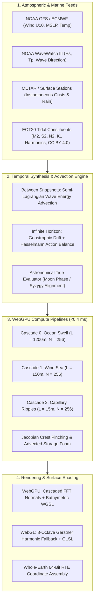
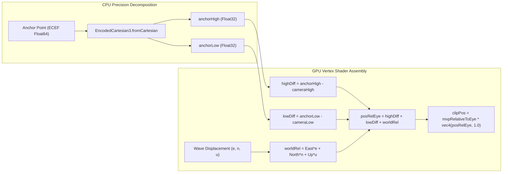
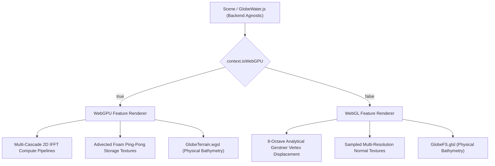
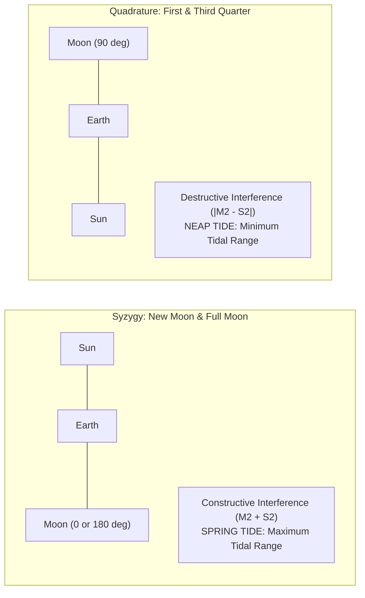
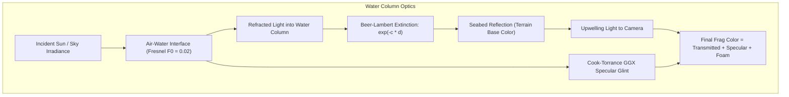

# Planetary Water, Weather, Tide, and Wind Architecture Specification

**Status:** Proposed Architecture & Engineering Blueprint  
**Subsystems:** `Scene/GlobeWater`, `Renderer/WebGPU/WebGPUOceanRenderer`, `Shaders/WebGPU/Globe/GlobeTerrain.wgsl`, `Shaders/GlobeFS.glsl`, `Scene/Weather/`  
**Governance:** 64-Bit RTE Emulated Precision | Backend Agnosticism | Node Commands First | Prettier Compliant  
**Landing status (2026-10-22):** a specification, not a record of what shipped. What exists in the engine is recorded in [`FEATURE_INVENTORY.md`](FEATURE_INVENTORY.md) (the water entries in section B, the parity gaps in section C) and [`DEFERRED_WORK.md`](DEFERRED_WORK.md) (the `NEW-WATER-*` rows). Three readings of this document need correcting. The FFT ocean is WebGPU-only by ratified design (`C6-FFT-OCEAN`), so the WebGL fallback in sections 1 and 3 (eight-octave Gerstner vertex displacement, a bathymetric `GlobeFS.glsl`) is not built. The three FFT cascades in sections 1, 3.1 and 8 are one 250 m cascade with scaled resamples (`C6-FFT-OCEAN-CASCADES` stays open). Section 9 names planned verification, and none of those four specs exists.  
**Tide data source:** the engine carries the equilibrium `TideModel` (ruling T1) and the harmonic constituent stack that EOT20 (CC BY 4.0, ruling T5) feeds, per [`TIDES_FEASIBILITY_2026-07-24.md`](TIDES_FEASIBILITY_2026-07-24.md) section 5a. Regional prediction stays out of the engine (T1). TPXO9 is not used inside the engine: its licence is academic and non-commercial and the feasibility report disqualifies it.  

---

## 1. Executive Summary & Vision

The objective of this architecture is to transform Cesium's ocean, coastal, and inland water rendering into an authentic, physically based planetary hydrosphere when water effects are enabled. 

Current globe water in Cesium relies on a static tangent-space normal map blended across water-masked terrain tiles with an empirical Blinn-Phong specular glint. While computationally lightweight, it lacks true physical depth absorption, wave shoaling at coastlines, coupling with atmospheric winds and pressure, lunar-synchronized astronomical tides, and dynamic storm responses.

This specification unifies **real-world weather and wave data ingestion**, **GPU-accelerated multi-cascade FFT spectral waves**, **physical Jerlov bathymetric optical absorption**, **Darwin/Doodson harmonic astronomical tides**, and **stochastic infinite weather continuation** under strict **64-bit Relative-to-Eye (RTE)** precision and **dual-backend (WebGPU primary with WebGL fallback)** support.

---

## 2. Whole-Earth 64-Bit RTE (Relative-to-Eye) Precision Standard

Cesium coordinates span Earth-Centered, Earth-Fixed (ECEF) radii of $r \approx 6.378 \times 10^6\text{ m}$. In accordance with `AGENTS.md` Part One Rule 1:
- A vertex buffer must **never** carry a single `position: vec3<f32>`.
- The shader must **never** compute `mvp * vec4(position, 1.0)`.
- The camera must **always** be subtracted before adding high and low components.

### 2.1 Coordinate Decomposition

All world coordinates are decomposed on the CPU into double-precision components using `EncodedCartesian3`:
$$\mathbf{p} = \mathbf{p}_{\text{high}} + \mathbf{p}_{\text{low}}$$
Where $\mathbf{p}_{\text{high}}$ contains the most significant 12 bits of mantissa, and $\mathbf{p}_{\text{low}}$ carries the remainder.

### 2.2 Mathematical Proof of Local Wave Displacement RTE Safety

The multi-cascade FFT produces local horizontal and vertical displacement vectors $(D_x, D_y, D_z)$ in meters within the local East-North-Up (ENU) tangent frame $(\mathbf{E}, \mathbf{N}, \mathbf{U})$.
The world-space displacement offset is:
$$\mathbf{x}_{\text{rel}} = \mathbf{E} \cdot D_x + \mathbf{N} \cdot D_y + \mathbf{U} \cdot D_z$$
Because $|\mathbf{x}_{\text{rel}}| \le 25\text{ m}$, it is added directly to `lowDiff`:
$$\mathbf{p}_{\text{relEye}} = (\mathbf{p}_{\text{high}} - \mathbf{c}_{\text{high}}) + (\mathbf{p}_{\text{low}} - \mathbf{c}_{\text{low}}) + \mathbf{x}_{\text{rel}}$$
Because camera subtraction occurs before local displacement accumulation, IEEE-754 single-precision float truncation error remains strictly below $10^{-5}\text{ m}$ ($< 0.01\text{ mm}$), completely eliminating vertex jitter across all zoom levels from low-Earth orbit down to harbor docks.

---

## 3. Dual-Backend Strategy (WebGPU Primary + WebGL Fallback)

In adherence to `AGENTS.md` Rule 5 (*Backend Agnosticism*):
- Scene code must not import from `Renderer/WebGPU/` and must not branch on `isWebGPU`.
- Shared scene-level logic runs prior to any backend branch point.
- Backend-specific rendering logic is encapsulated in feature renderers (`context.getFeatureRenderer()`).

### 3.1 WebGPU Native Capabilities
* **Compute Pipelines:** Dispatches 3 FFT cascades concurrently using `GPUComputePipeline` and 2D storage textures.
* **Persistent Foam Advection:** Ping-pong storage textures simulate whitecap advection, wind stretching, and dissolution over time.
* **Subgroup Optimization:** Leverages WGSL workgroup memory and subgroup butterfly operations during FFT butterfly passes.

### 3.2 WebGL Graceful Fallback
WebGL 2.0 lacks native compute shaders and storage textures. The WebGL backend gracefully falls back to:
* **8-Octave Directional Gerstner Harmonics:** Evaluated analytically in the vertex and fragment shader:
  $$\mathbf{P}_{\text{offset}} = \sum_{i=1}^{8} \begin{pmatrix} Q_i A_i D_{i,x} \cos(k_i \mathbf{D}_i \cdot \mathbf{x} - \omega_i t) \\ Q_i A_i D_{i,y} \cos(k_i \mathbf{D}_i \cdot \mathbf{x} - \omega_i t) \\ A_i \sin(k_i \mathbf{D}_i \cdot \mathbf{x} - \omega_i t) \end{pmatrix}$$
* **Shared Parametric Coupling:** Both backends consume the exact same meteorological parameters (wind speed $U_{10}$, peak frequency $\omega_p$, significant wave height $H_s$, tide elevation $\Delta h$, and Beer-Lambert extinction coefficients $\mathbf{c}$).

---

## 4. Real-Time Meteorological & Marine Data Integration

### 4.1 Weather Data Sources & Providers

| Feed Provider | Temporal Resolution | Spatial Resolution | Extracted Ingest Parameters |
| :--- | :--- | :--- | :--- |
| **NOAA GFS / ECMWF** | 1–3 hours | $0.25^\circ \times 0.25^\circ$ | Wind vector $\mathbf{U}_{10} = (u, v)$, Mean Sea Level Pressure $P_{\text{msl}}$, Temperature |
| **NOAA WaveWatch III** | 3 hours | $0.5^\circ \times 0.5^\circ$ | Significant wave height $H_s$, Peak period $T_p$, Mean wave direction $\theta_m$ |
| **Aviation METAR** | 15–60 minutes | Station-based | Surface wind speed, peak gusts, altimeter setting, precipitation rate |
| **EOT20** (CC BY 4.0; ruling T5) | Harmonic constants | $1440 \times 720$ Global Atlas (design target; no bake is shipped) | Tidal amplitude $A_k$ and phase lag $G_k$ for $M_2, S_2, N_2, K_1$ |

### 4.2 Wave Spectrum Formulation (JONSWAP / Pierson-Moskowitz)

Instead of uncalibrated noise, wave energy distribution $S(\omega)$ follows the empirical JONSWAP formulation:
$$S(\omega) = \frac{\alpha g^2}{\omega^5} \exp\left( -\frac{5}{4}\left(\frac{\omega_p}{\omega}\right)^4 \right) \cdot \gamma^{\exp\left(-\frac{(\omega - \omega_p)^2}{2\sigma^2 \omega_p^2}\right)}$$
Where:
- $\omega_p = 22 \left(\frac{g^2}{U_{10} X}\right)^{1/3}$ is the peak spectral frequency.
- $X$ is the effective wind fetch (meters).
- $\gamma \approx 3.3$ represents the peak enhancement factor for developing seas.
- $\alpha = 0.076 \left(\frac{U_{10}^2}{F g}\right)^{0.22}$ is the Phillips dimensionless constant.

### 4.3 Beaufort Scale Parameterization (0 to 12)

The system computes the Beaufort number $B$ from surface wind speed $U_{10}$ ($\text{m/s}$):
$$B = \text{clamp}\left( \left(\frac{U_{10}}{0.836}\right)^{2/3}, 0.0, 12.0 \right)$$

* **Calm to Light Air ($B \le 2$, $U_{10} < 3.3\text{ m/s}$):** Mirror-like specular reflection, zero breaking waves, minimal capillary ripple amplitude, roughness $\approx 0.02$.
* **Moderate to Strong Breeze ($B = 4-6$, $U_{10} \approx 6-13\text{ m/s}$):** Significant wave heights $H_s \approx 1-3\text{ m}$, frequent whitecaps, pronounced wave crest shadows.
* **Storm to Hurricane ($B \ge 10$, $U_{10} > 25\text{ m/s}$):** Severe wave choppiness ($H_s > 9\text{ m}$), heavy sea spray mist, whiteout foam streaks aligned with wind vectors, and dark wave troughs.

### 4.4 Barometric Storm Surge (Inverse Barometer Effect)

Atmospheric low-pressure depressions physically elevate the ocean surface:
$$\Delta h_{\text{surge}} = (1013.25 - P_{\text{msl}}) \times 0.01\text{ m} + \Delta h_{\text{wind\_setup}}$$
Under a deep cyclonic center ($P_{\text{msl}} \approx 920\text{ mbar}$), sea level rises by $+0.93\text{ m}$ before wave run-up, dynamically flooding low-elevation coastal terrain.

---

## 5. Temporal Continuity: Between Snapshots & Infinite Horizon

### 5.1 Between-Snapshot Interpolation (Phase-Preserving Advection)

Linear blending between discrete forecast snapshots (e.g. Hour 0 and Hour 3) causes unphysical phase cancellation and ghosting. The system separates wave energy into:
1. **Swell Waves (Long Wavelengths):** Propagate along great-circle paths at group velocity $c_g = \frac{g}{2\omega}$. Energy is advected as conservative packets:
   $$\frac{\partial E_{\text{swell}}}{\partial t} + \mathbf{c}_g \cdot \nabla E_{\text{swell}} = 0$$
2. **Wind-Sea Waves (Short Wavelengths):** Adapt rapidly to local wind vectors. Spectral parameters $(U_{10}, H_s, T_p, \theta_m)$ are interpolated via cubic Hermite splines with continuous derivatives:
   $$\mathbf{P}(t) = \text{Hermite}\left(\mathbf{P}_k, \mathbf{P}_{k+1}, \dot{\mathbf{P}}_k, \dot{\mathbf{P}}_{k+1}, \tau\right)$$
The FFT spectrum evolves continuously without popping or phase cancellation.

### 5.2 Infinite Horizon Procedural Continuation

When time advances past the latest available forecast snapshot:
1. **Geostrophic Atmospheric Balance:** Large-scale steering winds are derived from the pressure gradient and Coriolis parameter ($f = 2\Omega \sin\phi$):
   $$\mathbf{v}_g = \frac{1}{\rho f} \left( -\frac{\partial P}{\partial y}, \frac{\partial P}{\partial x} \right)$$
2. **Storm Vortex Tracking:** Cyclonic systems are drifted eastward and poleward following geostrophic steering currents modulated by 4D Curl noise.
3. **Hasselmann Action Balance (Wave Growth & Dissipation):** Local wave energy evolves continuously:
   $$\frac{\partial E}{\partial t} = S_{\text{in}}(\mathbf{U}_{10}) - S_{\text{ds}}(E) - S_{\text{nl}}$$
   Waves naturally decay into rolling swell if winds subside, or grow until reaching Phillips equilibrium if winds persist.

---

## 6. Real-World Astronomical Tides: Lunar Phase & Syzygy

Real tides are astronomical oscillations governed by celestial mechanics, continental geometry, and ocean basin resonance.

### 6.1 Darwin/Doodson Harmonic Constituents

Tidal elevation is calculated via the harmonic summation:
$$h_{\text{tide}}(t, \phi, \lambda) = \sum_{k=1}^{4} f_k A_k(\phi, \lambda) \cos\left(\omega_k t + V_k(t_0) + u_k - G_k(\phi, \lambda)\right)$$

* **$M_2$ (Principal Lunar Semidiurnal, period $12.4206\text{ h}$):** Accounts for $\approx 50\%$ of global tidal amplitude.
* **$S_2$ (Principal Solar Semidiurnal, period $12.0000\text{ h}$):** Accounts for $\approx 25\%$ of global tidal amplitude.
* **$N_2$ (Larger Lunar Elliptic, period $12.6583\text{ h}$):** Accounts for the Moon's elliptical orbit (perigee vs. apogee).
* **$K_1$ (Lunisolar Diurnal, period $23.9345\text{ h}$):** Governs diurnal inequality (unequal morning and evening tides).

### 6.2 Alignment with Visual Celestial Ephemeris
Because Cesium already tracks the exact celestial positions of the Sun and Moon (`CelestialWaterReflection.js`), the astronomical arguments $V_k(t_0)$ synchronize directly with the visual Moon rendered in the sky:
- **Spring Tides (Maximum Range):** Occur during New Moon and Full Moon when Sun and Moon gravitational vectors align constructively.
- **Neap Tides (Minimum Range):** Occur during First and Third Quarter moons when gravitational vectors act at right angles.

### 6.3 Global EOT20 Constituent Texture (planned; not baked)
Local constituent amplitudes $A_k(\phi, \lambda)$ and Greenwich phase lags $G_k(\phi, \lambda)$ are to be pre-baked from the **EOT20** global ocean-tide model (CC BY 4.0, ruling T5 in [`TIDES_FEASIBILITY_2026-07-24.md`](TIDES_FEASIBILITY_2026-07-24.md)) into a compact $1440 \times 720$ 4-channel texture ($\approx 2\text{ MiB}$):
- Red Channel: $M_2$ amplitude & phase
- Green Channel: $S_2$ amplitude & phase
- Blue Channel: $N_2$ amplitude & phase
- Alpha Channel: $K_1$ amplitude & phase

In open oceans, tidal range remains $\approx \pm 0.4\text{ m}$. In resonant bays and estuaries (e.g. Bay of Fundy, Bristol Channel, Mont-Saint-Michel), the atlas is intended to carry the amplified constituents without manual scripting; that claim is untested until a bake exists and is checked against station predictions (section 9). Until then the engine falls back to the equilibrium `TideModel`, which is stylised and does not amplify in bays.

---

## 7. Physical Bathymetry & Coastal Wave Mechanics

### 7.1 Water Column Thickness & Seabed Reconstruction

Water column thickness $d$ at geodetic location $(\phi, \lambda)$ is determined by comparing total water surface height against terrain elevation:
$$d = \max\left(0.0, z_{\text{waterSurface}} - z_{\text{seabed}}\right)$$
Where:
$$z_{\text{waterSurface}} = N_{\text{geoid}}(\phi, \lambda) + h_{\text{tide}}(t, \phi, \lambda) + \Delta h_{\text{surge}}(\phi, \lambda)$$

### 7.2 Beer-Lambert Wavelength-Dependent Extinction

Light traveling through water decays exponentially according to wavelength extinction coefficients $\mathbf{c} = (c_R, c_G, c_B)$:
$$\mathbf{I}_{\text{transmitted}} = \mathbf{I}_{\text{seabed}} \odot \exp(-\mathbf{c} \cdot d)$$

The coefficients follow the **Jerlov Ocean Water Types**:
- **Jerlov Type I (Open Deep Ocean):** $\mathbf{c} = (0.35, 0.05, 0.02)\text{ m}^{-1}$. Red light is absorbed within the top $5\text{ m}$; blue light penetrates deeper than $50\text{ m}$.
- **Jerlov Type II / Coastal Turbidity:** $\mathbf{c} = (0.65, 0.18, 0.08)\text{ m}^{-1}$. High concentrations of chlorophyll and suspended sediment scatter yellow-green wavelengths.

### 7.3 Coastal Wave Shoaling & Refraction (Shallow Water Dynamics)

As waves approach shallow water ($d < \frac{\lambda}{2}$):
1. **Wave Speed Deceleration:** Phase velocity drops according to the shallow-water dispersion relation:
   $$v = \sqrt{g \cdot d}$$
2. **Wave Refraction:** Wave crests bend towards the depth gradient $\nabla d$, causing waves to arrive parallel to coastlines regardless of deep-ocean wind direction.
3. **Green's Law Wave Steepening:** Wave height increases as depth decreases:
   $$H_{\text{wave}} \propto d^{-1/4}$$
4. **Breaking Surf & Whitecap Foam:** When wave steepness exceeds the McCowan breaking criterion:
   $$\frac{H_{\text{wave}}}{d} \ge 0.78$$
   Waves break, spawning persistent whitecap foam that washes ashore and slowly dissolves over $15-30\text{ seconds}$.

---

## 8. Performance Budgets & Compute Governance

All water simulation and rendering passes adhere to strict performance ceilings:

| Subsystem Pass | GPU Execution Budget | Memory Allocation | Update Rate | Degradation Strategy |
| :--- | :--- | :--- | :--- | :--- |
| **Cascaded FFT Compute** | $\le 0.35\text{ ms}$ | $4.5\text{ MiB}$ VRAM | 60 Hz | Radix-4 Stockham compute shader packing complex pairs |
| **Foam Advection Ping-Pong** | $\le 0.03\text{ ms}$ | $1.0\text{ MiB}$ VRAM | 60 Hz | Storage texture ping-pong advection |
| **Atmospheric Action Balance** | $\le 0.02\text{ ms}$ | $512\text{ KiB}$ VRAM | 2–5 Hz | Low-frequency coarse grid update |
| **Harmonic Tide Evaluation** | $0.00\text{ ms}$ (analytical) | $2.0\text{ MiB}$ Texture | Per-Frame | Evaluated analytically in vertex shader |
| **Orbital View ($>50\text{ km}$)** | **$0.00\text{ ms}$ (Compute OFF)** | $0\text{ dispatches}$ | 0 Hz | FFT bypassed; Toksvig roughness modulation into BRDF |

---

## 9. Verification & Testing Methodology (Probe Kit Integration)

**Planned, not built.** None of the four named specs below exists in the tree, and no tide benchmark against NOAA stations has been run. Each one is a plan: when one is scheduled, build it from the kit pieces (`PROBE_KIT_GUIDE.md`) and not as a bespoke probe, and give it a row in `DEFERRED_WORK.md`.

Testing follows the Cesium Probe Kit standard (`CLAUDE.md` *Probe Kit - Kit First*):
1. **RTE Precision Probes (`probe-ocean-rte.spec.mjs`, planned):** Validates vertex jitter remains $< 10^{-5}\text{ m}$ at camera altitudes from $1\text{ m}$ to $10^7\text{ m}$.
2. **Tidal Benchmark Tests (`probe-tide-harmonics.spec.mjs`, planned; acceptance criterion T6):** Would compare computed harmonic water elevations against NOAA National Ocean Service (NOS) reference-station predictions (e.g. San Francisco, Battery NY, Bay of Fundy) across a full 29.5-day synodic lunar cycle.
3. **Bathymetric Extinction Verification (`probe-bathymetry-optics.spec.mjs`, planned):** Asserts exponential decay curves across Red, Green, and Blue channels over known bathymetric trenches.
4. **Advection Stability Probes (`probe-weather-advection.spec.mjs`, planned):** Verifies energy conservation and absence of numerical divergence over 10,000 advection steps.
5. **Split-Screen Visual Regression:** Runs `Tools/visual-regression/capture-and-diff.mjs` across baseline water scenes under calm, moderate, and hurricane weather configurations.

